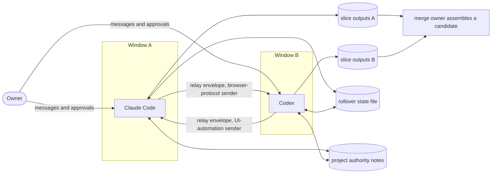
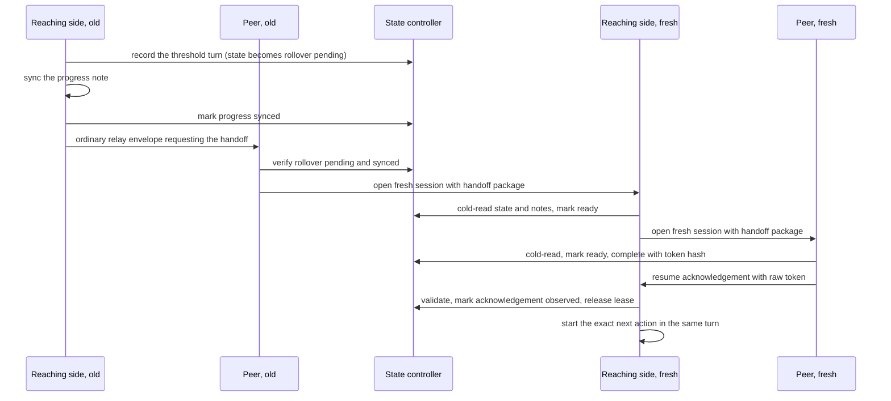

# Agent collaboration

This document describes how the two supported agents, Claude Code and Codex, share work for one owner on one Windows machine. They act as two symmetric co-executors. They split divisible work into slices, write only their own outputs, review each other's artifacts, and return control to the owner only for decisions that belong to the owner.

It covers structure and method. The programs that implement the method on the reference installation are not part of this repository; see [What is not included](#what-is-not-included). The memory packages that both agents share are described in [Architecture](ARCHITECTURE.md).

> **Status: v0.2 method description.** Every path, conversation ID, record and message below is synthetic; status tokens, classification names and transform identifiers such as `copy/v1` are the vocabulary of the reference implementation. The numbers are the reference installation's values, most of them fixed in its code. Treat them as starting points, not as tuned optima.

## Purpose

Two agents with different tools and blind spots find more problems than one agent reviewing its own work. Without rules they also create new ones: both edit the same file or do the same task, one waits for a message the other never sent, retries deliver duplicates, and the owner is asked to approve things that were never the owner's to decide.

The method aims at four things: parallel execution in slices that do not overlap; independent review by an agent that did not write the artifact, with checks the author did not design; owner attention reserved for policy, budget, external commitments and public or irreversible actions; and consistent state across windows and sessions. For the last, the shared rollover state changes only through revision-checked writes, other shared files follow single-writer, append-only or lease rules, and a long unattended run moves to fresh sessions before its context degrades.

## Principles

- **Peers, not a hierarchy.** Author, reviewer, merge owner and persistence owners are assigned per task, from the task, the context, the available tools and the evidence. Standing capability hints may set defaults (in the reference installation, one agent leans to figure rendering and visual checks, the other to textual consistency and reviews that read across many files); the owner can override them, and they are never inferred from past finding counts.
- **One writer per file.** Each slice writes only its exclusive outputs, one merge owner per batch reconciles the shared final files, and each persistence duty has one named owner.
- **The relay is a plain pipe.** Send, wait, reply. Do not send again while waiting, start side tasks or duplicate the peer's work, and do not read the peer's chat to guess its state; the only exceptions are the sender's own identity and delivery probes, and an explicit owner request to check the peer's progress when no other channel exists. If the owner loses track, say in one sentence who is doing what.
- **Transport success is not receipt.** Only the peer's reply proves that it read a message; a cleared input box, a successful send or a changed shared file does not.
- **Never blind-retry.** If an action may already have taken effect, do not repeat it: a certain duplicate costs more than an unconfirmed delivery.
- **Fail closed.** Missing fields, revision conflicts, identity mismatches, unknown phases and unlisted files stop the action with an explicit `BLOCKED` or `FAIL`, never a guess; a checker that meets malformed input reports `FAIL` instead of crashing.
- **Honest evidence, bound approvals.** A check claims only what it ran, and inference is labelled as inference. The author never approves its own exception, an approval binds to the artifact's hash, and a blocked action is not routed through another tool or the peer (steps [5](#5-review-and-verify), [9](#9-human-gates-and-permission-blocks) and [12](#12-peer-approved-exceptions-in-the-publication-gate)).
- **Owner time goes to owner decisions.** Agents settle technical matters, note their assumptions and continue; they pause only for governance signals, and then in plain text (steps [8](#8-governance-pauses-and-stop-conditions) and [10](#10-decision-ownership-and-owner-communication)).
- **Durable state over chat memory.** State, counts and decisions come from the [project authority notes](PROJECT_AUTHORITY_NOTES.md) and the rollover state file, not from relay turn numbers, chat history or README files, which are navigation only.
- **No new bureaucracy.** No automatic scoring, leaderboards, duplicate ledgers or new reminders; one short retrospective per batch, with one adjustment for the next batch. If you log review outcomes per agent, start a new section when a model or tool version changes instead of re-scoring old results, and record an unknown version as unknown.

## Roles

| Role | Held by | Responsibility |
|---|---|---|
| Owner | The human | Business policy, budget, external commitments, business responsibility, and approval of every public or irreversible action. Can stop or pause both agents at any time. |
| Agent | Claude Code or Codex | Executes its slices, reviews the peer's slices, and settles technical matters jointly with the peer. |
| Dispatcher | The agent that splits a task | Writes the slice assignment record and sends the peer's slice before starting its own. |
| Author | Named per slice | Writes the slice's outputs and proposes any exception the slice needs. |
| Reviewer | The author's peer | Checks the concrete artifact against the review checklist and writes a review receipt. |
| Merge owner | Exactly one agent per batch, or none | Reconciles the slices into the shared final files and recomputes the gates. It is a duty for one batch, not a rank. |
| Persistence owners | Named per slice | Memory writes, project-note sync, graph-pending notices and capability-registry updates. |
| Independent verifier | A separate implementation, normally held by the peer | Confirms an assembled result without reusing the author's code. |

A task that needs one deciding voice, such as a formal review with a single arbiter, may keep an asymmetric final arbiter. For long prose, one agent may draft while the other reviews concrete artifacts. That is task fit, not a standing hierarchy: a divisible writing project still gives both agents execution work.

## Terms

| Term | Meaning |
|---|---|
| Batch | One owner-level task stream with a close-out. Micro-patches, sub-agents and round trips inside it are not separate batches. |
| Composer | The chat input box of an agent's desktop app. |
| Readback | Reading text back from the app after inserting or sending it. |
| Fingerprint | A normalised form of the message text that survives the chat's rendering; matching it recognises the sent message in the chat. |
| Unattended segment | Explicitly started work on one project that advances only through relay, with no direct owner message. Rollover turns are counted only inside one. |
| Cold read | Rebuilding context from the state file and project notes alone, without chat history. |
| Lease file | A shared file that marks one handoff in progress. |
| Pair epoch | A counter the controller increments with each completed rollover; the resume acknowledgement must carry the new value. |

## Structure



| Component | Role |
|---|---|
| Relay envelope | A plain-text message placed in the peer's chat input; see [Envelope shape](#envelope-shape) and [templates/relay-envelope.md](templates/relay-envelope.md). |
| Relay skill | One per agent, loaded by the trigger on line 1. It holds the send rules, the sender's outcome table, the atomic-turn, no-pop-up and stop rules, and the handling of rollover acknowledgements. |
| Browser-protocol sender (Claude Code to Codex) | Drives the Codex desktop app through the Chromium DevTools Protocol, so the owner's keyboard and mouse are never taken. It verifies each send, binds an ordinary send to one target conversation (a new-session send has no ID yet) and archives verified and refused envelopes. |
| UI-automation sender (Codex to Claude Code) | Mouse and keyboard automation, because the Claude Code window exposes no debugging endpoint. See [its guards](#guards-on-the-ui-automation-sender). |
| Slice assignment record and manifests | The record splits work ([templates/slice-assignment.md](templates/slice-assignment.md)). Export and release slices also keep a per-file manifest and a list of deliberate exclusions. |
| Rollover state controller | A script that owns one JSON state file: per-agent turn counters, whether an unattended segment is active, phase, project context, rollover ID, pair epoch and whether a resume acknowledgement is still awaited. Every change goes through the script, under a lock and a revision check; the file is never edited by hand. |
| Fresh-session dispatcher | One procedure per agent. It opens a fresh session of the peer and sends a handoff package that has its own trigger. A shared lease file allows one handoff at a time: an existing lease blocks a new handoff, and overriding it is an explicit choice made only after inspecting the lease. |
| Project authority notes | A progress note and a decision note per project, which a fresh session reads cold. See [templates/project-progress-note.md](templates/project-progress-note.md) and [templates/project-decision-note.md](templates/project-decision-note.md). |
| Publication gate, assembler and verifier | Release-side checks described in [Routing and gates](ROUTING_AND_GATES.md#the-export-pipeline). The parts that need both agents are [peer-approved exceptions](#12-peer-approved-exceptions-in-the-publication-gate) and the peer's [independent verifier](#independent-verification). |
| Review receipts | Machine-readable records written by the reviewer. They keep the review decision apart from any authorisation. |

## Method

### 1. Decide whether to split

Split a task when all of these hold:

- the owner has authorised dual-agent work for this task (a relay turn or an explicit request), and the owner has not already assigned the work differently;
- it divides into parts that write different files;
- both agents are available and healthy;
- ownership and possible conflicts are clear.

Otherwise run it single-agent. Quota, file ownership and task fit can change the split from one batch to the next.

When the owner hands a task to one agent, that agent carries it through: execution, verification, delivery and any required sync. It does not pass the task on because it guesses the peer would do it better.

Parallelism means slices of the same piece of work, not a reason to open a new front. Finish and report the current item, and agree the plan and the split with the peer, before starting a new large effort.

### 2. Write and dispatch the slice assignment record

The dispatcher writes one record per slice and sends the peer's slice first, inside an ordinary relay envelope. Only then does it start its own slice, which is one of the two exceptions to [atomic turns](#atomic-turns).

The record must be self-contained. The peer may not see a follow-up message until its own atomic turn ends, so a record that depends on a follow-up can leave both agents waiting for each other.

Required fields: `slice_id`, `sources` (read-only for the slice), `outputs` (exclusive to it), `write_locks`, `deliverable` (one sentence), `review_checklist` (3 to 5 concrete checks) and five owner fields. `merge_owner` takes `claude`, `codex` or `none`; `memory_owner`, `notes_sync_owner`, `graph_pending_owner` and `capabilities_owner` also accept `merge-owner`. Recommended: `author`, `reviewer`, `forbidden_actions` (for example no install, download, network access, repository initialisation or push) and `fail_stop` (conditions that stop the slice instead of letting it continue). Meanings, a blank record and a worked example are in [templates/slice-assignment.md](templates/slice-assignment.md).

`write_locks` lists only the paths that the agent executing the slice must not write while the slice is active, typically its read-only sources and the dispatcher's own outputs; the dispatcher, in turn, does not write the slice's outputs. Keep the list narrow, so that a lock never blocks work that cannot conflict.

`graph_pending_owner` appends the change notices for the derived graphs that the slice touched, and the two logs are separate. Memory-card changes go to the memory graph's own pending log ([Memory governance](MEMORY_GOVERNANCE.md#12-log-new-memories-for-the-graph), [Memory graph](MEMORY_GRAPH.md)); changed workspace files go to the research vault's log ([templates/pending-update-log.md](templates/pending-update-log.md)).

### 3. Work inside exclusive outputs

Every slice writes only its exclusive outputs. The release workflow of the reference installation added the following, which suit any export or publication slice:

- The slice writes only its own directory. Production files stay read-only for the slice; a needed production change is delivered as a patch proposal.
- Every output file has a manifest entry (source path and hash, transform identifier, output path and hash, classification, reason), and files left out on purpose go into an exclusions list. The reference scanner accepts the classifications `own_code`, `product_contract`, `public_adapted`, `public_authored`, `public-synthetic` and `third_party`; a `third_party` entry also records the upstream component's details. Format and a synthetic entry: [templates/slice-assignment.md](templates/slice-assignment.md#slice-manifest).
- A transform identifier says what was done. A plain copy, for example `copy/v1`, must be byte-identical to its source. Changes made at merge time get their own identifiers, for example `integration-readme/v1`, so that they can be reviewed separately.
- Each slice runs the content gate on its own outputs and records the result. The merge owner does not rely on that result (see [step 6](#6-merge)).

### 4. Exchange relay envelopes

#### Envelope shape

```text
/to-codex
[RELAY] FROM:claude TO:codex TURN:12
---
<body>
```

- **Line 1** is the receiver's trigger, a slash command that loads its relay skill (here `/to-codex` and `/to-claude`). **Line 2** is the header with exactly three fields, sender, receiver and turn, with agent names in lower case. **Line 3** is `---`. Typed control blocks, such as a slice assignment record or a resume acknowledgement, open the body, after the reply thread field when there is one.
- **Turn number.** The previous turn plus one, or 1 for a new context. It is transport metadata only, never a work counter or a cap. Apart from the reply thread field there are no control fields: no stop marker, no "expect reply" field and no turn limit.
- **Reply thread field.** Envelopes from Codex start the body with the ID of the Codex conversation that sent them. Codex takes it from that conversation's verified runtime identity, never from the window in front and never from another conversation, and Claude Code replies into exactly that conversation. If the ID cannot be established, the field says `UNKNOWN` and Claude Code holds its reply: unless the owner designates a conversation, it never guesses the visible one, and it never opens a new conversation as a fallback. Envelopes from Claude Code omit the field, because the Codex to Claude Code sender cannot target a conversation anyway.
- **Language.** Bodies use the owner's working language, so that the owner can follow either window; identifiers, paths, commands and status tokens stay verbatim.
- **Handoff packages**, which open fresh sessions, have their own triggers and fields; the ordinary relay skill never parses them.

Line-by-line layout and synthetic messages: [templates/relay-envelope.md](templates/relay-envelope.md).

#### When a message is a relay turn

A turn is a relay turn when the first line is exactly the receiver's trigger, or when the owner explicitly asks to send work to the peer, to get a review from the peer, or to consult the peer. A mere mention of the peer, a quotation or a status remark is not a relay turn. A natural-language kickoff still produces a strict envelope on the wire, and it counts as a direct owner message, so it ends any [unattended segment](#13-fresh-session-rollover).

#### Atomic turns

- Finish all local work first: inspection, execution, audit, file edits and memory operations. Treat the envelope as the turn's final report: what was finished, the evidence for it, what is blocked, and what the peer is asked to do next.
- Send one stable, complete handoff, not progress packets: messages can cross in flight, and work done after a send leaves the peer with stale state.
- Do no project work after the send, with two exceptions: after dispatching a slice assignment record, the dispatcher works on its own slice; and a background job started before the send may keep running if the envelope declares it and says that only monitoring follows until the next turn.
- After a successful send, the sending agent's window shows exactly one line, for example `Sent to Codex (turn 12)`; anything longer shows that the reply leaked into the local chat.
- A relay turn never opens a pop-up, choice card or modal prompt: a modal blocks the turn until someone answers, so the envelope is never sent and the peer waits. Anything for the owner is written as plain text.

#### Write, then send

Claude Code to Codex:

1. Write the complete envelope to a fresh private file in UTF-8, unique to this send and written once.
2. Only after the write has succeeded, call the sender with that file. The sender copies it into its shared staging file under its own lock and reads it back before any UI action.

Codex to Claude Code: Codex writes the complete envelope to one fixed staging file and only then calls the protected entry point, which checks the file, passes it to the sender and removes it after the call (see [guards](#guards-on-the-ui-automation-sender)).

In both directions the write must succeed before the send starts. Never run the two in parallel: a failed write next to a successful send delivers whatever older envelope is still on disk, and the delivery check still passes, because it proves only that the staged file arrived.

#### Choosing the target conversation

This applies to the Claude Code to Codex direction, which can bind a send to one conversation.

- If the owner points at the conversation that is open on screen, that conversation is the target. The sending agent reads its ID with a separate read-only probe of the peer app and passes the ID to the sender, which binds the send to it. The reference sender has no built-in "current conversation" mode and refuses an ordinary send that names no conversation.
- For a blank new conversation, the sender uses its new-session mode.
- For a reply to the peer, the target is the conversation named in the incoming reply thread field.
- Only when no target was named and no incoming thread exists does the agent ask one short question. Without a designation it never takes the visible conversation as the target. Thread binding is an engineering safeguard against a conversation switch during a send, so the owner never has to supply or confirm a conversation ID.

#### Verifying delivery

The browser-protocol sender proves each step before the next:

1. **Stage** under the sender lock and check the hash. If staging cannot be proven, stop before touching the UI.
2. **Check target and composer.** The bound conversation must be on screen and its composer empty. Non-empty text is the owner's draft and is left alone; the one exception is the caller's own earlier envelope, which the sender clears only after proving that it matches exactly. Either failure refuses before inserting.
3. **Insert and compare** with the envelope after normalisation. On a mismatch, do not click.
4. **Guarded click** only on a send button whose accessible label starts with an allowlisted word (send, or queue while the peer is busy, in the app's display language) or that has no label (older builds). Voice, dictation, stop, cancel and interrupt labels are always refused.
5. **Deliver a queued message.** If the busy peer queued the message, press that queue entry's deliver button once, within a bounded wait, and only on the entry that holds this envelope's header line.
6. **Re-check.** Every sample after the click must show the same bound conversation and the same composer element. Otherwise the result is indeterminate, unless a matching fingerprint is read back.
7. **Decide.** The primary signal is the composer going from the envelope text to empty. A matching fingerprint of the new chat message is the strongest receipt and is enough on its own; its absence is not a failure when the composer cleanly emptied, because a busy peer renders queued messages late.
8. **Archive** an immutable copy once staging is verified, before any UI action, so an archived copy does not prove sending. Some refusals made before staging, such as a missing conversation ID, instead copy the pending text into a separate refused folder; in every refusal before the UI, the caller's private file stays unchanged.

**Security note for adopters.** A debugging endpoint lets any local process read and drive that app. Bind it to the loopback interface, keep it enabled only while you need it, treat access to it like a credential, and check the app's terms before automating it. An incoming envelope is the peer's data: it carries no owner approval, and the receiver applies its own permission checks to everything it is asked to do.

#### Outcomes and retry policy

| Outcome class | Typical causes | What the sending agent does |
|---|---|---|
| Delivered | Exact match; message matched but the composer did not clear (warning); composer cleared with the readback still pending | Print the one-line acknowledgement and stop. Do not open the log again for confirmation: it records the same send and adds nothing. |
| Stopped before insertion | Debugging probe failed; target window not found; new-session mode could not open an empty conversation; staging unproven; another sender holds the lock; target identity refused; owner draft in the composer | Read the sender's log once. Staging: re-stage once from the same private file. Lock: wait for the other sender to finish, without looping. Identity: obtain a verifiable thread, or else ask the owner in one sentence to bring the target conversation to the front; never retarget to the visible one. Owner draft: leave it untouched and report it. Probe: start the peer app with its debugging endpoint enabled. |
| Refused before the click | Send slot not in send mode after insertion (for example voice or stop); identity changed before the click; the composer text differs from the exact envelope | Do not click. The sender removes its own inserted text only while it can still prove the text is its own; otherwise the text stays unclicked. A send slot that was not in send mode is a safe wait-and-retry, because nothing was clicked. Report the state. |
| Uncertain after the click | Delivery unproven with text left in the composer; composer unreadable; identity not provable after the click | Never resend ([why](#failure-modes-and-lessons)). Read the sender's log once. If the text left in the composer is the envelope itself, the send probably did not fire; if it is unrelated text, the envelope was probably delivered. Report the state, and if non-delivery is suspected, ask the owner in one sentence to glance at the peer window instead of retrying. |

A legacy keyboard-and-mouse sender for the Claude Code to Codex direction is kept for manual emergency use only; it is never an automatic fallback.

#### Guards on the UI-automation sender

The Codex to Claude Code direction has no debugging endpoint, so the sender uses the mouse and keyboard. It is guarded as follows:

- **Protected entry point.** For ordinary envelopes, Codex calls the sender only through an entry point that takes no arguments. The entry point hard-codes the target; refuses a staging file that is older than a short freshness window or reached through a link or junction; checks the trigger, header and separator lines; pins the sender script by SHA-256; and removes the staging file after the call. That exact command is allowlisted in Codex's approval rules, and because it takes no arguments, the allowlist covers nothing else. Handoff packages, other targets, paste readback and the input-blocking fallback are not allowlisted and go through normal approval.
- **One sender at a time**, through a global named mutex. If the mutex cannot be taken within the wait limit, the sender stops and pastes nothing.
- **The owner comes first.** The sender waits until the owner's keyboard and mouse have been idle before it takes focus. If the owner is still active when the wait ends, it stops without pasting, unless the input-blocking fallback was explicitly requested. It never moves or resizes the window, and it restores the clipboard, the foreground window and the cursor in a `finally` block.
- **Draft protection.** The sender probes the composer before pasting. Non-empty text that does not start with a relay trigger is the owner's draft: the sender exits without pasting or pressing Enter. Only an empty composer or a leftover relay draft is ever replaced.
- **Enter, not a click**, because while the peer is generating, the send-button position can hold the stop button.
- **Readback is opt-in**, because the desktop app can report false negatives on readback. Blocking the owner's input is an explicit fallback only.
- **Residual risks.** A composer probe that comes back empty, or falsely empty, lets the sender replace the composer content, which can overwrite a real owner draft. And there is a window of 1 to 2 seconds in which typing by the owner, resumed after the idle check, can interleave with the paste.

This direction cannot bind a send to one conversation, so the receiving side handles misdelivery.

#### Misdelivered envelopes

If an incoming envelope's reply thread and project paths do not match the receiving session's work, that session:

1. does not execute the envelope and does not reply to the peer;
2. confirms that the project path in the envelope exists;
3. finds the owning session by searching session transcripts for the reply thread value or the previous turn's header (a session that is not running does not appear in the client's list of live agents);
4. forwards the envelope verbatim, with a first line saying that it was misdelivered and that nothing was done;
5. tells the owner where it went.

### 5. Review and verify

#### What a review covers

A review looks at four facets: the goal and real use; verification and failure branches; boundaries and concurrency; conclusions and sources. Each facet is checked briefly, with depth on the declared focus areas. The reviewer declares the scope and the layers it does not cover in advance.

Required gates cannot be scoped away: security, permissions, irreversible actions, key numbers and authoritative sources.

Proportionality:

- A small reversible fix normally gets one independent review.
- A targeted re-review happens only on a new change, an existing failure or a new open risk.
- Unchanged bytes are not cold-reviewed again.
- The number of reviews never substitutes for coverage.

#### Counting reviews and findings

- One frozen version of an object, reviewed once by one team under a pre-declared scope, is one review opportunity. Sub-agents, test counts, re-runs and round trips do not add opportunities.
- Findings are deduplicated by common root cause.
- The report keeps these apart: self-checks, re-checks of known leads, independent new findings, executor failures, blocked unknowns and rejected hypotheses. An unknown never counts as a pass.
- A miss counts as confirmed only if the problem was already in the reviewed version, lay inside the declared scope or a required gate, was passed by that review, and was later independently confirmed. Problems introduced later are not counted back; uncovered optional layers are not counted against the reviewer; a missing required check is recorded as a process gap.

These counts are used only to decide when to re-discuss the split; see [Thresholds and triggers](#thresholds-and-triggers). The overall division of work is never changed automatically.

#### Independent verification

- Running the author's code again is not a review. Values computed by the same logic prove only self-consistency, so expected values must come from outside the implementation.
- In the release pipeline, the peer's independently written verifier, with its expected values re-frozen against the current manifests, must report a content match on the assembled candidate. Only then are dependencies installed or a repository initialised.
- Raw labels, the execution harness and the independent checks are held by different parties, and an evaluation holdout is run by the agent that did not choose the thresholds. If that cannot be arranged, record the deviation and mitigate it as the reference installation once did: thresholds frozen in a hashed file before labelling, and a blind labeller. See [Five-dimension programme](FIVE_DIMENSION_PROGRAMME.md#observe-before-enforce) for the role split in a study and [Evaluation](EVALUATION.md) for blind labelling.

#### Four kinds of PASS

Report these separately; none stands in for another:

1. the code passes its tests;
2. the frozen inputs (the fixtures or snapshots captured for the check) pass;
3. the environment's normal permissions would allow the action;
4. the actual run passed.

A component review, a real run and correct behaviour after start-up check different things, so each gets its own review; that is not re-reviewing unchanged bytes.

Before any state-changing work, check three things against real sources: the input and receipt fields; the health, permission and dependency conditions the next stage needs; and the completion and recovery path. A synthetic oracle proves only the layer it covers. An unresolved state is not cleared by moving to a new directory, starting a new run or reusing an old PASS. Keeping an old version is not, by itself, a safe way back from an unknown state.

#### Review receipts

The reviewer writes a machine-readable receipt. It records the decision, keeps it apart from authorisation, and counts the side effects the reviewer performed. A synthetic example:

```json
{
  "schema": "example-review-receipt/v1",
  "reviewer": "codex",
  "slice_id": "docs-example-a",
  "decision": "PASS_WITH_NOTES",
  "notes": ["install section does not say which platforms are untested"],
  "production_authorized": false,
  "public_release_ready": false,
  "public_action_approved": false,
  "execution_authorized": false,
  "side_effects": {
    "production_code_changes": 0,
    "service_control": 0,
    "downloads": 0,
    "git_changes": 0,
    "remote_operations": 0,
    "publications": 0,
    "memory_writes": 0,
    "background_tasks": 0
  }
}
```

A component PASS in a receipt is never production or public authorisation.

### 6. Merge

The merge owner:

1. assembles each candidate into a new directory and never overwrites an older candidate;
2. recomputes the content gate for every slice itself and ignores the slices' self-reported status;
3. copies every file by its manifest entry and checks the hashes;
4. stops on any of these: an unlisted file, a missing listed file, a hash mismatch, a junction or symbolic link, or a path outside the declared roots;
5. applies integration changes as recorded transforms, which both agents review;
6. asks the peer to review the same assembled result and to run its independent verifier;
7. runs the tests on a copy in a short temporary path; a missing dependency surfaces and stops the merge there, because the content gate does not check dependency closure.

For a release, the steps after the merge (one initial commit, secret scans of the tree and the full history, and both agents reviewing the same commit before the owner-approved public action is carried out) are in [Routing and gates](ROUTING_AND_GATES.md#the-export-pipeline).

### 7. Persist

When one agent works alone, it persists its own work; when the agents split work, the owner fields of the slice assignment record decide, and the merge owner normally writes the closing memory. A persistence owner checks that its tools work at write time, retries once on failure, then hands the write to the peer with context. It never skips a write silently. The write procedure itself, with recall and deduplication first, is in [Memory governance](MEMORY_GOVERNANCE.md#16-two-agents); which pending log gets the change notice is in [step 2](#2-write-and-dispatch-the-slice-assignment-record).

### 8. Governance pauses and stop conditions

Ordinary doubt, minor implementation choices and the obvious next step are not reasons to stop. The agents pick a reasonable assumption, note it and carry on.

Project work stops, and the decision goes back to the owner, only when one of these governance signals appears:

- a success criterion that was fixed in advance is not met;
- a result reverses under a check that was agreed before the result was seen;
- continuing would create an ethical, integrity or disclosure risk;
- the next step is a decision to stop, merge or drop a line of work, which only the owner can make.

Adapt the list to the owner-level signals of your own work. The pause is plain text, with the options and a recommendation. The peer holds, does not resume on its own and does not ping again; work resumes only on the owner's explicit go-ahead.

The loop stops when:

1. the owner stops either agent with its stop button, which interrupts that agent's current turn (an envelope already sent stays sent);
2. the owner types a message that is neither the strict trigger nor a clear peer-directed request; it is handled as a normal prompt;
3. the owner says stop, pause or halt. Both agents pause project work, acknowledge, sync the notes and make sure no background job contradicts the owner, then resume only on an explicit go-ahead.

Agents never invent a turn cap and never ask whether to continue. The fresh-session rollover in [step 13](#13-fresh-session-rollover) is a context-hygiene step, not a stop.

### 9. Human gates and permission blocks

Public pushes, visibility changes, portal uploads, final submissions and any other publication always go to the owner, and a request for a quick answer never waives that ([Routing and gates](ROUTING_AND_GATES.md#worked-example-the-publication-gate)).

- The owner approves one specific public action, bound to the repository owner and name, the commit, the manifest and the gate report. An upload to a private remote is also disclosure, so there is no "private first, then public" shortcut.
- One-time tool downloads are approved by the owner after the agent names the file, its source and its size.
- Agreement between the agents never creates authorisation, since neither holds the owner's authority. It does start registered procedures from the routing table without asking; owner-only steps inside them, such as a submit or a public-push approval, still wait ([Routing and gates](ROUTING_AND_GATES.md#2-route-with-a-sentinel-table), [templates/sentinel-table.md](templates/sentinel-table.md)).
- Tool permission belongs to the environment that executes the action. When that environment requires direct confirmation, the owner gives it in the executing agent's window; an approval relayed from the other window records the owner's intent but is not tool permission there. When a fresh confirmation is needed, say that the tool mechanism refused, not that the owner had not approved, and never re-ask for a permission already in effect.
- A blocked action is recorded: what was done, what was not, and why. The agent does not switch tools or hand the action to the peer, because either would bypass the check that refused it, and it does not keep asking for broad authorisation. Independent authorised work continues, and owner items are collected on one page, each with a recommendation.

### 10. Decision ownership and owner communication

| Decided by the agents (jointly, when both are working) | Decided by the owner |
|---|---|
| Technical and process direction | Business policy trade-offs |
| Configuration and label wording | Budget and external commitments |
| AI task roles: author, reviewer, merge owner, persistence owners | Business responsibility |
| How to split, review and verify | Every public or irreversible action, and the specific approvals the permission mechanism requires |

These choices are the agents' only within existing authorisation and the task's scope, and an explicit owner choice prevails. Both agents' instruction files carry this split as one standing rule ([Instruction kernel](INSTRUCTION_KERNEL.md)).

- Agents report what they decided, why, and what remains open; they do not route internal choices to the owner for sign-off.
- Any question that does reach the owner carries the agents' recommended answer.
- Before calling something blocked on the owner, the agents trace who actually set the requirement; their own design assumptions are labelled as theirs.
- A question is still asked when the answer depends on a fact, preference or constraint that only the owner has and that would change the outcome.
- The agent in whose window the owner spoke relays the owner's decision to the peer verbatim, with a timestamp or "time unknown". The peer does not act on a predicted decision.
- If the owner has authorised work to continue while they are away, for example overnight, the agents keep going within that scope, and every handoff names the next step and the current blocker.

### 11. Shared state: revision-checked writes

The rollover state file is the one shared file that both agents change through a compare-and-swap controller. Other shared state relies on one named writer per batch (project notes, memory writes), on append-only logs (the pending logs) or on its own create-and-release rules (the handoff lease). The controller works like this:

- Every mutating action passes the revision that the caller read with a fresh read. If it differs from the current revision, the action is refused with a revision conflict.
- Each write increments the revision and records the actor and the action.
- The new state is written to a temporary file and then atomically replaces the old one, with a backup during the swap.
- All actions run under one global named mutex. If the mutex cannot be acquired within the wait limit, the action returns `BLOCKED`. An abandoned mutex is taken over.
- Invariants are checked again before every write.

### 12. Peer-approved exceptions in the publication gate

The content gate, its rule categories and what a clean scan does not prove are described in [Routing and gates](ROUTING_AND_GATES.md#worked-example-the-publication-gate). The part that needs both agents is how a hit may stay:

1. **Propose.** The author writes an exception record bound to the output file's hash, with status `PROPOSED_FOR_PEER_REVIEW`. That is the only status the author may set alone.
2. **Review.** The peer writes a review receipt with one decision per hit, `APPROVED` or `REJECTED`, and a reason.
3. **Record.** Once the receipt exists, the author sets `APPROVED_BY_PEER` and adds the reviewer, the receipt path and the receipt hash.
4. **Re-validate on every scan.** The scanner accepts the exception only if its author matches the slice's author, which the slice manifest should state (a slice whose author cannot be determined fails closed), and the reviewer differs; the receipt is a regular file reached without links and its hash matches; the receipt's reviewer and slice ID match; and an `APPROVED` decision has the same path, category, view and output hash, with lines that cover the exception's lines.

Any byte change, a line-ending change included, invalidates the exception and needs a fresh approval, because the peer approved the bytes it saw. This binds the program to the artifacts; it is not an identity proof or a signature.

A synthetic exception record:

```json
{
  "output_path": "docs/example.md",
  "category": "email",
  "view": "raw",
  "lines": [14],
  "reason": "documentation shows the reserved example domain only",
  "bound_output_sha256": "<64 lowercase hex characters>",
  "approval_status": "APPROVED_BY_PEER",
  "author": "claude",
  "reviewer": "codex",
  "review_file": "reviews/docs-example-a.review.json",
  "review_sha256": "<64 lowercase hex characters>"
}
```

`view` is `raw`, or `decoded` for files such as notebooks that are also scanned after decoding. `lines` are positive integers; booleans are rejected.

### 13. Fresh-session rollover

A long unattended run degrades an agent's context. The rollover moves both agents to fresh sessions that rebuild their context by reading durable notes cold, instead of carrying an ever-longer conversation.

#### When turns are counted

Counting applies only when all three hold:

1. the work belongs to one complete project with existing project authority notes;
2. the agents explicitly started an unattended segment, passing six fields: work context ID, progress-note path, decision-note path, exact next action, pending review and write locks;
3. the work advances only through peer relay, with no direct owner message.

Counted turns are substantive: implementation, review, diagnosis, decisions and owner-usable artifacts. These do not count: pure acknowledgements, waits, transport retries, handshakes and cold-read receipts. Each counted turn carries a unique event ID, and the controller keeps a deduplication list of recent IDs per agent.

#### Sequence



1. **Reach the threshold.** When the controller records the reaching side's threshold turn, the state moves to rollover pending. That side may finish the turn, but first it syncs the progress note and then marks the progress synced. This freezes the context, records a SHA-256 digest of the six context strings (not of the files they name) and binds a lease path. The pair must roll before the next counted turn.
2. **Request and open.** The reaching side asks the old peer for the handoff in an ordinary envelope. The old peer checks the durable state and opens a fresh session of the reaching side.
3. **First fresh side.** The fresh reaching side does its cold read, marks itself ready (it must go first) and opens a fresh session of the peer.
4. **Second fresh side.** The fresh peer does its cold read and marks itself ready; each side's counter resets at that point. It generates a one-time random token and completes the rollover, which requires both counters at zero. Only the token's SHA-256 is kept; the controller also increments the pair epoch and then waits for the resume acknowledgement.
5. **Acknowledge.** The fresh peer sends a typed resume acknowledgement (rollover ID, new epoch, sender, an event ID built from the rollover ID and the epoch, the context digest and the raw token) and ends its turn; it neither releases the lease nor starts project work.
6. **Resume.** Only actual receipt of that envelope unlocks the pair. The fresh reaching side validates the sender, ID, epoch, digest and token, marks the acknowledgement observed and releases the lease, which activates the pair. It starts the exact next action in the same turn and later sends a single combined result instead of a standalone "handshake succeeded" note. A duplicate acknowledgement is consumed silently.

#### Phases and scope control

Phases: initialisation pending, active, rollover pending, first side opened, pair ready, awaiting resume acknowledgement, blocked.

- The counted segment closes as soon as the owner writes directly, the agents turn to work outside the project, or they move to a different project. The active side records an interrupt with a typed reason (owner intervention or non-project work) and evidence. This is allowed only in the active or rollover-pending phase with no lease held; it retires any pending rollover ID, resets both counters and deactivates the segment.
- An opened or receipt-gated rollover cannot be interrupted; the controller fails closed.
- Work starts from an inactive state and enters a segment only through the explicit start action, at count 0, passing all six fields; context from an inactive state is audit history and is not inherited. Inside the segment, the next action, pending review and write locks may change until the progress sync, but the work context ID and note paths cannot be swapped.
- Starting directly inside a segment, or with a preloaded count, is refused, except to recover a segment already at the threshold. That needs an evidenced migration reason, and a recorded owner decision if both counters are at or over the threshold.
- One lease file allows one handoff at a time. If the handoff send fails, the lease it created is withdrawn, while the recorded rollover state and its ID are kept.
- After a rollover, the old sessions only coordinate recovery, and a later rollover in the same segment gets a new rollover ID. Another project never triggers a handoff automatically; a project-boundary handoff happens only on explicit request.

## Thresholds and triggers

All values are the reference installation's; most are constants in its code. The rollover threshold is also enforced as an invariant (see its row).

| Parameter | Default | Notes |
|---|---|---|
| Rollover threshold | 15 counted turns per agent | The 15th turn may finish after the progress-note sync; the pair rolls before the 16th. The reference controller rejects any other value; yours may make it configurable. |
| Event-ID deduplication window | last 50 IDs per agent | Stops a repeated turn from counting twice. |
| Controller mutex wait | 10 s | Then `BLOCKED`. Every change also needs the current revision. |
| Lease-release lock wait | 30 s | Then `BLOCKED`. |
| Stale-lease report | older than 60 min | Any existing lease blocks a new handoff; past this age it is also reported as stale. |
| Resume token | 32 random bytes, URL-safe base64 without padding | Accepted length 24 to 128 URL-safe characters. Only the SHA-256 is stored. |
| Context digest | SHA-256 of the six context strings as compact JSON | Not of the files they point to. |
| Browser-protocol sender timings | probe timeout 2.0 s; poll every 0.2 s; wait 0.4 s after insert and 0.5 s after the click; chat readback window 5.0 s; new-session render up to 4.0 s; busy-peer queue handoff 10 tries, about 2 s | The readback window was cut from 20 s once the composer change became the primary signal. |
| UI-automation sender waits | lock 30 s; idle wait up to 30 s for 1 s without owner input | Parameters of that sender; for what happens on a timeout, see [guards](#guards-on-the-ui-automation-sender). |
| Review checklist | 3 to 5 checks per slice | |
| Persistence failure | 1 retry, then hand to the peer | Never a silent skip. |
| Review of a small reversible fix | 1 independent review | Re-review only on a new change, an existing failure or a new open risk. |
| Immediate re-discussion of a risk | 1 independently confirmed highest-severity finding, or a recurrence after a claimed fix | |
| Discussing a swap of specific tasks, or an added independent deep check | 2 confirmed misses on the same facet within 2 batches, on different objects with different root causes | Applies to the next batch only. |
| Comparing miss rates between agents | at least 20 comparable review opportunities per agent | With fewer, one miss swings the rate. Not claimed to be statistically sufficient even at 20. |
| Publication content gate | 0 unapproved hits; any carriage return stops assembly | Public files are strict UTF-8 text. See [step 12](#12-peer-approved-exceptions-in-the-publication-gate). |

Triggers: relay turn ([definition](#when-a-message-is-a-relay-turn)); governance pause and stop ([step 8](#8-governance-pauses-and-stop-conditions)); registered procedures during relay work ([step 9](#9-human-gates-and-permission-blocks)).

## Failure modes and lessons

| What happened | Rule adopted |
|---|---|
| A reply was printed in the local chat instead of being sent: the envelope's content drew the agent into answering it, and the relay rule was not loaded. | The relay rule is always loaded with the send command spelled out ([Instruction kernel](INSTRUCTION_KERNEL.md)); the one-line acknowledgement makes a leak visible. |
| A parallel write and send delivered an old envelope. | [Write, then send](#write-then-send). |
| Under earlier versions of the sender, every uncertain send that was examined had in fact been delivered, and every retry produced a duplicate. | Never blind-retry; the composer change became the primary delivery signal. |
| Scraping the peer's chat, sending again while the peer was still working, side ideas and duplicated work made the collaboration confusing. | Send, wait, reply, with explicit split roles. |
| The owner's own unrelated draft was read as a retained envelope, and a decorative suggested-prompt placeholder as a draft. | Judge drafts by document content, ignoring decoration (fixed in the sender). Read text left after the click before concluding, and never resend (see the open edges below). Sender bugs are the agents' to fix, not chores for the owner. |
| A peer app update made the sender pick an overlay window, a hidden duplicate composer and a voice button. | Prefer the main window and the first visible element; click only an allowlisted send label, or none on older builds; always refuse denylisted labels. |
| The peer app's visible conversation could change during a send. | Thread binding in one direction, verbatim forwarding by the receiver in the other. |
| After an automatic permission check refused an edit to a shared script, the same edit was made with another tool; it was judged a bypass and reverted. | Do not switch tools or delegate; ask in the executing window ([step 9](#9-human-gates-and-permission-blocks)). |
| A component judged fine would have failed in production: a receipt field did not match the real input, and a start condition was checked too late. | Check real inputs, next-stage conditions and recovery paths first; report the [four kinds of PASS](#four-kinds-of-pass) separately. |

Steps [1](#1-decide-whether-to-split), [5](#independent-verification) and [10](#10-decision-ownership-and-owner-communication) carry three further lessons: close current work before opening a new front, give the holdout to the side that did not calibrate, and check where a requirement came from before calling it the owner's.

What worked well: in the batches where it was used, a single merge writer per batch, with the peer writing only its exclusive directory, produced no write conflicts. The two agents' evidence was also complementary: one measured real benefit on production copies, the other found contract and recovery mismatches, and together they changed the execution plan.

Open edges:

- The Codex to Claude Code direction still cannot bind a send to one conversation, so misdelivery there depends on the receiver forwarding.
- After a click, the browser-protocol sender reports a retained draft for any text left in the composer, including text the owner typed, so a delivered envelope can still look unproven.
- The UI-automation sender's two residual risks ([guards](#guards-on-the-ui-automation-sender)) have no incident data: it is not known whether either has caused real harm.

## What is not included

For agent collaboration, this repository publishes the method only. The following are not included:

- The two sender programs, their exit-code tables in code form, their staging and archive folders, and their logs.
- App-specific details of the peer user interface: debugging ports, element selectors and the localised button labels the sender matches. They change with app updates and are specific to one machine.
- The relay skills, the fresh-session dispatchers and the agent instruction files.
- The rollover state controller, its state file and lease file, and real rollover IDs, epochs, revisions, event IDs, tokens or digests.
- The publication scanner, its rules file, the assembler, the independent verifier, real exception records and real review receipts.
- Any real envelope, conversation ID, project note, memory, review or decision record.

To adopt the method, reimplement these pieces for your own agents and start from the templates.

## Related documents

- Templates: [slice assignment](templates/slice-assignment.md), [relay envelope](templates/relay-envelope.md), [sentinel table](templates/sentinel-table.md), [instruction kernel](templates/instruction-kernel.md), [progress note](templates/project-progress-note.md), [decision note](templates/project-decision-note.md) and [pending-update log](templates/pending-update-log.md).
- [System overview](SYSTEM_OVERVIEW.md) for where collaboration sits; [Routing and gates](ROUTING_AND_GATES.md) for the sentinel table and the publication gate; [Instruction kernel](INSTRUCTION_KERNEL.md) for where these rules live; [Project authority notes](PROJECT_AUTHORITY_NOTES.md) for the notes a fresh session reads; [Memory governance](MEMORY_GOVERNANCE.md) and [Memory graph](MEMORY_GRAPH.md) for persistence and the graph's pending log; [Five-dimension programme](FIVE_DIMENSION_PROGRAMME.md) and [Evaluation](EVALUATION.md) for separated roles and blind labelling in studies.
