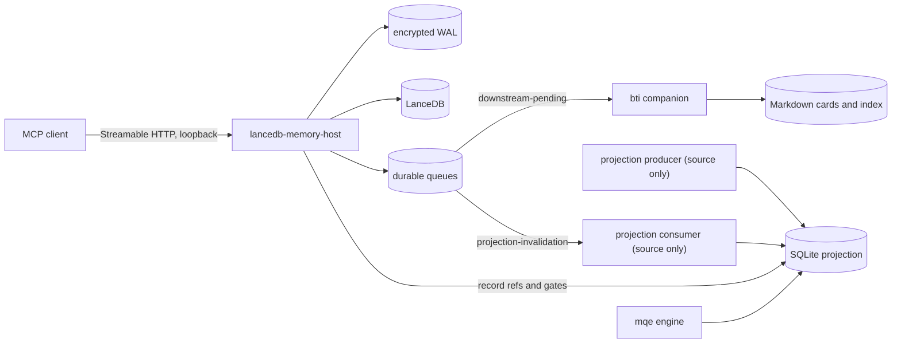

# Architecture

This document describes how the three packages fit together in v0.1. It covers what the code does, not deployment guarantees: the producer, the online consumer and application hooks are included as source only and are not enabled. See [Design decisions](DECISIONS.md) for the reasons behind the main choices.

## Components

| Component | Location | Role |
|---|---|---|
| Memory host | [`lancedb-memory-host/src/index.ts`](../lancedb-memory-host/src/index.ts) | MCP server on `127.0.0.1`. Owns authentication, rate limiting, the tool surface, the audit log and `/health`. |
| Write plane | [`mutation-write-plane.ts`](../lancedb-memory-host/src/mutation-write-plane.ts) | Encrypted write-ahead log, idempotent save, update and forget, and publication of mutation events. |
| Durable queues | [`consumer-queue.ts`](../lancedb-memory-host/src/consumer-queue.ts) | File-based queues with leases, retries and dead letters. Delivery is at least once. |
| Retrieval runtime | [`memory-runtime.ts`](../lancedb-memory-host/src/memory-runtime.ts) | Vector and BM25 search over LanceDB, fused by reciprocal rank, with deadlines, circuit breakers, a short cache and a local lexical fallback. |
| Vendored store | [`memory-lancedb-pro/src/store.ts`](../lancedb-memory-host/memory-lancedb-pro/src/store.ts) | LanceDB storage layer from an upstream package, patched; see [third_party](../third_party/memory-lancedb-pro-1.0.32/README.md). |
| Projection resolver | [`projection-ref-resolver.ts`](../lancedb-memory-host/src/projection-ref-resolver.ts) | Maps memory IDs to opaque `rr1_…` references through the current projection and applies its lifecycle gates. |
| BTI companion | [`bti/memory_save_tx.py`](../bti/memory_save_tx.py) | Writes a Markdown card and index line for a memory, with a journal and idempotent retries. See [bti/README.md](../bti/README.md). |
| Query engine | [`mqe/src/engine.mjs`](../mqe/src/engine.mjs) | Bounded queries, evidence packs and hydration over a read-only projection. See [mqe/README.md](../mqe/README.md). |
| Projection contract | [`mqe/projection/projection_contract.mjs`](../mqe/projection/projection_contract.mjs) | Validates the projection pointer and database identity; shared by the host and the engine. |
| Producer and consumer | [`mqe/projection/`](../mqe/projection/) | Build and activate projection generations. Source only in v0.1. |
| Runtime adapters | [`mqe/runtime/`](../mqe/runtime/) | Hook daemon, IPC and native shims. Source only; not installed or built. |

The host imports query-engine modules from `../mqe`, and the consumer imports the host's queue module from `../lancedb-memory-host`, so the two directories must stay side by side.

## Write path

`memory_save_tx`, `memory_update` and `memory_forget` go through the write plane. `memory_store` is a compatibility route for callers that cannot supply an idempotency key.

1. **Request.** `memory_save_tx` requires an idempotency key of 8 to 256 characters; `memory_update` and `memory_forget` accept one for stable retries. Retries must reuse the key, which is never stored in plain text.
2. **Write-ahead log.** The request is recorded in the encrypted log under `<MEMORY_DATA>/write-plane/`. Its key file is separate from the bearer secret and is created on first start if missing.
3. **Commit.** The row is written to LanceDB with an embedded outbox record. A forget writes a hidden tombstone instead of deleting the row.
4. **Publish.** The mutation event is placed on durable queues:
   - by default, on `projection-invalidation`, with a no-op entry on `downstream-pending`;
   - with `companion_required: true`, on `downstream-pending` first. The host then runs the BTI companion, which writes the Markdown card; only after it succeeds is the event moved to `projection-invalidation`. The save call waits for this companion run.
5. **Receipt.** A new memory has no reference yet: the tool returns `stored` with `record_ref: null` and `record_ref_status: pending_projection`. A retry with the same key is recognised and does not write a second memory.

On startup and every 30 seconds, the host recovers interrupted transactions from the log and retries pending companion work, so a crash between steps does not lose an accepted request. Delivery is at least once, so consumers must tolerate a repeated event.

### Queues

Each queue has `pending`, `inflight`, `acked` and `dead-letter` directories under `<MEMORY_DATA>/write-plane/consumers/<queue>/`. A worker claims an event with a lease, then acknowledges it or schedules a retry. After five failed attempts by default, the event moves to `dead-letter`, where it stays for inspection. `/health` counts each state.

### Companion configuration

The companion runs `bti/memory_save_tx.py` with `PY312_EXE`. It writes cards under the BTI data home (`BTI_DATA_HOME`, or `./bti-data` relative to the host's working directory). Writes need a fail-closed exclusion file; in companion mode the default is `bti/fail_closed_exclude_narrow.json`, which you create from [the example](../bti/examples/fail_closed_exclude.example.json). If the companion cannot write, the periodic recovery retries the event until it is dead-lettered after the attempt limit; `/health` reports `degraded` meanwhile.

## Read path

`memory_recall` takes a query and a limit (default 5, maximum 20).

1. **Search.** Vector search (through the embedding service) and BM25 search run against LanceDB, each with its own deadline, and their results are fused by reciprocal rank. Repeated failures open a branch's circuit breaker for a cool-down period. If semantic search fails, a bounded local lexical index answers instead, and the response says so.
2. **Lifecycle.** The current projection's gates keep only current records. When the query asks about history, superseded or inactive records may also be kept, labelled as no longer current; records that the hard gates reject are never kept.
3. **References.** Each remaining hit is mapped to its `rr1_…` reference through the current projection. Hits without a mapping are withheld; raw internal IDs are never returned.
4. **Output safety.** Text is sanitised, and an excerpt that is unsafe or reveals an identity is replaced by a redaction marker. If memory or the projection changes while the call runs, the call returns no results and asks the caller to retry.

The response is plain text with a short retrieval line: `mode`, cache status and the state of each branch. `memory_list` applies the same reference mapping, so it also lists only mapped records.

### Projection

A projection is a read-only SQLite database, `mqe/data/projection/memory_index.<epoch>.sqlite`, selected by the pointer `mqe/data/projection/CURRENT.json`. The pointer records the schema, reference-key identifier, corpus epoch, file name and checksum. The host and the engine load one generation and check its identity before use. References are keyed HMACs of the record ID: stable for one key, and they do not expose the ID directly. They are not anonymisation and do not replace access control.

In v0.1 nothing builds or activates a projection automatically. A fresh installation has no `CURRENT.json`, so recall and list return no records. The seeded test [`seeded-projection-recall.test.mjs`](../lancedb-memory-host/test/seeded-projection-recall.test.mjs) builds a synthetic projection with the query engine's generator and runs the full mapped path through the real host.

## Health

`GET /health` needs no secret. Each call runs an active retrieval probe of up to 30 seconds, so poll it sparingly. It reports `ok` only when all of these hold:

- the vector and BM25 probes both succeed, and neither circuit is open;
- the write plane is ready and its last recovery had no failures;
- neither queue has dead letters, and no required companion event is pending;
- the projection consumer has written a fresh health file in a running state.

The last condition cannot hold in v0.1, because the consumer is not enabled, so a working host reports `degraded` with `projectionConsumer.status` `unavailable`. See [Maintenance](MAINTENANCE.md) for each field.

## Data on disk

| Path | Contents |
|---|---|
| `<MEMORY_DATA>/audit/` | Daily audit log of tool calls: tool, a fixed input label and the outcome. Memory text and queries are not written. |
| `<MEMORY_DATA>/write-plane/wal/`, `sequence.json`, `.wal-key` | Encrypted write-ahead log, its sequence and its key. |
| `<MEMORY_DATA>/write-plane/consumers/` | Durable queues. |
| `<MEMORY_DATA>/write-plane/companion-runtime/` | Short-lived companion request files, removed after each run. |
| `LANCEDB_MEMORY_DB` | LanceDB tables. |
| `SECRET_FILE` | Bearer secret. |
| `<BTI_DATA_HOME>/memories/` | Markdown cards and `MEMORY.md` index written by the companion. |
| `mqe/data/projection/` | Projection databases, `CURRENT.json` and consumer health. |

All of these are private. Do not commit them; the repository's `.gitignore` excludes the default locations.
