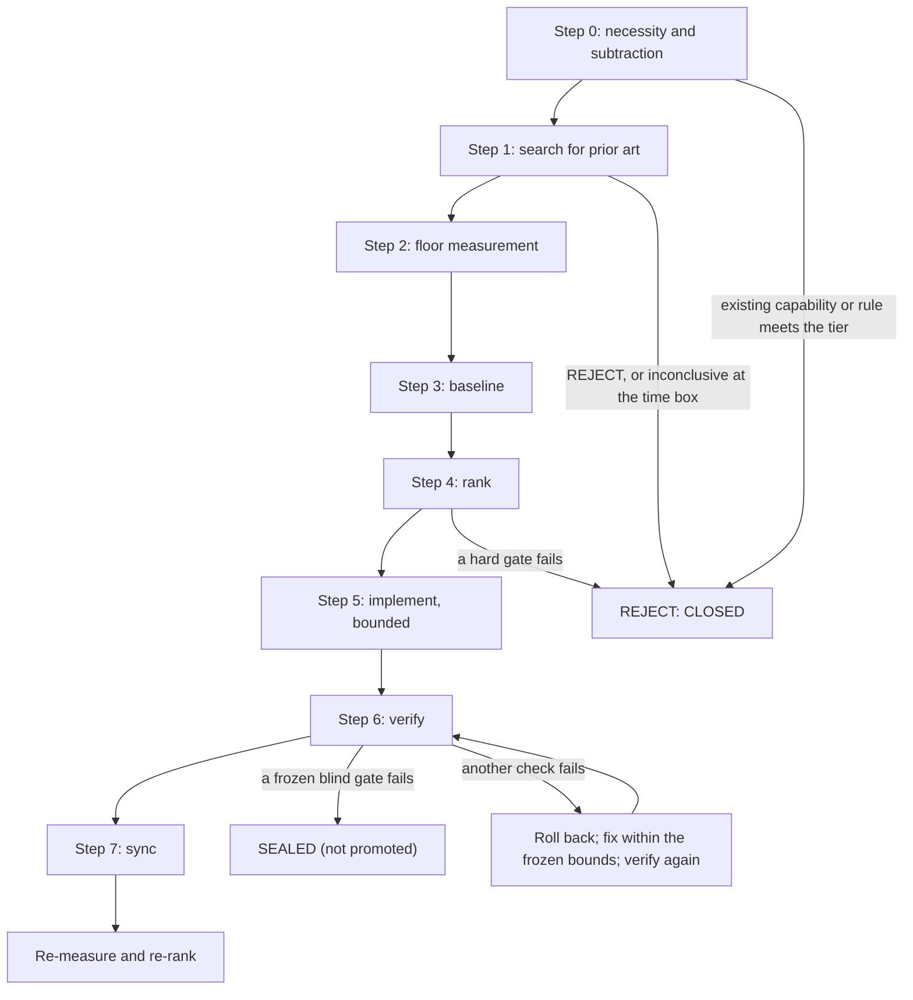

# Five-dimension programme

How changes to the memory system are proposed, measured, accepted and retired.

[FIVE_DIMENSIONS.md](FIVE_DIMENSIONS.md) defines the five dimensions for the memory host and the query engine: build cost, retrieval cost, generation cost, refresh latency and query scale. [EVALUATION.md](EVALUATION.md) gives the protocols for a frozen quality study and a complete-request cost comparison. This document extends the same dimensions to the other knowledge and memory layers and adds the method around them: what evidence a change needs, how it is judged, and how it is adopted, sealed or retired. It does not change those two documents, and it restates them only where a worked example needs the detail.

This is a method, not a product. It ships no scripts, candidate data, measurements or criteria files. See [What is not included](#what-is-not-included).

## Purpose and philosophy

The programme covers the knowledge base of notes, long-term memory, graph and index layers, and derived briefing pages (see [the layer table](SYSTEM_OVERVIEW.md#the-layers)). Each keeps its own role and its own authority boundary. They share one evaluation method and one improvement loop, and that shared method is this programme.

The idea behind it: memory for coding agents is no longer a matter of owning a database. It is a matter of trading the five dimensions against each other as one system. A change that makes retrieval cheaper but refresh slower, or answers shorter but less supported, has to show that the trade is worth it.

### Non-goals

- Merging stores, graphs or entry points into one "unified" layer because it looks tidier.
- Letting a graph, a briefing, a compressed page or a retrieval result replace the authoritative notes, production evidence, raw sources or primary memory records.
- Pushing one attractive metric to its limit while the others get worse.
- Building a second query engine next to the one that exists.

### Principles

- Describe every candidate on all five dimensions, including "no effect" and "unknown": a profile, never an equally weighted score. Correctness, relevance and output safety are checked across all five.
- Unknown stays unknown. An unmeasured cost is not 0, a zero placeholder in a schema is not a measured zero, and a missing label is neither a negative nor a reason to drop a query from the denominator.
- Keep minutes, tokens, calls, money and human touchpoints in separate columns, and claim no payback without a stated usage frequency.
- Subtract before you automate, absorb mechanisms rather than products, and before you build, look for prior art and measure the number the design depends on.
- Measure on the real machine under its normal load; never stop other work, change the machine's load or create a quiet window to get a cleaner number.
- Freeze baselines, held-out sets, labels and evidence before comparing, and change one variable per round. Observe a candidate rule before enforcing it, with its criteria and a fixed end registered before its outcome is seen.
- Split authoring, labelling, evaluation and merging between the agents; the author of a change is never its independent reviewer.
- Experimental behaviour that can change production output is off by default, byte-identical to the old path when off, reversible, and has a rollback defined before it is switched on. A channel A change may go live once its same-round check passes, but it still needs a rollback.
- A fixture result describes the fixture: do not extrapolate it to production scale, and do not claim zero harm in production from a sample with frozen labels.

## Structure

Every proposal is one row in the [candidate table](templates/five-dimension-candidate-table.md), from proposal to retirement. It must pass the [hard gates](#hard-gates), enters through one of [two channels](#two-channel-adoption-rule) and runs the [per-round flow](#the-per-round-flow). Neighbouring rules live in their own documents: the programme's own status notes and sync log in [Project authority notes](PROJECT_AUTHORITY_NOTES.md); the prior-art trigger, the sentinel table and the publication gate in [Routing and gates](ROUTING_AND_GATES.md); memory writes in [Memory governance](MEMORY_GOVERNANCE.md); slice assignment, write locks and merge ownership in [Agent collaboration](AGENT_COLLABORATION.md); and the memory-graph and screen-context layers in [Memory graph](MEMORY_GRAPH.md) and [Screen context](SCREEN_CONTEXT.md).

There is no global stage gate. Each candidate runs its own loop. Candidates whose write locks, authority inputs and runtime resources do not overlap may run in parallel, one per agent or several per agent.

## Glossary

| Term | Meaning in this programme |
|---|---|
| Dynamic bottleneck | The step that wastes the most time, tokens, compute or human effort right now, shown with evidence at the start of a round. Once it is solved, measure again; the next round may target another dimension. |
| Payback window | A forecast horizon, 90 days by default, used only for channel B: do the savings recover the cost within the window? It is not a retention period, a retrieval time range or a trial period anyone has to wait out. |
| Acceptance tier | The quality level at which a deliverable counts as accepted. It is frozen before two options are compared, and both are compared at that tier. |
| Accepted unit | One deliverable that met the frozen acceptance tier. |
| Floor measurement | A measurement of the one number a design depends on, taken on the real machine under normal daily load before building. |
| Evidence pack | Here, a frozen, immutable bundle of first-hand evidence for one decision, without a recommendation ([Collector and fresh decider](#collector-and-fresh-decider)). The query engine's evidence pack is a different thing: a bounded retrieval result ([Design decisions](DECISIONS.md#return-bounded-evidence-and-explicit-abstentions)). |
| Formal phase | The reference installation's gated close-out of the query engine: a fixed list of checkpoints, each counted as done only when its own frozen acceptance criteria were met. See [Formal-phase accounting](#formal-phase-accounting-kept-as-method). |
| Sealed release, `SEALED` | Two different things. A sealed release is a hash-bound build waiting for activation. The candidate state `SEALED` means the candidate failed a frozen gate. Neither is a release. |
| Authority source | The place that decides a fact: project authority notes, production files, raw sources, primary memory records. |
| Derived layer | Anything computed from authority sources for navigation or speed: graphs, indexes, bridges, briefings, telemetry sidecars, READMEs. |
| `exact`, `estimated`, `unknown`, `not_applicable` | The class every recorded value carries: measured directly; derived from a proxy, a sample or a calculation; not observed; or the dimension does not apply. |

## Minimum evidence per dimension

"Very light", "fast" and "barely any tokens" are not evidence. Each figure needs a unit, its class and a pointer to what produced it: a command that can be rerun, a frozen report, or a fixture. Each saving is counted in one dimension only.

| Dimension | What to count | Minimum evidence | Common mistake |
|---|---|---|---|
| Build cost | One-off human and agent time; code and configuration volume; new dependencies; storage; CPU and GPU; tokens, calls and retries spent on compilation, extraction or graph building; for an embedding-backed host, embedding work separately from projection construction | Real elapsed time or a rerunnable command, plus the change in dependencies, files and storage | Counting only the code diff and forgetting extraction calls |
| Retrieval cost | Query latency; retrieval tokens and calls; file-browsing rounds; cost of hydrating evidence; failures and abstentions | Values from the query-engine workstream, copied read-only (see [Why the query engine stays isolated](#why-the-query-engine-stays-isolated)) | Rerunning someone else's measurement and contaminating it |
| Generation cost | Model calls, tokens, run time and failed retries per user query, for answer generation, context synthesis and evidence expression | Provider-reported usage where it exists; otherwise a labelled proxy and `unknown` for billed tokens | Counting a build-time extraction saving again as a generation saving |
| Refresh latency | Delay from a source change to a usable derived artefact; allowed staleness; cost of a no-op refresh; failure recovery | Source and output hash or modification time, compile time, pending count, probe result, and before and after evidence | Treating a queued or stored change as proof that readers already see it |
| Query scale | Files, records, nodes, edges, projects and concurrent requests that can be served; how the curve grows | Current size counts plus at least one boundary or growth sample | Extrapolating a green small sample to unlimited scale |

## Task-level acceptance

Task-level acceptance is not a sixth dimension. It projects the five dimensions onto the end point of one real task. Use it for any candidate that replaces a tool, an automation, a skill or a workflow step.

1. Freeze the acceptance tier before comparing.
2. Record `accepted_units` and `time_to_accepted_deliverable`.
3. Count what surrounds the work: verification, rework, waiting for approval, failure recovery, tool switching and human touchpoints.
4. Record `cost_per_accepted_unit`, one unit per column.
5. Record `bad_case_external_cost` (reputation, compliance or other external loss) separately from the direct cost of running the work.
6. For a probabilistic AI candidate, record `deterministic_rule_available` and `tolerable_error_envelope`: which failures are allowed and which are zero-tolerance, the maximum attributable loss, how a failure is detected, how it is rolled back, and the human fallback.
7. Record `subtraction_result`: `retained`, `removed_from_design` or `simplified`.

Fields nobody observed stay `unknown`. Faster local generation, more code or a better model score do not by themselves prove an end-to-end net benefit. `removed_from_design` changes only the proposal; deleting anything that already exists, whether a file, a dataset or a service, still needs its own approval.

## Benefit judgement

```text
net_benefit_90d = savings_90d - build_cost_once - maintenance_90d - degradation_cost_90d
```

Every term must be in the same unit for the subtraction to mean anything. `degradation_cost_90d` covers only quantifiable degradation outside the hard gates; a hard-gate degradation is never priced, it removes the candidate.

Prefer comparable quantities such as time, calls, tokens, storage and human rounds. When a benefit cannot be converted into one unit, keep several evidence columns and state a dominance relation ("no worse on any column, better on two") or the uncertainty. Every candidate states its assumed usage frequency; without one, write "frequency unknown, no payback claim". Compare candidates at one frozen acceptance tier, by `time_to_accepted_deliverable` and `cost_per_accepted_unit`, never by local speed or output volume.

### Decision order

| Question | Decided by |
|---|---|
| May this candidate enter the pool at all? | Hard gates |
| Which candidate goes first? | The dynamic bottleneck |
| Is it worth doing? | 90-day net benefit (channel B) or same-round verification (channel A) |

## Hard gates

Any degradation on any of these removes the candidate, whatever it gains elsewhere, because each protects something a saving cannot buy back:

1. **Authority and provenance.** Every fact can still be traced to its authority source.
2. **Answer quality and evidence.** Answers stay as good, and the evidence needed to support them can still be hydrated.
3. **Privacy, security and prompt-injection boundaries.** No new exposure of private content, no new path for untrusted text to act as instructions.
4. **Recoverability.** Rollback exists, and nothing fails silently.
5. **Isolation.** Write locks between projects and agent windows hold, and the owner's current work is not disturbed.

A gate result is PASS or FAIL with the failed gate named. "Nearly passed" is FAIL.

## Two-channel adoption rule

| | Channel A: immediate absorption | Channel B: heavy investment |
|---|---|---|
| Entry | A mature mechanism; reuses the existing stack; no new resident service, separate store or authority source; small and reversible | Adds a tool, service, database, migration, data copy, recurring fee or long-term maintenance |
| Verification | Same-round before and after comparison on tokens or a labelled proxy, elapsed time, file-browsing rounds or refresh delay, plus non-degradation of quality and authority | Isolated pilot, real floor measurement, 90-day benefit forecast and a rollback drill |
| Decision | Adopt as soon as verification passes | Adopt only if the forecast pays back within 90 days and every hard gate passes |

No proposal ever sits and waits for 90 days. The window is channel B's forecast and decision horizon, nothing more. Ninety days is the reference installation's operating choice, not a derived optimum; pick a horizon over which your usage forecast stays credible.

**Worked example (channel A).** An event-driven product that compiles knowledge pages was evaluated and not installed. Three of its ideas were absorbed into the existing stack instead: a content-hash freshness probe on each derived page, an "ensure fresh before consume" step before every read of such a page, and a short quick-start page that routes an agent to the right authority notes, which the agent re-reads before acting. The change was checked on the spot with a context-size proxy, the number of file-browsing rounds, cold-start time, and by forcing the dirty branch: a changed source triggers a recompile before the read. Session start runs only a light due check, never a rebuild, and no service, store or authority source was added. Later hardening added that a failed refresh emits nothing and records `FAIL_CLOSED`, so the agent reads the authority notes directly, and that an unparseable non-empty, non-comment pending record fails loudly instead of being read as "no change". The briefing rules are in [Research knowledge vault, section 10](RESEARCH_KNOWLEDGE_VAULT.md#10-keep-derived-layers-honest).

## The per-round flow

Each candidate runs one minimal closed loop.



**Step 0, necessity and subtraction.** Freeze the acceptance tier. Ask whether an existing capability or a deterministic rule already meets the goal, and whether steps can be deleted or simplified. For a probabilistic AI candidate, record `deterministic_rule_available` and `tolerable_error_envelope` here. When removing or simplifying steps, or an existing rule, already reaches the frozen tier more cheaply end to end, the round ends here with REJECT and the existing capability or rule stays, as is or simplified. Steps 1 and 2 did not run, so their fields record `not run: stopped at step 0` instead of guessed results. Never automate for the sake of automating.

**Step 1, prior art.** Give the problem a name, because a well-known problem usually has well-known answers. Search two to four phrasings, collect three to eight of the closest first-hand solutions, and study the best two or three: which difficulty each one overcame, which it left open, where it breaks, and its licence and upkeep risk. The verdict is exactly one of REJECT, ADOPT, ADAPT or BUILD, with `decision_state` CONCLUSIVE or INCONCLUSIVE. BUILD must survive the sweep; it never comes before it. Steps 0 to 2 share one time box (10 to 30 minutes by default, hard stop at 30); a sweep still inconclusive at the stop returns REJECT for now with `decision_state: INCONCLUSIVE`. A sweep of the same area from roughly the last 30 days is cited instead of repeated. When the sweep fires outside this programme, and when the owner may suppress it, is set in [Routing and gates](ROUTING_AND_GATES.md#3-self-triggers).

**Step 2, floor measurement.** Identify the one number the design depends on and measure it today with installed tools, on the real machine, under its normal daily load; a green result on an artificially quiet machine is not evidence. In this programme the step is part of the loop for every candidate the sweep admits; the general procedure in [Routing and gates](ROUTING_AND_GATES.md#11-the-two-procedures-the-self-triggers-start) makes it the default for performance-sensitive builds. When the candidate replaces a workflow, a good floor number is required but does not settle the question; also compare `cost_per_accepted_unit` at the frozen tier.

**Step 3, baseline.** Record the current value of each dimension with its evidence path, observation time and unknowns. Copy the retrieval column read-only from the query-engine workstream.

**Step 4, rank.** Apply hard gates first, then the dynamic bottleneck, then the channel and the benefit judgement.

**Step 5, implement, bounded.** A stage lock binds only the selected candidate, its acceptance tier and its write locks. It is not a global freeze. The selected candidate is not swapped for a newer idea until it is deployed and synced. Tuning uses [bounded experiments](#bounded-experiments); a load-bearing choice uses a [frozen evidence pack and a fresh decider](#collector-and-fresh-decider).

**Step 6, verify.** Repeat the same before and after protocol. Actually exercise both the benefit branch and the failure branches, for example stale input, a concurrent change, an error path and the rollback itself; a fail-closed path that never fired is not evidence.

**Step 7, sync.** Patch the programme's progress note (its status block and the affected section) and, if a stable rule changed, its decision note, then record the sync as one new AI sync-log row, as in [Project authority notes](PROJECT_AUTHORITY_NOTES.md#2-the-sync-gate) ([row example](templates/sync-log-row-example.md)).

A release counts as done only when the active pointer, switch or entry actually exists and has been verified; a candidate, a sealed release that is not yet active or an "activation-ready" build is not a release. After a release, re-measure and re-rank at once, and continue with any candidate that does not touch the retrieval path owned by the [query-engine workstream](#why-the-query-engine-stays-isolated). When the two agents split candidates between them, each split is a slice assignment record with exclusive outputs, write locks and one merge owner ([Agent collaboration](AGENT_COLLABORATION.md), [template](templates/slice-assignment.md)).

## Bounded experiments

For multi-round tuning of a candidate that has already been selected:

1. Freeze the baseline, the stop condition, the bounds of each variable and a held-out acceptance set before the first round.
2. Change exactly one attributable variable per round.
3. Record benefit, degradation, failures and rollback evidence for every round, including rounds that made things worse.
4. Stop when the stop condition is met, not when a pleasing number appears.

Experiments serve one local choice. They are never used to widen permissions, write locks, authority sources or irreversible actions.

## Collector and fresh decider

Use this split only for high-stakes trade-offs, long evidence chains or materially conflicting sources; ordinary small questions stay in one context. The point is independence: the context that gathered the evidence carries its own guesses and dead ends, while a fresh context judges only what was frozen.

**The collector** gathers conflicting first-hand evidence, assumptions, gaps and source links, and writes no recommendation. It freezes an evidence pack with each source and its anchor, a map from every claim to its source, conflicts between sources, searches that found nothing, unknowns, the freeze time, the frozen acceptance tier, and a content hash or other immutable identifier.

**The decider** starts in a new subagent or context, reads only the frozen pack and the sources it links, never sees the collector's conversation, and returns exactly one of REJECT, ADOPT, ADAPT or BUILD. It may use the same model; the new context is what makes it fresh. A decision taken inside the collector's own context is reported as a same-context decision, never as fresh.

The prior-art sweep runs first. A later decision review of the owner's plan ([Routing and gates](ROUTING_AND_GATES.md#3-self-triggers)) may reuse the frozen pack, but only when a load-bearing trade-off remains that only the owner can settle; it repeats no searches and no questions.

## Observation contracts

Two kinds of observation are governed here: telemetry about derived layers, and count-only observation of a candidate rule before anyone enforces it. Each contract fixes what is recorded and what may not be recorded and, for a candidate rule, when the window ends and which pre-registered criteria decide.

### Telemetry

These rules apply to the non-authoritative sidecar that records five-dimension observations, for example runs of the graph rebuild, the bridge build and briefing reads in the [research knowledge vault](RESEARCH_KNOWLEDGE_VAULT.md#10-keep-derived-layers-honest).

- Telemetry never changes production output or authority state. If it fails, production carries on, and the affected values are reported as `unknown` or "coverage unknown", never estimated or filled in.
- Every value is classified `exact`, `estimated`, `unknown` or `not_applicable`. Token counts the provider did not return stay `unknown`, with the token field `null`.
- Each producer writes one atomic JSON event per operation, at its own success and failure boundary. Exactly equal canonical payloads are deduplicated; a different payload under the same key fails instead of overwriting.
- Events carry only declared numbers, enums, hashes and a few page identifiers: never query text, page text, user input, the working directory, absolute paths or full exception text.
- Only a successful read that actually outputs and flushes a page counts as consumption (`EMITTED`). A step that only makes a page fresh is not consumption, and a failed refresh produces empty output and records `FAIL_CLOSED`.
- The top-level duration covers the whole operation; partial timings are listed separately, and a failure event names only the stage it actually reached.
- An aggregator produces a sorted event log and 7, 30 and 90-day windows keyed on observation time, falling back to backfill time only when that is missing. An aggregate is a derived snapshot: refresh and verify it before any current judgement, and record when it was generated. A verify proves consistency at save time, not today's rolling window or a stable 7 or 30 days.
- Backfilled baseline events and measurements taken while auditing are listed separately and never count as natural use. In the reference pilot, exactly one controlled change to the baseline definition was made before freezing, and the original measurement was kept in a separate field. After freezing, events are immutable.
- Reads that bypass the metered reading wrapper are not seen, so their coverage is reported as unknown. Observation is not free: measure its own overhead per call and report it with the results.

### Observe before enforce

Worked example: the weak single-lane rule from [DECISIONS.md](DECISIONS.md#observe-candidate-rules-before-enforcing-them). The memory host retrieves through two lanes, vector search and BM25 full-text search. The rule drops a candidate that only one lane matched, and only weakly, before the top five are taken; lower-ranked candidates then refill the top five. It replaced an earlier plan, set aside after evaluation, to abstain from the whole answer when evidence is weak, and it is itself still subject to the criteria below. Counting how often the rule would apply proves applicability only; whether it helps needs the blind study (group B) and the paired cost measurement (group C).

1. **Count-only mode behind a default-off switch.** The rule computes what it would drop, but the returned result never changes.
2. **A fixed end,** about seven days after activation, never extended to wait for a better result.
3. **Pre-registered criteria.** Before any outcome of the observation window or the blind study is seen, enable criteria are written and frozen with a content hash. A later revision may clarify procedure, such as the order of sampling steps, but keeps the thresholds and the earlier revision.
4. **Four groups, all of which must pass.** The numbers are the defaults the reference installation registered.

| Group | Question | Default criteria |
|---|---|---|
| A, applicability | Does the rule run where intended, often enough? | At least 200 successfully observed calls (calls, not distinct queries) and coverage of at least 50%: observed calls over eligible calls, where eligible means an ordinary recall that reaches the lifecycle filter ([Architecture](ARCHITECTURE.md#read-path)), summed over each host instance's last snapshot. A would-drop ratio (would-drop count over candidates that passed the lifecycle filter) within 0.5x to 2x of the offline ratio; outside that band, stay off and investigate rather than retune, and do not call it a defect without investigation. The result lists, per day, why calls were not observed, missing host instances, abnormal stops, and whether events from the last hour before a stop may be missing. Cached and degraded-mode calls skip the rule by design and are not gaps in the evidence. |
| B, blind quality | Does it help answers on real queries? | A fixed sample of 80 real queries from both agents, drawn after the window from the agents' own records of that window (the counter stores no query text) by rules frozen beforehand: exclude probes, acceptance and test queries and anything from earlier training or holdout sets; deduplicate same-session retries; stratify by day in proportion to eligible counts; at most three per session; fixed seed. Freeze the drawn list with its hash before any evaluation or labelling, and choose no seed or rule after seeing any group result; extra samples are reported separately, never mixed into the 80. Label the union of both variants' top five, refill included, with two independent blind labels and blind adjudication ([Evaluation](EVALUATION.md#quality-study-protocol-template)). Pass: Hit@5 over all 80 queries gains at least three hits, no grade-2 item is removed by the rule or missing from the final output, and at most two grade-1 items are removed. |
| C, full-path cost | What does it cost per request? | At least 200 warmed pairs of full-path requests with identical inputs, alternating AB and BA; the p95 of per-pair differences (on minus off) is at most 10 ms. Timing buckets from the observer itself do not count. Enabling keeps the existing safety checks: the final validity check still runs after the asynchronous read of the reviewed safe summary, no verdict is reused from an earlier request, and the state-change, concurrent-update and safe-summary-failure branches keep their current safety semantics. If the budget is exceeded or the measurement conditions do not hold, the rule stays off; a targeted fix is re-verified on pre-specified independent evidence, never by retuning on the quality sample. |
| D, off-state and rollback | Is "off" really off? | Off by default, with output byte-identical to the original path on the ordinary, cached, held-back (unobserved), degraded, concurrent-change and error branches. The reference criteria omit the stale branch that [Evaluation](EVALUATION.md#cost-and-safety-gates) lists; a new study should include it. Rollback is switching the rule off and restarting the host, because the switch is read only at start-up; switching off without a restart is not guaranteed. |

5. **Failure handling.** If any group fails, the rule stays off and the issue is registered; thresholds are not retuned on new samples. Unknown readings and too few samples never count as PASS, and incomplete labels fail group B.
6. **Wording of a pass.** A pass is a bounded finding: under frozen AI labels, no relevant item was observed dropped in this sample. It is never "zero harm in production".
7. **Separated roles.** One agent draws the sample and organises blind labelling; the peer agent, which did not choose the thresholds, runs the main evaluation, implements the enabled version and measures cost. Each reviews the other's part, the two labels come from independent labellers, and no earlier holdout set is reused.
8. **After a pass,** the two agents decide to enable and report their reasons to the owner. The enabled version still has to pass current source and input checks, and the production change follows the approval mechanism of the agent that executes it.

**First-enable scope.** Enabling covers only the verified path: ordinary, freshly executed hybrid retrieval with the default top five from 20 candidates. Cached, degraded, incomplete-evidence and other-limit results, and requests served under an exclusive evaluation lease, keep their original output. A wider scope needs its own evidence; a check at the default limit says nothing about every limit from 1 to 20.

## Review after a completed or failed run

A separate intake reviews a run only after it has finished or failed; it never takes over a live task, and an ordinary request to "polish this" does not start it. It feeds the skill-discovery queue described in [System health and governance](SYSTEM_HEALTH_AND_GOVERNANCE.md#8-turn-repeated-work-into-skills-with-a-human-gate) and ends in exactly one of three states:

| State | Requires | Writes |
|---|---|---|
| `no_change` | Nothing reusable was found | Nothing |
| `record_episode` | A reusable observation without a proven fix | One redacted, immutable episode record; the queue is not touched |
| `patch_candidate` | All of: a concrete failure; a causal link to a text or workflow step; an exact target with its source hash; a replay of the failure; a held-out check; a safety regression check; a rollback plan | One isolated draft and at most one `needs_human_review` entry in that queue, or a reference to an equivalent open entry instead of a duplicate |

Every entry then goes through review by both agents, content-hash checks, a rollback plan and the owner's review gate. The intake never approves, starts or claims validation, or promotes anything, and it leaves production prompts, skills, memory, hooks, agent instruction files and agent configuration unchanged. Triggers, permissions, privacy, submission and destructive-action gates are locked: only dedicated maintenance changes them. The intake adds no daemon, heartbeat, resident process, optimiser, second queue or second state machine.

## Authoritative sources and derived layers

Which source decides which question is set out in [System overview](SYSTEM_OVERVIEW.md#authoritative-and-derived-sources). For candidates in this programme:

- A graph, index, bridge, briefing, telemetry sidecar or README may locate evidence but never decides a fact. A briefing is an internal routing cache that carries source and freshness evidence; it is never promoted to status or decision authority, and a keyword match in it never grants permission to act.
- Read project state in this order: the progress note's current status, the decision note's stable rules, each system's live evidence, then derived pages and READMEs. Notes never overwrite production facts, and a remembered fact about mutable external state is re-verified before acting. If a note and the evidence disagree, do not quietly pick one; handle it as described in [Project authority notes](PROJECT_AUTHORITY_NOTES.md#three-layers).
- A shadow candidate, not used in production, tests signed acceptance of claims: a claim counts as accepted only with a signed approval event and a passing check against its current source; when the source or its anchor drifts, current use is blocked, and the signed history is not rewritten.
- A derived page whose input queue is empty, such as the vault's recent-changes page ([Research knowledge vault, section 10](RESEARCH_KNOWLEDGE_VAULT.md#10-keep-derived-layers-honest)), may skip the rebuild and emit only a small fixed "no changes" marker labelled derived and non-authoritative, and only while every source, input, output and self-check binding still verifies; otherwise it rebuilds in full. The memory-graph briefing follows its own release-bound rules in [Memory graph](MEMORY_GRAPH.md#consumers-and-briefing).

## Why the query engine stays isolated

Retrieval cost belongs to the query-engine workstream, which runs separately with its own defect register and evidence chain. It owns the whole retrieval path: the query engine and the host's retrieval code (branch deadlines, caches and candidate filters such as the weak single-lane rule). Other candidates never write to, restart or rerun anything there, including hooks, settings, models, queues, stress tests, reports and run directories, and they copy its final figures read-only. The lock covers only the retrieval path; it never freezes other objects or dimensions.

Why: another candidate's load or restart would change the numbers the workstream is freezing; CPU, files, hooks, settings, models, queues and recovery state are shared; and the workstream's results must stay attributable to its own changes.

Once the engine was live and its formal close-out was replaced by [maintenance](#maintenance-mode-use-and-fix), one narrow exception was added: a concrete defect may touch the engine under a registered exclusive write lock, with a minimal diff, a rollback plan and an idle window both agents agree on. The exception covers that defect only, authorises no other candidate and does not reopen formal acceptance. The separate rule that online integration ships as source only is in [DECISIONS.md](DECISIONS.md#keep-online-integration-outside-the-demonstration-boundary).

## Maintenance mode: use and fix

Once a system is live and in daily use, finishing a long gated close-out can cost more than it returns. The owner moved the query engine's close-out to "already live, use and fix": its unfinished formal checkpoints were stopped, their history was kept unchanged, and the unfinished formal pass is not claimed. An ordinary fix keeps the original interfaces and redaction boundaries, has a backup and a rollback, and gets one necessary verification of the affected scope. Deletion, wider permissions, publication and submission keep their owner confirmation gates. Maintenance updates only the defect line, the current status and the sync log; historical planned hours are not maintenance estimates.

### Defect register

One line per concrete defect: symptom, a minimal evidence pointer, fix scope and owner, verification, and state or rollback. No memory text, queries or secrets in the register. A defect is marked fixed only after closure evidence from a real client test, never from static reasoning alone.

### Change-triggered checks

For the memory host and query engine, each check verifies only the scope a change affected; the checks are not chained into a gate sequence. Prefer existing isolated fixtures; an ordinary fix does not touch the owner's real memories by default.

| Trigger | Check |
|---|---|
| Record-reference mapping, mutation or projection invalidation changes | Operate on fixture A and prove fixture B unchanged; unknown references are rejected; corrected or forgotten content is no longer consumable; run on an isolated store, and confirm real deletion separately |
| Public response, query-engine evidence pack, recall or list output, hook or error format changes | Run sensitive negative controls on the actual output while normal safe text stays visible |
| Lifecycle, write-ahead log or queue code changes, or a real restart happens | Check leases, barriers, active writes and queues first; then confirm a single instance, ping, read-only calls and queue end states; use fault-injection fixtures only when recovery logic itself changed |
| Tool return body, schema or client compatibility changes | The same known query shows safe text and a reference in both agents, and the synthetic no-hit branch is visible in both; degraded retrieval and cached results still show the text |

A deployment on the shared host needs an idle window both agents confirm and the installation's established restart procedure.

### Due by signal, not by calendar

Maintenance becomes due when a measured signal crosses a recorded threshold ([MAINTENANCE.md](MAINTENANCE.md#periodic-checks)). For example, store compaction becomes due when any of three signals reaches 200: active storage fragments, or the unindexed tail of the full-text index or of the index on the record scope field. A read-only check answers on demand with exit code 0 (not due), 10 (due) or 20 (unknown); unknown is never read as "not due", and no scheduled task or reminder runs it. When due, the existing compaction procedure and its gates are reused: one cycle per run, versions kept so the run can be rolled back, and owner permission for each run through the executing agent's approval mechanism. A narrow standing permission would need its own explicit grant from the owner; reaching the threshold implies none.

## Formal-phase accounting (kept as method)

These rules governed the query engine's [formal phase](#glossary). In maintenance mode they are general method, not preconditions for an ordinary fix.

- **Classify before logging.** Each material event is classified as formally accepted; an engineering milestone (no formal credit); a blocker or a generation change, such as a new data epoch, toolchain or pinned source; failed or superseded (the old failure is kept, an old pass is not inherited); or a pause or handoff (stop execution first, confirm nothing is running, then sync). Events without material change get no log line. Label every result offline, live or formal: offline, static or fake-runner passes never count as formal acceptance. The notes these events go into are described in [Project authority notes](PROJECT_AUTHORITY_NOTES.md).
- **Stop on a real conflict.** A real conflict between a note and live evidence stopped work: both originals were kept, and the owner or the agent responsible for the batch resolved it. Nobody picked the source that favoured their own result.
- **Treat an error from a multi-file patch as a possible partial write.** Re-read and recount every target before retrying; never assume a global rollback happened.
- **Estimates stay estimates.** Work was planned in one-hour units. An overrun is recorded honestly (actual time, rework, size of the miss) and acceptance continues unchanged; an overrun alone never blocks the task. This replaced an earlier rule that blocked any task past its estimate and stalled useful work. A change of scope, denominator, dependency or acceptance keeps the old plan, publishes a new version and records the net hours and critical-path impact. Agents do not re-baseline on their own, and versions, attempts, findings and manifests are not units of progress.

## Candidate states and the candidate table

Track every proposal in [templates/five-dimension-candidate-table.md](templates/five-dimension-candidate-table.md). Keep rows for rejected, sealed and retired candidates; they record what was tried and why it stopped.

| State | Meaning |
|---|---|
| PROPOSED | Written down; nothing measured yet. |
| SHADOW (not promoted) | Built and tested beside production; production does not use it. |
| PASS_SHADOW (not promoted) | Passed its shadow gates; still not used by production. |
| WAITING_EXTERNAL | A shadow waiting on a precondition owned elsewhere. |
| OBSERVING | Running in count-only mode until a fixed end. |
| SOURCE_ONLY_COMMITTED | Code deployed, but its benefit appears only when a future natural run uses it. Benefit is not back-filled. |
| ACTIVE | Adopted and verified in production with before and after evidence. |
| SEALED (not promoted) | Failed a frozen gate. Kept for the record, never retuned on the same blind set. Reopened only as a new design with a new development set and a new independent blind set. |
| DEFERRED | Blocked by a shared contract or the query-engine lock. Other candidates continue. |
| CLOSED | Rejected before any build. |
| PAUSED | Was active; stopped because its cost no longer pays for its use. Can be resumed with new evidence. |
| RETIRED | Was active; removed for good. |

A deployment transaction (a commit that moves code into place) is not a benefit of its own. A shadow result is never written into production as a stable contract. A state changes only when the evidence named in the row changes, never because a file exists, a review passed or a chat message says so.

A batch of candidates closes when each reaches its own terminal state: deployed, accepted within a stated scope, or sealed. Shadows are never forced to promotion, and a closed batch is reopened only for a new concrete task or a real defect, not to wait for more natural observations.

## Defaults you can change

These are the values the reference installation uses. Keep your own in configuration and record why they changed.

| Setting | Default | Notes |
|---|---|---|
| Payback window | 90 days | Channel B forecast only |
| Telemetry windows | 7, 30 and 90 days | Keyed on observed time |
| Prior-art sweep | 2 to 4 phrasings, 3 to 8 projects, close reading of the top 2 or 3; 10 to 30 minutes for steps 0 to 2, hard stop at 30; a same-area sweep from about the last 30 days is reused | Inconclusive at the stop: REJECT for now. Trigger: [Routing and gates](ROUTING_AND_GATES.md#thresholds-and-triggers) |
| Observation window | About 7 days from activation | Never extended |
| Observation criteria | The four groups under [Observe before enforce](#observe-before-enforce) | Denominator always the full sample |
| Compaction due | Active fragments, full-text tail or scope tail at 200 | Exit codes 0, 10, 20 |
| Retries when replacing a durable file (for example extraction receipts, plans and promoted files) | Only transient access-denied, sharing-violation and lock-violation errors; at most 5 attempts, back-off doubling from 0.1 s | Each attempt logs only the operation, attempt number, error code and file base name; fail closed after the last attempt |
| Hashes | Full lowercase 64-character hex SHA-256 over the bytes actually written | Never truncated, never over newline-normalised text |
| Planning unit | 1 hour | Formal phase only; an estimate, not a gate |

## Failure modes and lessons

| What went wrong | Lesson |
|---|---|
| An authority route pinned the content hash of a live progress note, and every projection refresh failed after the next ordinary edit ([details](PROJECT_AUTHORITY_NOTES.md#failure-modes-and-lessons)). | Add "edit the live source after enabling" to acceptance, and keep a pre-reviewed package that only switches the feature off. |
| A shadow router passed its development set, then failed all three of its acceptance gates on a fresh blind set (gates in the [candidate table](templates/five-dimension-candidate-table.md)). | Development success is not acceptance. Seal the candidate, never tune on the blind set, and do not call a narrow miss "close to passing". |
| A hook client was built before anyone measured its start-up cost under real load or looked for prior art ([details](ROUTING_AND_GATES.md#failure-modes-and-lessons)). | Name the problem, look for prior art and measure the number the design depends on before building. |
| Agents listed items as waiting for the owner because of a requirement the owner never stated. | Trace each owner wait to an owner statement or a mechanism that requires it; wording and labels used only by agents are the agents' decision ([Agent collaboration](AGENT_COLLABORATION.md#10-decision-ownership-and-owner-communication)). |
| Trigger phrases for an authority entry missed the owner's natural wording and matched unrelated phrases with similar words. | Test triggers against real owner wording and near-miss negatives, and fix them narrowly ([Routing and gates](ROUTING_AND_GATES.md#6-keep-the-table-fresh)). |

## What is not included

- No candidate rows, measurements, labels, queries, evidence packs, telemetry events or defect-register entries from the private system; the template's rows are invented. The thresholds here restate the reference installation's registered defaults and are not recommendations for every workload; the criteria documents, their hashes and their revision history are not included.
- No collector, decider, sampling, blind-labelling, telemetry-aggregation or due-check tooling. The v0.1 code contains the observation-only weak single-lane counter; its enabled form, the four-group study and its outcome are not published.
- No published evidence that any candidate described here improved production answers or reduced production cost. Where the text says a change was adopted or switched on, it describes the reference installation and cannot be verified from this repository.
- The memory-graph and screen-context layers are documented in [MEMORY_GRAPH.md](MEMORY_GRAPH.md) and [SCREEN_CONTEXT.md](SCREEN_CONTEXT.md); this document only says how changes to them are judged.
