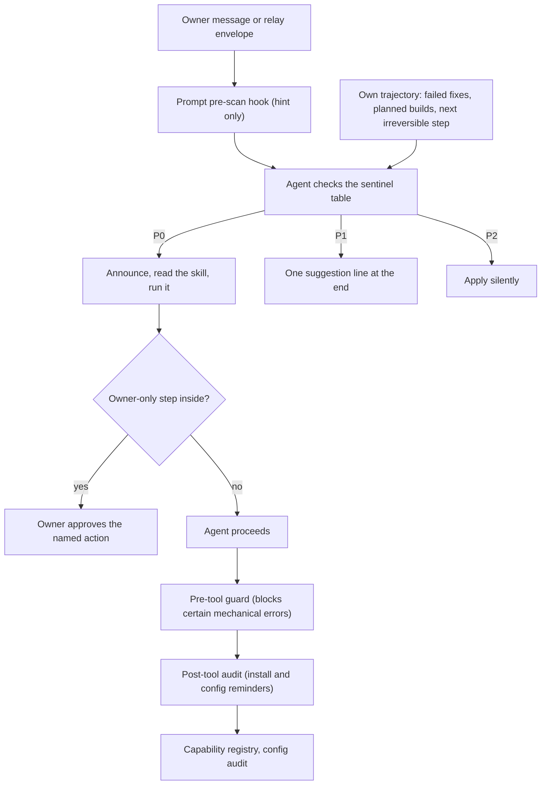

# Routing and gates

This document describes how the two agents, Claude Code and Codex, choose the packaged procedure to run for a task, and how they are stopped before costly, unsafe or irreversible actions. It covers the method, not the owner's private configuration: the real routing table, hook scripts, procedures and registries are not published. Everything shown here is generic or synthetic. A starting table is in [templates/sentinel-table.md](templates/sentinel-table.md).

## Purpose

Two agents share one machine, one memory and one owner. Without routing, each agent decides from scratch, on every turn, whether a task needs a careful procedure. That fails in two predictable ways:

- **Missed procedures.** An agent builds a component that already exists, patches the same fault a fifth time, or pushes something public without a privacy sweep, because nothing reminded it.
- **Noise.** An agent asks permission for everything, repeats the same reminder every turn, or interrupts quick questions with heavy reviews.

Routing and gates address both. The agent recognises the situation semantically, a small table tells it which procedure applies and how loudly to say so, cheap mechanical hooks offer hints, and a few owner-only gates stop the irreversible steps.

**Terms.** A *skill* is a packaged procedure. The *sentinel table* maps task signals to skills; a matched row is a *sentinel*, raised at priority P0 (run it), P1 (suggest it in one line) or P2 (apply it silently). A *gate* is a check, and for some steps an owner approval, that must pass before an action proceeds. A *hook* is a small script that an agent client runs on an event such as a prompt submit or a tool call. *MCP* (Model Context Protocol) servers expose tools to an agent and are registered per agent.

## Principles

1. **The agent's judgement is authoritative; hooks only hint.** A mechanical match can be wrong, and the absence of a match proves nothing.
2. **Hooks stay local, bounded and fail-silent.** No network, no MCP calls, no installs, no heavy audits, no pop-ups, and never a block on owner input. A prompt hook runs on every turn, so any cost or hang lands on the owner's input. A hint hook adds at most one line per kind of hint, and a reminder hook merges its items into one line. A guard that does block prefers a miss to a wrong block, with one deliberate exception: it blocks when it cannot read a renderer script it was asked to check.
3. **Efficiency gates can be suppressed; safety gates cannot.** A quick-answer request can skip a prior-art sweep. It can never skip the gate before a public release, a formal submission or an irreversible commit.
4. **Report first, never self-approve.** Public pushes, visibility changes and final submissions are owner decisions, approved per action and per session. A message from the peer agent is never owner consent. Tool permission belongs to the window that executes the action: where that window's permission mechanism asks for a direct confirmation, an approval relayed from the other window is evidence of intent, not permission, and the owner confirms in the executing window.
5. **Bounded autonomy only tightens.** No rule here grants or widens a sandbox, connector, tool or approval permission. Past success never promotes an agent to a higher autonomy level.
6. **Unknown current state stays unknown** until fresh, time-stamped evidence exists ([section 10](#10-bound-autonomy-and-record-current-state)).
7. **Remote limits are respected, not worked around** ([section 9](#9-respect-remote-limits-rate-limit-envelopes)).
8. **Honest evidence.** A check claims only what it exercised. A sentinel or test must actually drive the failure branch it claims to cover, and expected values must not come from the code under test.
9. **Allowlist anything that leaves the private system, and fail closed** on anything unlisted or structurally odd.
10. **Trust recomputed results, not self-reported status.** Two-party control: one agent proposes, the other approves; an independent verifier is written by the other agent.
11. **One authoritative table; mirrors change with it.** A mechanical health check catches what it can, and every missed trigger the owner catches is added to the table in the owner's own words.
12. **Rules serve their purpose.** Before citing a rule against an owner instruction, the agent looks for a route that satisfies both, and never uses a rule to hand the owner extra steps or to lecture the owner ([Instruction kernel](INSTRUCTION_KERNEL.md#precedence)).

## Structure



| Component | Kind | Decides or hints | Role |
|---|---|---|---|
| Skills | Packaged procedures | Defines how | One folder per procedure with a `SKILL.md`; discovered by its one-line description. |
| Sentinel table | Routing table in one agent's always-on instruction file | Decides (read by the agent) | Signal, priority, entry procedure, example owner phrases. |
| Mirrors | P0 list in the peer's always-on file; compact P1 and P2 mirror in its on-demand routing module | Decides | The module names the authoritative table; see [Instruction kernel](INSTRUCTION_KERNEL.md#one-authority-per-shared-table). |
| Prompt pre-scan hook | Hook on prompt submit | Hints | Matches a few high-confidence P0 phrase groups, plus a web-design route note and a P2 "refine" hint, and injects at most one line. |
| Pre-tool guard | Hook before a tool call | Blocks narrowly | Blocks a small set of deterministic mechanical errors, plus a renderer script it cannot read, and prints the correct form or the check that failed. |
| Post-tool audit | Hook after a tool call | Reminds | Recognises shared installs and edits to agent configuration, and injects a reminder. |
| Session-start due check | Hook at session start | Reminds | Compares current counts with the thresholds file and shows at most one merged maintenance line; see [System health and governance](SYSTEM_HEALTH_AND_GOVERNANCE.md#3-keep-the-session-start-sentinel-cheap). |
| Config doctor | On-demand, report-first health tool | Reports | Includes a shallow sentinel health check. |
| Skill-discovery queue | Shared candidate queue | Proposes | Detectors propose new skills; a human approves. |
| Capability registry | YAML file | Records | Meant to record every shared install with paths and verify commands; completeness has not been audited. See [templates/capability-entry.md](templates/capability-entry.md). |
| Envelope registry | JSON file | Records | Rate-limit envelope per remote provider; a report-only contract that callers read, not an enforcer. |
| Editing constitution | Always-on rule layer | Constrains | Minimal diffs, honest evidence, authority, privacy gate, bounded autonomy, rate-limit envelopes, decision ownership. |
| Publication gate | Skill plus export tooling | Gates | The fullest worked example; see [below](#worked-example-the-publication-gate). |

## Method

### 1. Package procedures as skills

A skill is a folder with a `SKILL.md`. Its front matter holds a `name` and a one-line `description`. Both agents discover skills automatically, and the description is the runtime trigger source: it lists the slash names and the natural phrases, in every language the owner uses, that should start the skill. The procedure itself goes after the front matter.

- **One copy for both agents.** The global skill folders of the two agents are one physical directory reached through a directory link, so a global skill exists once. A project-level skill needs its own link in each project.
- **Read before acting.** When a slash name, a natural phrase or a mandatory scenario matches a description, the agent reads that `SKILL.md` before acting. Descriptions decide discovery; the sentinel priorities, not the descriptions, decide when a skill fires automatically and how loudly.
- **Strict front matter.** Start at byte 0 with `---`, use no byte-order mark, and keep `description:` on one physical line as a quoted string; the stricter parser silently skips other forms ([details and scans](INSTRUCTION_KERNEL.md#skill-front-matter-compatibility)).
- **A cheat sheet is reference only.** A human-readable list of triggers can be kept, but it is never the runtime source.

### 2. Route with a sentinel table

The sentinel table maps task signals to procedures. Each row has a signal, a priority, an entry procedure and examples of what the owner actually says. The table holds signals only; it never copies procedure text.

**Inputs scanned on every turn:** the owner's message, any relay envelope from the peer agent, the current task trajectory, and the agent's own tool and test failures.

**Priorities:**

| Level | What the agent does |
|---|---|
| P0 | Announces the procedure at the start of the reply, reads the skill and runs it. It does not ask permission to start. Owner-only steps inside the procedure still wait for the owner. |
| P1 | Adds exactly one plain-text suggestion line at the end of the reply. The current task continues. |
| P2 | Applies the procedure silently. It is a default way of working rather than a choice for the owner, so the agent never mentions it. |

A P0 row can carry a standing owner authorisation for one task family, for example a substantial design or redesign of a public-facing web page. Its procedure then starts without a command, short "continue" messages keep it running, and the agent mentions it at most once. The procedure pulls in design guidance while designing, and an interface-guideline review and a real-browser check before delivery; technical and visual acceptance are reported separately. Browsing, installing a skill or a small local fix does not start it. Publishing the result still follows the owner's permissions and the publication gate.

Two further row types exist. An *explicit-only* row runs only when the owner explicitly asks for it, for example a grilling session that first reads the material the owner points to, and its deep mode needs a second explicit request. A *split* row carries both levels; the agent picks P0 or P1 from the stakes of the case, for example P0 for code bound for a submission or an archive. Outside the table, a few heavy procedures accept only their explicit entry, and a few routes are mandatory, such as a tool's account or authentication problem always going to that tool's own account procedure.

**Run rules:**

1. At most one sentinel per turn. When several match, the highest priority wins.
2. The same decision, failure, package or repository is raised at most once per session, unless its state changes.
3. The reminder is a single short line that names the scenario, the suggested procedure and a brief reason, and offers to run it, for example `Possible fit: <procedure> for <scenario> (<reason>). Run it?` A one-word yes from the owner starts it immediately, without restating it.
4. No pop-up cards, and never a block on the current task.

**Suppression.** Owner phrases that ask for a short answer, a direct route or no reminders (for example "short answer please" or "no suggestions this time") suppress sentinel reminders for that turn. How far this reaches differs between the two reference kernels: on the Claude Code side every sentinel reminder, on the Codex side optional suggestions and the prior-art sweep (see [Instruction kernel](INSTRUCTION_KERNEL.md#reasoning-depth-and-quick-answers)). For the prior-art sweep, an explicit instruction to proceed without searching (for example "go ahead, no search needed") also suppresses it. Three gates are never suppressed: public release, formal submission and irreversible commits. A quick-answer request shortens the reply, not the gate.

**Relay mode.** When the owner has put a task into a relay between the two agents, either agent may raise a sentinel in its envelope (see [templates/relay-envelope.md](templates/relay-envelope.md)). When both agents agree that a procedure applies, they start it without returning to the owner, because a registered procedure is usually the surer route to a correct result. Only the act of starting is automatic: owner-only steps inside the procedure, such as a final submit, approval of a public push or an irreversible commit, stay with the owner even when both agents agree.

**Where the table lives.** The full table sits in one agent's always-on instruction file, because the pre-scan hook and the health check point at it. The peer keeps the P0 routes always on and a compact P1 and P2 mirror in an on-demand routing module that names the authoritative table; the authoritative side's own routing module holds only detail rules and says that it does not hold the table ([Instruction kernel](INSTRUCTION_KERNEL.md#one-authority-per-shared-table); [kernel template](templates/instruction-kernel.md)).

### 3. Self-triggers

Three triggers fire from the agent's own trajectory, without any owner wording. The agent announces them itself.

1. **Diagnose after two failed variants.** When two distinct fix variants for the same fault have failed (the same error signature, the same failing check, the same flaky behaviour, or the same shared hook or script failure), the agent announces and runs the diagnosis procedure before a third attempt. Normal progress, where fixing one sub-problem exposes a different one, does not count. Failures in shared scripts, in pipelines that produce external deliverables, and nondeterministic failures go to diagnosis directly; a small single-shot bug may still get a quick fix.
2. **Prior art before a build.** When the agent is about to design and build a new component, protocol or pipeline expected to take more than about one hour, or to choose a language, runtime, toolchain, storage or inter-process mechanism, including a mid-project "let us write our own" pivot, it runs the prior-art sweep first. Glue scripts, one-off analyses and finished documents or figures are excluded. A sweep of the same area in the last 30 days is cited instead of repeated. If the same decision would also trigger a P1 decision review, the P0 sweep runs first and its result is reused.
3. **Gate before anything irreversible.** When the next step is a public push, a portal upload, a final submission, a repository visibility change or another irreversible commit, the agent enters the matching gate. There is no threshold and no suppression.

### 4. Silent defaults

P2 procedures are applied without comment. In the reference installation they are:

- private structured reasoning for multi-step problems;
- a definition-of-done check before closing a task;
- a "refine" intake that captures reusable lessons only after a run has completed or failed with concrete evidence, never while the task is still active and never as a direct production change;
- an on-demand text-network view of explicitly selected long, multi-source or tangled material. In the reference installation this is a remote service, so only text that may leave the machine is sent to it. Credentials, raw screen captures, OCR text and frames are never sent; other [screen-derived](SCREEN_CONTEXT.md) text is sent only with separate consent and de-identification; and nothing is saved there by default ([System overview](SYSTEM_OVERVIEW.md#lenses-and-guards-outside-the-stack)). For an unfamiliar oversized corpus (soft signals: more than about 100k estimated tokens or more than 20 artifacts), a graph-first pass may decide what to read in full, while complete or high-stakes audits stay source-first. The view allocates attention, never supplies a final fact, and is never called from a hook;
- simplification and code-review discipline at closeout;
- zero-wrapper delivery of text meant for another AI (no greeting, no commentary around it);
- a vocabulary ladder when the owner meets unfamiliar terms;
- implementation notes that turn high-level advice into operational steps (kept as an observation item).

Some capabilities are routed silently by task meaning and stage through a separate natural-task routing table in the [kernel](INSTRUCTION_KERNEL.md#two-layers-per-agent-plus-neighbours) rather than a sentinel row, for example a domain-specific analysis library when the task actually needs it; the peer keeps its copy of that table in its on-demand routing module, next to the P1 and P2 mirror. This adds no extra prompt hook, background task, model polling or per-turn full check, and it escalates to a gate only on a real P0 condition. As with the sentinel table, the skill catalog handles discovery and the table handles routing.

At closeout the agent reports formal skills it used and implicit principles it applied separately, so that a reader can tell a procedure that ran from a habit that was followed.

### 5. Mechanical hooks: hints and narrow guards

Hooks are cheap, local and designed to fail silent: unreadable hook input or a caught error ends the hook with exit code 0 and no output. Of the hooks described here, only the pre-tool guard uses the blocking exit code 2, for a certain match or for a renderer script it cannot read. The one other block is the reminder check at the end of a turn, which holds the stop once when a due maintenance line is missing (see [System health and governance](SYSTEM_HEALTH_AND_GOVERNANCE.md#5-deliver-each-reminder-to-the-task-that-owns-it)). Hooks never call the network or MCP, install anything, rebuild a graph, run a heavy audit or show a pop-up.

**Prompt pre-scan (on prompt submit).** A small script holds ordered groups of high-confidence phrases for P0 scenarios. It reports only the first matching group, as one injected line such as `suspected P0 hit: <scenario>; check the table`. The agent must still check the table: a false positive is ignored, and no line does not mean no match. Only when no P0 group matches, the same hook checks two further matchers and still emits at most one line: a routing note for the owner-authorised web-design family, and a P2 hint that a finished or failed run may hold a reusable lesson (ignored while the task is still running, and never a licence to change production skills, prompts, memory, hooks or configuration). A fixture file of positive and negative prompts, including near misses such as release notes or a proof of concept, tests the P0 groups and the refine hint. Relay envelopes are scanned too, because they arrive as prompts. P1 rows are deliberately never matched mechanically, because their phrasing varies too much. Design notes from the reference hook:

- The group order puts the most expensive mistakes first: release gate, then submission, then diagnosis, then four further P0 scenarios. Not every P0 row has a phrase group: the prior-art sweep relies on the agent's own self-trigger, and the web-design route is checked only after the P0 groups.
- Generic secondary words such as "final check" fire only together with a context word, and the context set excludes the trigger words themselves, so the condition cannot become always true.
- A few short English words that occur inside common longer words get word boundaries, so they do not match inside those words. Word boundaries fail where text in a script without spaces touches a Latin word; that miss is accepted and covered by synonyms.
- The hook decodes its input bytes as UTF-8 explicitly instead of trusting the environment (see [lessons](#failure-modes-and-lessons)).

On the peer side the same kind of pre-scan runs in Node, inside the existing prompt hook rather than as a separate one, because a prompt hook's start-up cost is paid on every turn. It was added after a real miss showed that the peer suggested procedures less reliably. The same limits apply there: fail-silent, no MCP, network or heavy work, no pop-up and at most one suspected-P0 line, and PowerShell prompt hooks are not allowed. Whether hooks fire in headless, non-interactive runs must be verified before relying on it.

**Pre-tool guard (before a shell call).** It blocks only deterministic mechanical errors whose correct form is known, for example:

- a bare interpreter launcher that would resolve to the wrong runtime;
- the bare name of a CLI installed through the Node package manager as the first element of a subprocess argument list on Windows, which fails because the extension search is not applied there;
- a document-renderer launch that uses an unverified binary or launcher, a malformed profile URI, or a renderer script that fails a static safety check. On one side the guard still allows a direct call to the verified renderer binary, so there the wrapper-only rule rests on the instruction text; the other side's guard blocks every direct launch.

When it is certain, or when a renderer script it must check cannot be read, it exits with code 2 and prints the correct form or the failed check. Otherwise it exits 0.

**Post-tool audit (after a tool call).** One bounded Node dispatcher replaced several PowerShell hooks to avoid their cold-start cost. It has two matchers:

- shell commands that install shared capabilities (global package installs, tool installs, skill installs, MCP registration for either agent, skill directory links, local installs into the shared tools folder): it injects the [cross-tool install self-check](#8-register-shared-capabilities-and-self-check-installs) reminder;
- edits to skill files, either agent's kernel file or a project-level instruction file (not the on-demand modules), settings, hook files, MCP configuration, the capability registry or the thresholds file: it injects a reminder to run the read-only configuration security audit at the next natural stop and to inspect directly any changed file outside the user's home folder.

When both match, the two reminders go out as one injection. It never runs a shell, a network call or MCP, and never writes a file.

**Session-start due check.** A bounded script compares current counts with the thresholds file and merges every due item (for example maintenance or slimming, skill-discovery backlog, a stale doctor report, and pending counts of the [memory graph](MEMORY_GRAPH.md) and the research knowledge vault) into one maintenance line, which the agent shows verbatim as the first line of its reply; a one-line freshness note for the vault's briefing may follow. The probes decide what is due, and delivery is tracked per task. An item whose state has not changed stays quiet for 24 hours after its visibility was confirmed, a new state is shown at once, static configuration flags repeat at every session start until fixed, and a task that runs for days gets a refresh at most every 24 hours. Probes, receipts and repeat rules are in [System health and governance](SYSTEM_HEALTH_AND_GOVERNANCE.md#3-keep-the-session-start-sentinel-cheap) and [its delivery section](SYSTEM_HEALTH_AND_GOVERNANCE.md#5-deliver-each-reminder-to-the-task-that-owns-it).

### 6. Keep the table fresh

- **Health check.** The config doctor's sentinel check is shallow by design. It confirms that the pre-scan hook file exists, that the agent settings text mentions it (a text match, not a parse of the hook event), that the instruction file still contains the sentinel section title, and that every procedure on the doctor's own hand-kept P0 list still has a `SKILL.md`. It does not compare that list with the table, and P1 rows are reviewed by hand. At the time of writing, that list in the reference installation lags the table by two P0 routes. The doctor runs on demand; the session-start due check reminds the owner when its last report is older than 14 days.
- **Same-pass updates.** When a skill is paused, renamed or changes its triggers, the table changes in the same pass, together with every mirror: the peer's P0 list and P1 mirror, both agents' pre-scan phrase groups and the doctor's P0 list.
- **Fixed question for new skills.** Every new skill gets one question: does it enter the table, and at which level?
- **Backfill from misses.** When the owner catches a missed sentinel, the agent acknowledges it, runs the correct gate now, and adds the owner's exact wording to the examples column.

### 7. Turn repeated work into skills, with a human gate

One shared skill-discovery pipeline serves both agents. Several detectors propose candidates in one schema to one shared queue: a runbook miner over session events, a pattern surfacer over memory notes, a weekly outward discovery job (paused in the reference installation at the time of writing), an execution-gap detector and a post-run skill optimiser. A `source` field records provenance only. Review is human-gated: a skill is created, validated or promoted only with the owner's approval, never automatically. The pipeline adds no prompt hook of its own; backlog reminders come from the session-start due check. Queue states and evidence rules are in [System health and governance](SYSTEM_HEALTH_AND_GOVERNANCE.md#8-turn-repeated-work-into-skills-with-a-human-gate).

### 8. Register shared capabilities and self-check installs

Every capability that both agents rely on is recorded in one capability registry in the same turn as the install ([template](templates/capability-entry.md)). After a shared install the agent checks four things, skipping one only with a written reason:

1. **CLI:** the command resolves on `PATH` for both agents.
2. **Skill:** a global skill is visible to both through the shared skills link; a project-level skill needs its own per-project link, and both skill listings show it.
3. **MCP server:** nothing syncs MCP registrations, so the server is registered in each agent separately and both listings are checked.
4. **Registry:** the entry is appended or updated.

For shared capabilities, a CLI plus a skill is preferred over an MCP server: an MCP server must be registered in each agent separately, while a CLI on the shared path and a skill in the shared folder reach both agents at once. On Windows, Python subprocess calls to Node CLIs go through one shared resolver that tries `.cmd`, then `.exe`, then `.bat`, then the bare name, and never a `.ps1` script. Where shared Node CLIs and Python tools are placed (outside the per-user locations that the peer's sandbox cannot read), the rules for verify commands and the registry's known drift are in [System health and governance](SYSTEM_HEALTH_AND_GOVERNANCE.md#1-register-every-shared-install).

### 9. Respect remote limits: rate-limit envelopes

Before concurrent calls that compete for one remote limit (a shared provider, endpoint, credential, account, outgoing address or quota), the agent looks up that provider's envelope (a rate-limit record, unrelated to relay envelopes) in a machine-readable registry. The global rule is short; provider-specific values live in the registry and in task scripts.

- Unknown scope or limit: serialize.
- Honour `Retry-After`.
- Cap both the attempt count and the total waiting time; give up once that budget is used or the circuit breaker has tripped.
- Repeat a call only when repeating it is harmless: a read, or a write that carries a stable idempotency key. A call that is not idempotent, or cannot be undone, is never resent blindly.
- A failed lane cools down on its own; successful lanes are not rerun.
- Never rotate accounts or keys to get around a quota.

An envelope record has this shape. The field names follow the reference registry, but the provider and every value are synthetic and do not reproduce any real record; the reference defaults are listed under [Thresholds and triggers](#thresholds-and-triggers). The registry format is not published as a stable schema. `max_elapsed` is in seconds, and `scope_key` names what the limit is shared across, for example an account plus an egress address, or one upstream endpoint.

```json
{
  "schema_version": "example-envelopes/v1",
  "mode": "report-only-contract",
  "providers": [
    {
      "provider_id": "example-provider",
      "scope_key": "endpoint",
      "max_concurrency": "unknown",
      "unknown_policy": "serialize",
      "retryable_statuses": [429, 503],
      "retryable_errors": [],
      "unknown_error_policy": "fail_closed",
      "honor_retry_after": true,
      "max_attempts": 3,
      "max_elapsed": 60,
      "backoff": { "strategy": "exponential", "base_seconds": 2, "cap_seconds": 16 },
      "jitter": { "strategy": "full", "factor": 1.0 },
      "circuit": { "failure_threshold": 5, "open_seconds": 120, "half_open_max_calls": 1 },
      "idempotency": { "default_operation": "read_only", "retry_non_idempotent": "forbidden", "idempotency_key_required_for_writes": true },
      "quota_bypass": "forbidden",
      "source": { "kind": "local_policy", "references": [], "provider_limits_verified": false, "notes": "Synthetic example values; provider limits were not verified." },
      "observed_at": "2026-01-15"
    }
  ]
}
```

`provider_limits_verified: false` is honest about where the numbers came from: they are conservative defaults, not the provider's documented limits. The registry is a report-only contract; it does not enforce anything by itself.

### 10. Bound autonomy and record current state

**Action bounds.** Before any action with external or material side effects, the agent states six fields:

| Field | Question it answers |
|---|---|
| `capability_scope` | Exactly which resources, accounts and files the action may touch. |
| `success_signal` | What observable result shows it worked. |
| `failure_detection` | How a failure or partial failure will be noticed. |
| `fallback_or_rollback` | How to undo it or what to do instead. |
| `human_confirmation_point` | Where the owner confirms before the effect happens. |
| `max_loss` | The worst acceptable outcome, with the resource pool or budget isolated where possible. |

**Levels:**

| Level | Allowed |
|---|---|
| L0 | Advice only. |
| L1 | Draft or preview, then owner confirmation. |
| L2 | Reversible, narrow execution, only after explicit owner authorisation and only when every field above is bounded and verifiable. |

There is no automatic promotion from past success. Irreversible actions need confirmation per action.

**Current-state evidence.** If a conclusion depends on a present physical or on-screen state that is not in the context, the agent marks it unknown, obtains fresh evidence with a tool it is already authorised to use or asks the owner to confirm on site, and records `observed_at` for that evidence. It never fills the gap from general norms.

**Gray-box delegation.** An agent may work against a component's interface without reading its internals only if three things hold: callers rely on a contract that is not changing, the edit is confined and can be undone, and its effect can be checked by something other than the edited code. If the change could reach far, the contract is unclear or the tests would not notice a wrong answer, the agent reads the implementation and what it depends on, and verifies in the real environment. Code that touches security, credentials, sign-in, privacy or redaction, or that could fall back to an open state or hide an error, is never treated as a black box: the agent reads the implementation, the dependencies involved and where the output ends up, and tests the risky branch on purpose.

**Decision ownership and permission blocks.** Technical and process choices within existing authorisation belong to the agents, who report them with reasons; business policy, budget, external commitments and accountable persons belong to the owner, who is asked with a recommendation ([Agent collaboration](AGENT_COLLABORATION.md#10-decision-ownership-and-owner-communication)). After an automatic permission denial, reaching the same effect with another tool or through the peer is a bypass; the action waits for approval in the window that will execute it ([Agent collaboration](AGENT_COLLABORATION.md#9-human-gates-and-permission-blocks)).

### 11. The two procedures the self-triggers start

**Diagnosis.** A disciplined feedback loop for regressions and non-deterministic failures, instead of trying one more variant. In general terms: first build a fast, deterministic pass/fail signal that reproduces the symptom the owner described; for a flaky failure, raise the reproduction rate until it is debuggable. If no such loop can be built, stop and say so. Then write three to five ranked, falsifiable hypotheses before testing any, change one variable at a time, lock the fix with a regression check where a proper seam exists (otherwise record why there is none), and rerun the original loop. A small single-shot bug may still get a quick fix; the full loop is mandatory in the cases listed under [self-triggers](#3-self-triggers). This loop is adapted from the bug-diagnosis skill (published as `diagnose`, now `diagnosing-bugs`) in Matt Pocock's MIT-licensed [skills repository](https://github.com/mattpocock/skills).

**Prior-art sweep.** Report-only and time-boxed; it installs nothing. It has three parts. A necessity check asks whether the step can be removed or simplified, or whether a deterministic rule would do. An outward sweep ends in exactly one verdict, `REJECT`, `ADOPT`, `ADAPT` or `BUILD`, marked `CONCLUSIVE` or `INCONCLUSIVE`; `BUILD` is allowed only after the sweep. For performance-sensitive builds, a floor measurement takes the one number the design depends on, on the machine that will run it and under its usual workload. The steps, the comparison for a workflow that replaces another (time to an accepted deliverable, cost per accepted unit, unmeasured fields left unknown) and the collector and fresh-decider split for high-stakes evidence are in [Five-dimension programme](FIVE_DIMENSION_PROGRAMME.md#the-per-round-flow), [task-level acceptance](FIVE_DIMENSION_PROGRAMME.md#task-level-acceptance) and [collector and fresh decider](FIVE_DIMENSION_PROGRAMME.md#collector-and-fresh-decider).

## Worked example: the publication gate

The v0.1 release of this repository went through the fullest gate in the system. It combines a report-first release procedure (a skill) with export tooling. The same pattern fits any case where material leaves a private system.

### The release procedure

The procedure sweeps the working tree and the full git history for seven kinds of risk: identifiable or private datasets, personal data, credentials, local paths, unpublished work, internal assets and agent traces, and third-party copyright. It checks repository scope and ignore rules, hygiene (licence, README, no placeholders) and claims (tests pass, results regenerate). It then writes a checklist that starts with a repository lock (path, commit, intended visibility), gives a verdict of `CLEAR-TO-PUBLISH`, `NEEDS-FIX` or `BLOCKED`, lists findings by severity with evidence and fix, and ends with a do-not-publish list. Then it stops.

The checklist is kept outside the public repository, because its findings and its do-not-publish list point at the material that must stay private. The automatic scan never approves itself. A credential is an absolute stop, and a credential already committed must be rotated, not just removed. When unsure, the finding is treated as blocking (the highest severity) and the owner is asked. Cleanup removes internal agent traces (instruction files, relay and review records, tool provenance strings) from the public tree and its git history. In the v0.1 review, naming the supported agents as product features was judged acceptable. The procedure does not duplicate its siblings: reproducibility hardening and submission-package checks have their own procedures and are composed, not copied.

### The export pipeline

1. **Exclusive slices with per-file manifests.** Each agent exports only its own slice ([template](templates/slice-assignment.md)), and every public file has a manifest entry: source path and hash, transform id, output path and hash, classification and reason. Transform ids look like `copy/v1` and can be combined with `+`; a plain copy must be byte-identical to its source, and merge-time edits get their own `integration-*` ids. Third-party files also record name, version, source, integrity, licence and local modifications. The entry format and the classification vocabulary are in [Agent collaboration](AGENT_COLLABORATION.md#3-work-inside-exclusive-outputs).
2. **Allowlist, not denylist.** Public payload exists only under declared payload roots, and every file is listed. Files for the repository root sit under a `repo-root` payload root and are promoted at assembly. Fragments that join another slice's file sit under an `integration` root with an explicit mapping. Private metadata (manifests, scans, exclusions, verification records, hand-offs, private patches, source maps) is never copied.
3. **Fail closed on structure.** The export stops on an unlisted file under a public root, a listed file that is missing, an output hash mismatch, any junction or symbolic link, an out-of-bounds path or a missing dependency. Paths must be canonical relative POSIX paths (no empty, absolute, drive, UNC, backslash, `.` or `..` parts). Every ancestor is checked for links before resolving. Duplicate paths, or paths equal after case or Unicode normalisation, fail. File and byte counts must be true integers that match the list.
4. **Content scan.** Eight rule categories: private path, any drive-absolute path, user identity, private topic, e-mail, secret-like strings, internal traces and internal codenames. Every public text file is scanned, including SQL, C++ and C#. Notebooks and JSON also get a decoded view (all strings in document order, keys included) with its own exceptions, and a duplicate JSON key fails. Text must be strict UTF-8; NUL and other control bytes fail, which also catches UTF-16 without a byte-order mark. The rules file is schema-validated and pinned by hash. Results record file, rule, line and count, never the matched text. E-mail addresses pass only with a reserved example domain, such as `example.com` or a name under a reserved test suffix, matched as a whole domain and never as a substring.
5. **Peer-approved exceptions.** A hit that must stay passes only through an exception bound to the output file's hash and approved in a review receipt that the peer agent writes. The scanner re-checks author, reviewer, receipt hash and the matching decision on every scan, and any byte change invalidates the exception. Record fields, the status flow and the validation rules are in [Agent collaboration](AGENT_COLLABORATION.md#12-peer-approved-exceptions-in-the-publication-gate). This binds a program to artifacts; it is not an identity proof or a signature.
6. **Line endings inside slices.** Each slice normalises its text to LF itself. Exceptions bound to changed bytes are proposed again and approved again. Assembly never converts line endings and stops on any carriage return.
7. **Assembly recomputes the gate.** The assembler pins the manifest hashes, runs the content gate itself and accepts only `CLEAN` or `CLEAN_WITH_APPROVED_EXCEPTIONS`; it does not trust a slice's own report. It copies only listed files into a new candidate directory that contains a pure source tree. Receipts go to a separate private folder.
8. **Independent verifier.** A verifier written by the peer agent must report `CONTENT_MATCH` before any dependency install or `git init`.
9. **Tests in a copy.** Tests run in a copy under a short temporary path, because native libraries on Windows fail on long paths.
10. **One commit, then history checks.** `git init` and one initial commit. Then a secret scanner on the working tree and on the full history, a hidden-Unicode check (zero-width and bidirectional characters), a comparison of every public file against the strings of the private evaluation set, none of which may appear in public, and a manual review of every public file, split between the two agents, including a copyright judgement.
11. **Checklist and review of the same commit.** The pre-publish checklist records the verdict and the exact list of public actions requested. The peer agent reviews the same commit.
12. **Owner approval of named actions.** The owner confirms the authorship identity and approves each named action; for v0.1 these were creating an empty public repository with no generated files, enabling private vulnerability reporting before the push, pushing the exact reviewed local commit to the main branch and verifying the remote. Account steps and the push run in the owner's own signed-in session. The agent never handles a password or token, and does not use a hosting API tool whose acting account cannot be confirmed or whose commit would not be the reviewed one.
13. **Post-push verification.** The remote head equals the approved commit, the first hosted CI run is inspected, and a platform-sensitive test is checked to have actually run rather than been skipped.

**Hosted CI only.** The workflow runs on a hosted Windows runner on pull requests and pushes, with `contents: read` permissions, third-party actions pinned by commit, dependencies installed from lockfiles with lifecycle scripts disabled, synthetic tests only, no secrets and no local services. Self-hosted runners were rejected: they are a known risk on public repositories, and no isolated runner was available.

### What the scan does not prove

A clean content scan is only the first gate. It does not check dependency closure, secrets in unusual formats, business meaning or copyright. Those need the assembler's dependency checks, a secret scanner over tree and history, a manual review of every public file and a copyright judgement. Accepted residual items are recorded and scheduled for the next release rather than silently waved through.

### v0.1 outcome

The v0.1 candidate held 154 public files. Every scan hit was covered by a peer-approved exception, with none pending or unexplained, and the secret scanner and the hidden-Unicode check found nothing on the tree or the full history. Code and test bytes were identical to the previous candidate, so the local test results were carried over rather than rerun: memory host 252 tests, of which 251 passed and 1 symbolic-link case was skipped because the local test environment did not permit creating symbolic links; query engine 26 of 26; BTI companion 38 of 38. The first hosted CI run passed all three suites, and the host suite ran all 252 tests there, including the symbolic-link case. See [Evaluation](EVALUATION.md) for how the code itself is measured.

## Thresholds and triggers

All values are configurable defaults; these are the ones the reference installation uses.

| Setting | Default | Notes |
|---|---|---|
| Sentinels per turn | 1 | Highest priority wins. |
| Repeat of the same item | Once per session | Unless its state changes. |
| Diagnosis self-trigger | 2 failed distinct fix variants | Before the third attempt; some failures go to diagnosis directly ([section 3](#3-self-triggers)). |
| Prior-art self-trigger | Expected build above about 1 hour, or a toolchain choice | Suppressible by quick-answer phrases. |
| Prior-art reuse, time box and sizing | A same-area sweep from the last 30 days is reused; 10 to 30 minutes in total, of which the outward sweep takes about 10 to 20, hard stop at 30; 2 to 4 phrasings, 3 to 8 projects, close reading of the top 2 to 3 | Inconclusive at the stop gives `REJECT` for now with `decision_state=INCONCLUSIVE`. |
| Public push, public link, portal upload, final submit, visibility change, irreversible commit | No threshold | Never suppressed. |
| Pre-scan output | 1 line | First matching P0 group in a fixed order; otherwise the web-design note or the refine hint. |
| Hook time budget | 1 to 10 seconds per hook | Fail-silent on timeout or error. |
| Pre-tool guard | Exit 0 when uncertain; exit 2 with the correct form or the failed check when certain, or when a renderer script it must check is unreadable | |
| Rate-limit envelope, unknown concurrency | Serialize | |
| Retryable statuses | 429, 500, 502, 503, 504 | Unknown errors fail closed. |
| Attempts and total wait | 2 attempts; 90 to 120 seconds | Per provider. |
| Backoff | Exponential, base 1 second, cap 20 to 30 seconds, full jitter | Per provider. |
| Circuit | Opens after 3 failures for 60 seconds; 1 half-open call | |
| Writes to a remote service | Idempotency key required | Non-idempotent retry forbidden; quota bypass forbidden. |
| Autonomy | L0 advice, L1 preview plus confirmation, L2 reversible narrow execution with explicit authorisation | Irreversible actions confirmed per action. |
| Publication verdicts | `CLEAR-TO-PUBLISH`, `NEEDS-FIX`, `BLOCKED` | Assembler accepts `CLEAN` or `CLEAN_WITH_APPROVED_EXCEPTIONS`; verifier must report `CONTENT_MATCH`. |

Maintenance thresholds (skill discovery and the skill queue, doctor report age, graph pending counts and graph age, instruction-file size, the maintenance cooldown and the legacy memory index) are in [System health and governance](SYSTEM_HEALTH_AND_GOVERNANCE.md#defaults). Most of them live in one thresholds file that the session-start due check reads (layout: [templates/thresholds.example.json](templates/thresholds.example.json)); the 14-day report-age limit is a command-line default of the due check. The memory-graph reminder policy is in [Memory graph](MEMORY_GRAPH.md). See [Maintenance](MAINTENANCE.md#periodic-checks) for the general rule that a check becomes due when a measured signal crosses a threshold, not only because time has passed.

## Failure modes and lessons

- **Building before looking.** A hook's thin client was built before anyone measured its start-up cost under real load or looked for prior art. A short sweep afterwards turned up an established pattern for the problem and a much faster runtime option, and showed that similar projects met their latency targets only by leaving client start-up out of the measurement. Hence the prior-art self-trigger, and the floor measurement under real load.
- **Missed gates.** The current version of the sentinel table was written after eight documented cases where a gate should have fired and did not. Each case is recorded as evidence for the row or rule it motivated.
- **Uneven diligence between agents.** The owner noticed that the peer agent suggested procedures less reliably. The fix was a pre-scan hook on that side and the owner's own wording as examples, the same general fix as for any miss.
- **Drift of hand-maintained mirrors.** The doctor's list of P0 procedures is kept by hand. In the reference installation it still lacks two routes that the table marks P0, so its health check can pass while those procedures go unchecked. Change every mirror in the same pass as the table, and have the health check compare the lists instead of trusting either one.
- **Hook input encoding.** A Python hook started without UTF-8 environment variables decoded its input in the system's legacy code page, which swallowed JSON escape backslashes next to non-ASCII text and let a command through. Three hooks, the guard and the pre-scan hook among them, now decode their input bytes as UTF-8 explicitly; any other hook that reads non-ASCII prompt text should do the same.
- **Windows subprocess resolution.** Bare names of Node CLIs failed in subprocess calls, and a bare interpreter name picked the wrong runtime. Use the shared resolver and an absolute interpreter path; the pre-tool guard blocks both bare forms.
- **Scanner hardening under review.** Successive peer reviews of the content scanner kept finding ways around it: links, case or Unicode path aliases, loose example-domain matching, an unvalidated rules file, odd encodings, duplicate JSON keys, malformed counts, and keyword rules that fired inside code identifiers. Each fix is now part of the pipeline above; treat the scanner as reviewed code, not as a finished filter.
- **No blind resend of an irreversible step.** The first non-interactive push timed out. Nothing was sent again until the remote had been checked and shown unchanged; the push then went through after the owner's own sign-in, with no force, no tags and no other refs.
- **False negative claims.** A claim that a command-line flag did not exist turned out to be wrong, and it was a repeat failure. Before saying that something does not exist, search every entry point with a positive control and reproduce in a scratch copy.
- **Open items.** Whether the peer agent's hooks fire in headless runs is unverified. Whether every shared install has reached the capability registry has not been audited. Status labels such as "draft" have to be cleared when a procedure goes into use.

## What is not in this repository

This document publishes structure, philosophy and method. The following stay private:

- the real sentinel table, its rows and the owner's own trigger phrases, in any language;
- the agent instruction files, the on-demand rule modules and the skill bodies, including the release procedure and the prior-art procedure;
- the hook scripts and their phrase groups;
- the capability registry, the envelope registry with the real providers, and the thresholds file;
- the export tooling, the content rules file, the private evaluation strings, exception receipts, coverage tables, review files and pre-publish checklists;
- hosting account details, commit and CI identifiers, and any record identifiers of stored decisions;
- every path on the owner's machine.

The main template for this topic is [templates/sentinel-table.md](templates/sentinel-table.md), with synthetic rows; the thresholds file layout is in [templates/thresholds.example.json](templates/thresholds.example.json). Related templates: [templates/capability-entry.md](templates/capability-entry.md), [templates/instruction-kernel.md](templates/instruction-kernel.md), [templates/relay-envelope.md](templates/relay-envelope.md) and [templates/slice-assignment.md](templates/slice-assignment.md).

## Related documents

- [System overview](SYSTEM_OVERVIEW.md): where routing sits among the other layers.
- [Instruction kernel](INSTRUCTION_KERNEL.md): where the sentinel table and its mirrors live, the skill front-matter rule and the hooks that support the kernel.
- [System health and governance](SYSTEM_HEALTH_AND_GOVERNANCE.md): the config doctor, the session-start due check, the capability registry, the skill-discovery queue, the envelope validator and every maintenance threshold.
- [Agent collaboration](AGENT_COLLABORATION.md): relays, slice assignment records, review receipts, peer-approved exceptions and decision ownership.
- [Five-dimension programme](FIVE_DIMENSION_PROGRAMME.md): the full prior-art steps, task-level acceptance, and the collector and fresh decider.
- [Memory graph](MEMORY_GRAPH.md) and [Screen context](SCREEN_CONTEXT.md): the graph and screen layers mentioned above.
- [Architecture](ARCHITECTURE.md), [Maintenance](MAINTENANCE.md), [Design decisions](DECISIONS.md), [Five dimensions](FIVE_DIMENSIONS.md) and [Evaluation](EVALUATION.md): the published code and how it is measured.
