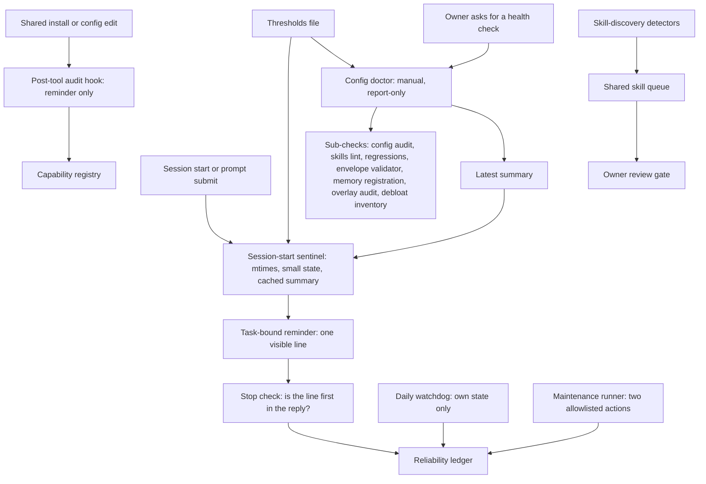

# System health and governance

This document describes how a two-agent workbench (Claude Code and Codex on one Windows machine, sharing one memory and one owner) keeps itself consistent without heavy background work. It covers the capability registry of shared installs, a report-only config doctor, a cheap session-start sentinel that reads one central thresholds file, task-bound reminders with a reliability ledger, a maintenance runner limited to a tiny allowlist, human-gated skill discovery, the external-service envelope validator, memory health and staleness checks, debloat reviews and report retention.

It publishes structure, philosophy and method. The owner's real registry, state files, queues, reports and scripts are not included. All examples are synthetic. Numbers called "defaults" are the values the reference installation uses; most can be configured, and a few are pinned on purpose (see [Defaults](#defaults)).

Templates: [templates/capability-entry.md](templates/capability-entry.md) and [templates/thresholds.example.json](templates/thresholds.example.json).

Neighbouring topics live elsewhere:

| Topic | Where |
|---|---|
| How the parts fit; how the two agents split and review work; project status | [System overview](SYSTEM_OVERVIEW.md), [Agent collaboration](AGENT_COLLABORATION.md) and [Project authority notes](PROJECT_AUTHORITY_NOTES.md) |
| Which procedure runs when, the sentinel table, hooks that hint, the publication gate, rate-limit envelope rules | [Routing and gates](ROUTING_AND_GATES.md) |
| Memory write, update and forget contracts; the periodic smoke check | [Memory governance](MEMORY_GOVERNANCE.md) |
| Pending rules of the research knowledge vault | [Research knowledge vault](RESEARCH_KNOWLEDGE_VAULT.md) |
| Host `/health` fields, queues, backups and generic periodic checks | [Maintenance](MAINTENANCE.md) |
| Memory-graph release and consumers; screen observations and daily digests | [Memory graph](MEMORY_GRAPH.md) and [Screen context](SCREEN_CONTEXT.md) |
| How changes are measured, adopted and retired; the store-compaction due check | [Five dimensions](FIVE_DIMENSIONS.md), [Evaluation](EVALUATION.md) and [Five-dimension programme](FIVE_DIMENSION_PROGRAMME.md) |

## Purpose

A workbench shared by two agents drifts quietly. A tool is installed for one agent and not the other. A vendor refresh overwrites a local rule inside a skill. Instruction files grow a little every week. Pending queues for graphs fill up, backup files pile up, report folders accumulate, and candidate skills wait for a review that nobody schedules. None of this breaks anything on the day it starts. It surfaces weeks later as an agent that cannot find a tool, a reminder that no one saw, or a session that starts slowly.

The design keeps heavy work off timers and keeps session start nearly silent:

- heavy inspection runs only in a session where a person is present and asks for it;
- session start does little: it reads timestamps, small state files and cached summaries, runs two bounded scans, and shows one line when accumulated work has crossed a threshold;
- a reminder counts only when it is visibly in front of the owner, and the system measures whether that happens;
- automatic maintenance is limited to an explicit allowlist of two actions; everything else becomes an item for review.

## Principles

1. **Report first.** The doctor, the inventories, the validators and the audits never fix anything. A fix is a separate small patch that the owner approves, followed by a rerun of only the check it addresses.
2. **Heavy work needs an attended session.** Full audits, regression suites and inventories run when a person invokes them, not on a timer.
3. **Startup stays cheap and fail-silent.** Session-start hooks read modification times and small state files, run two bounded scans (memory-note times for skill discovery and memory-card hashes for the memory graph) and reuse cached results for everything heavier. They never fall back to an expensive scan. A missing or stale cache is itself the reminder: run the doctor.
4. **One thresholds file for due signals.** Every domain threshold that decides whether maintenance is due lives in one file, and a loader holds built-in defaults that mirror it. Operational limits (timeouts, cache staleness, contract grace periods, runner budgets) live with their component and are listed in [Defaults](#defaults). Skills and contracts never copy a domain threshold.
5. **Due means measured.** Work becomes due when a measured signal crosses a threshold, and stale evidence counts as such a signal: an old doctor report, a stale miner queue while events still arrive, or an elapsed review interval with changed notes. Graph age alone is reported but never makes a graph rebuild due.
6. **Probes decide "due"; the ledger decides "delivered".** Domain probes stay authoritative for whether something needs attention. A separate ledger records only whether each probe ran and whether its signal reached the owner.
7. **Hidden context is not delivery.** Text injected into an agent's context proves nothing about what the owner saw. A reminder is delivered only when its line is the first line of the visible reply, or when the owner acknowledges it.
8. **An error is never "fine".** A probe that fails is shown as attention, with its own state. It is never treated as healthy or as "not due".
9. **"Not due" is not "current".** Being below a threshold, or reported as fresh, means maintenance is not due. It does not prove that the contents are complete. When an answer depends on content, check the sources.
10. **One reminder line at a time.** Each session start, and each 24-hour refresh in a long task, yields at most one merged line, because one short line is more likely to be read than a stack of reminders. The same registered source in the same state (one generation, see section 3) is not repeated for 24 hours after verified visibility. Static configuration flags and the to-try list count (the owner's plain-text list of tools to evaluate) are not registered sources: they reappear at every session start until fixed.
11. **Automate only an allowlist.** Policy validation rejects any attempt to widen it.
12. **Separate receipts, never fabricated ones.** Reading, maintaining or verifying, and notifying are recorded separately. No component fabricates a visibility receipt or changes a threshold to make a check pass. The text-matching and clear-all clean-up helpers are never called merely to make a visible symptom go away, because that hides real issues; the session-start sentinel calls them only when a fresh measurement shows that the cause is gone.
13. **A human gate for every skill change.** Detectors only propose. Entering validation and promotion each need the owner's explicit approval, and passing evidence never replaces that permission.
14. **Zero quality loss when slimming.** Externalise or merge, never drop silently. Back up each part, check every consumer before cutting, and have the peer agent review the result.
15. **Trash before delete.** Permanent deletion is opt-in. No budget is ever met by deleting user data.
16. **Register in the same turn.** A shared install is recorded when it happens, with a runnable, secret-free verify command.
17. **No fake green.** A check claims only what it executed, and expected values come from an independent source, not from the code under test.

## Structure



| Component | Runs | May write | Role |
|---|---|---|---|
| Capability registry | Edited by an agent in the same turn as an install | The registry file | Lists shared installs with paths and verify commands. |
| Post-tool audit hook | After shell commands and configuration edits | Nothing | Injects the install self-check or a config-audit reminder. |
| Config doctor | On request, in a live session | Its own run folders and latest summary | Consolidates existing checks into one report with an Attention list. |
| Session-start sentinel | At session start; bounded refresh on prompt submit | Delivery state, the reliability ledger, and the runner inbox during a runner takeover (section 7) | Emits at most one merged reminder line. |
| Thresholds file and loader | Read by the sentinel, the doctor, the debloat inventory and the maintenance runner's check; the ledger reads only the review-conversation section | Nothing | Holds the domain thresholds that decide whether work is due. |
| Reminder delivery | Session start, prompt submit, stop | Delivery state; at stop, visibility receipts in the reliability ledger; during a takeover, the runner inbox | Binds a reminder to one task and checks that it became visible. |
| Reliability ledger | With each probe and delivery | Ledger state | Records whether each signal was evaluated and seen. |
| Watchdog | Daily operating-system scheduled task | Its own state file only | Checks the sentinel's heartbeat. |
| Maintenance runner | Explicit invocation; optional periodic poll after activation | Its own state, inbox, receipts and backups; through the two allowlisted actions, the watchdog state, the reliability ledger and the delivery state | Runs two allowlisted actions and routes everything else to review. |
| Skill-discovery queue | Detectors on demand; review by the owner | The queue, under a lock | Holds proposed skills and their evidence. |
| Envelope validator | As a doctor sub-check | Nothing | Validates rate-limit envelopes. |
| Memory health checks | On request: in the doctor and as manual smoke checks | Nothing | Host registration, live tool list, index structure. |
| Debloat inventory and procedure | Inventory inside the doctor; procedure on request | Backups, then owner-approved edits | Measures load and slims without quality loss. |
| Report retention | Weekly operating-system scheduled task | Moves run folders to retained areas or trash | Bounds the number of run folders at the report root; staged trash stays until an owner-run purge with an explicit flag. |
| Overlay survival registry | Full audit in the doctor; stat receipts at startup | Receipts | Detects vendor refreshes that removed local rule edits (overlays) from managed skills. |

## Method

### 1. Register every shared install

One YAML file at the root of the shared tools directory lists every capability both agents rely on, under a top-level `capabilities:` list. Each entry carries six fields: `id` (a unique slug), `type`, `installed` (`YYYY-MM-DD`), `paths`, `verify` and `notes`. The documented schema has only these six fields; a few entries also carry `status` (absent means active; otherwise for example `paused_<date>`, `default_disabled` or `superseded_by_<id>_<date>`) and `updated`, which the template adopts as optional lifecycle fields. The entry format, the rules for verify commands and synthetic examples are in [templates/capability-entry.md](templates/capability-entry.md).

Two terms keep entries honest:

- A **verification command** is one runnable shell command that exits 0 or prints a stable token, never prose, and never prints secrets. For a CLI it is a path lookup or a call that prints a version; for a skill, a path test through the shared skills link, the single directory link that gives both agents one global skills folder (there are no per-skill links).
- An **upstream mirror** (a read-only clone kept for provenance) is not an install and is not kept in sync.

**When an entry is written.** In the same turn as the install. The post-tool audit hook ([Routing and gates](ROUTING_AND_GATES.md#5-mechanical-hooks-hints-and-narrow-guards)) recognises install-shaped shell commands and injects the four-step cross-tool self-check in [templates/capability-entry.md](templates/capability-entry.md#cross-tool-install-self-check); a step may be skipped only with a written reason. Edits to skill files, agent instruction files, settings and hook registrations, MCP and agent configuration, the registry, the thresholds file and hook scripts get a separate reminder to run the read-only configuration security audit at the next natural stop. The hook never writes the registry.

**Placement rules.** CLIs reach both agents through `PATH`. Global skills are one physical folder. Project-level skills need one link per project. MCP registrations do not sync at all. Shared Node CLIs go into one shared local npm project inside the tools directory: the reference installation met sandbox restrictions on the per-user global package folder, so choose a location both agents can read and verify the current permissions in each agent session. Python tool installers also install into a location next to the shared tools directory that both agents can read, and the package-manager prefix is never changed. For capabilities both agents use, a CLI with skill metadata is preferred over an MCP server.

**Honest current state.** In the reference installation the registry is kept by hand after the hook fires: no schema validator exists, the doctor does not parse it, and the install script that was meant to maintain it was never built. It has drifted: the documented four-value `type` vocabulary grew into many composite values, and `notes` turned into multi-paragraph change logs, so the file became large and slow to scan. Some `verify` items are prose result statements or non-string values rather than runnable commands, and a few entries carry ad-hoc extra keys. If you adopt the pattern, add a small validator for the six required fields, the type vocabulary, the date format, unknown keys, and `verify` items that are non-empty command strings rather than statements of a past result; and keep change history out of `notes`.

### 2. Run a report-only config doctor in a live session

The config doctor is a manual entry point that consolidates existing auditors instead of scheduling new ones. It runs when a person invokes it, and it never fixes anything.

**What it checks.**

| Area | Checks |
|---|---|
| Agent configuration | Whether each agent's configuration directory is under version control; tracked files that look sensitive or runtime-only; MCP configuration that fails to parse; secret-like environment values in MCP or agent configuration (key names reported, never values); secret-like configuration backups. |
| Memory host registration | A token-free verifier that fails closed. Core: the secret exists, both clients are registered, both endpoints are valid and identical. Security: the configured and the running listener are both loopback-only, the tool surface is memory-only, and there is no open cross-origin access or proxy trust. |
| Remote services | Registration of a remote analysis service on both agents, as booleans. The check starts the local bridge server only to list its tools (10-second limit), never calls the remote API and never returns secret values. It flags when it is unproven that the user environment variable the service needs survives a restart. |
| Agent runtime size | Codex's log database, its write-ahead file and plugin backup folders. |
| Skills | The two agents' skills roots resolve to the same directory; a skills manifest, a skills audit and a strict front-matter lint. |
| Accumulation | Memory-graph pending (through the full resolver, not the startup probe), skill discovery, vault graph, the owner's to-try and watch lists (plain-text lists of tools to evaluate and items to follow), backup-file count (counting stops at 2,000), skill-queue counts by status, the runbook-miner queue. |
| Environment | UTF-8 settings for subprocesses. |
| Reminder system | Freshness of the session-start sentinel and a reliability-ledger snapshot. |
| Hook trust | Codex runs a user hook only while it is trusted, so the doctor reads hook trust through the agent's official interface. After any hook is added, removed, changed or reordered, the official sequence (list, batch write, list again) re-establishes trust. |
| Routing freshness | The pre-scan hook file exists and the agent settings text mentions it (a substring match, not a parse of the hook registration); the instruction file still contains the sentinel section title; every procedure on the doctor's hand-kept P0 list (the routing table's highest-priority routes) still has a `SKILL.md`. The list is not compared with the table, so it must change in the same pass as the table; in the reference installation it has fallen behind the table. P1 rows are reviewed by hand. Details in [Routing and gates](ROUTING_AND_GATES.md#6-keep-the-table-fresh). |
| Configuration | Which thresholds were loaded and from where (`threshold_source`, see [section 4](#4-keep-due-thresholds-in-one-thresholds-file)). |
| Load | The debloat inventory ([section 11](#11-slim-the-workbench-with-debloat-reviews)). |
| Local overlays | The overlay survival audit ([section 12](#12-retain-reports-and-protect-local-overlays)). |

**Sub-checks.** Each runs as a subprocess with its own timeout ([Defaults](#defaults)): the configuration security audit per agent (skippable by a flag); the skills manifest, skills audit and front-matter lint; a set of regression suites; the external-service envelope validator; a guardrail self-test; a hook smoke test; and a static scan. The static scan covers a fixed set of active entry points (the two instruction files, the hook configuration files and the scripts they name, a fixed list of active bridge, checkpoint and service-launcher scripts, and the doctor's own modules and regression tests), not the whole tree.

**Output.** A timestamped run folder with a JSON and a Markdown report, plus a "latest summary" JSON and Markdown pair that the session-start sentinel reads as its cache. Overall status is `complete` or `complete_with_attention`. A nonzero exit from a sub-check is evidence for the report, not an automatic failure of the run. Sub-checks that succeed in the current run refresh their own report age, so a stale timestamp left by an earlier run cannot cause a false reminder.

**Attention.** The run lists an item under Attention when, for example:

- Codex's log database, its write-ahead file or plugin backups reach their size limits ([Defaults](#defaults));
- a sub-report is older than the staleness limit, or a sub-check timed out or exited nonzero;
- a guardrail finding of one of the two highest severities exists, or an active entry point could not be scanned (an unscanned target is not a pass);
- memory registration, envelope validation or hook trust is anything other than pass;
- a local overlay is missing, ambiguous or changed;
- the pre-scan hook, the sentinel section or a P0 procedure is missing.

**Closeout.** The Attention list is the result; fixes follow principles 1 and 12.

### 3. Keep the session-start sentinel cheap

The sentinel is a session-start hook with a strict contract: no audits, no web, no MCP and no git subprocess, and every read is bounded. Besides modification times and small state files, it reads the live sizes of the two instruction files, MCP and agent configuration (only to flag secret-like values) and queue files up to 2 MB; its two scans and its one child process are listed with the probes below. It emits one line when accumulated work crosses a threshold. The registered timeout is 3 seconds on the Claude Code side and 5 seconds through a Node wrapper on the Codex side. Any error, or a run past the timeout, ends it silently.

**Probes.**

- Doctor cache: missing or invalid, or the latest summary or the configuration-security, guardrail and skill-quality reports older than the staleness limit.
- Overlay receipts: path, size and modification time only.
- Memory-graph pending: the active pointer, the release manifest (up to 2 MiB) and the pending log (up to 4 MiB), plus a hash of every memory card in the configured roots, compared with the release corpus and capped by file count and file size but not by time. It never claims a full release validation; that stays in the doctor.
- Skill discovery: an open review batch, memory notes changed since the last review (by modification time) and new validated screen digests, all within one 1.2-second budget.
- Research knowledge vault briefing, at session start only: one child process that checks the freshness of the vault's briefing pages, runs alongside the other probes and is killed after 1.5 seconds.
- Skill crystallization and the skill queue (both defined in section 8), the to-try list, the owner review conversation (an optional periodic session in which an agent goes through a prepared batch of review material, built from local evidence, with the owner one item at a time), the vault graph (no source verification inside the hook budget), debloat and the watchdog.

**Static flags.** A secret-like environment value hard-coded in MCP or agent configuration; the two skills roots differ; an agent configuration directory is not under version control; Codex's log database exceeds 1,024 MB; a plugin-backup folder exists; a backup backlog at the debloat backup threshold, taken only from a fresh doctor cache. That backlog counts backup-named files across both agents' configuration roots and the shared tools directory, a different measure from the debloat inventory's count of files in the two backup folders (section 11), although both are compared with the same threshold.

**Debloat in the hook.** The sentinel reads the doctor's cached debloat result and refreshes only the two live instruction-file sizes, because the full inventory walks caches and event feeds and can exceed a hook's time budget.

**Output.** One merged line made of a fixed prefix, the due components joined by semicolons, and a closing hint to run the doctor in the current task, with at most eight deduplicated components, plus a marker that tells the agent to show the line verbatim at the top of its reply. The vault-briefing probe can add one separate freshness note to the injected context; it is not part of the merged line and is not a registered source. Each item bound to a registered source has a generation key: a truncated hash over the source id and the parts that identify its current state. The key drives repeat suppression. The same generation stays quiet for 24 hours after verified visibility, and a new generation, for example a new fault after a recovery, is shown again.

**Long tasks.** A task that runs for days never sees a new session start. A prompt-submit hook therefore refreshes due items at most once every 24 hours, guarded by a two-minute claim lease so that two prompts cannot refresh at the same time. The 24-hour interval is shared by all tasks: a refresh in any task resets it. A refresh that fails or times out (1.5 seconds) releases the lease without recording a refresh, so the next prompt can retry.

### 4. Keep due thresholds in one thresholds file

One JSON file holds the domain thresholds that the sentinel, the doctor, the debloat inventory and the maintenance runner's check use to decide whether work is due; the reliability ledger reads only its review-conversation section. Its schema id is `sentinel-thresholds/v0.2`, and it has sections for debloat, skill crystallization, skill discovery, the skill queue, the memory graph, the owner review conversation and the research knowledge vault graph. [templates/thresholds.example.json](templates/thresholds.example.json) shows the whole file with the default values of the reference installation under generic key names. The loader reads only the keys it knows. Every other key, including the underscore-prefixed documentation keys and any misspelled key, is ignored; a misspelled key shows up only as a missing key filled from defaults (`threshold_source` `file+defaults`).

A small loader holds built-in defaults that mirror the file and reports where the values came from:

| Situation | Loader behaviour | `threshold_source` |
|---|---|---|
| File present and complete | Uses the file. | `file` |
| Some keys missing | Fills the gaps from defaults and lists the missing key names. | `file+defaults` |
| File missing | Uses the defaults. | `defaults` |
| Parse error | Uses the defaults and records the error. | `defaults` |

Built-in defaults keep reminders working when the file is missing or broken; reporting the source keeps that fallback visible.

Skill instructions never repeat the numbers, and reminder contracts never repeat domain thresholds; the code that needs them reads this file. When a value changes, it changes in one place. The doctor prints the threshold source in its report body (missing keys and parse errors are in the JSON report). It does not raise a fallback as an Attention item, and the session-start sentinel does not report it. If you adopt the pattern, raise any source other than `file` as attention. Change a threshold because the workload changed, never to make a check pass.

### 5. Deliver each reminder to the task that owns it

A reminder that sits only in injected context may never reach the owner. Delivery therefore uses three hook points that share one task identity:

1. **Session start.** The sentinel registers a pending reminder under the task identity: the first present of `session_id`, `thread_id`, `conversation_id` or `transcript_path`, stored together with the field name. The clients' hook input supplies `session_id` on session start, prompt submit and stop. Because the key includes the field name, a reminder registered under one field is never consumed by a call that presents a different one, so one task cannot consume another task's reminder. A call without any identity registers nothing and records no ledger run.
2. **Prompt submit.** The pending reminder is injected again until it is delivered.
3. **Stop.** The hook checks once whether the first line of the agent's final reply, after leading whitespace, is exactly the reminder line. If it does not, the stop is blocked once so that the agent can add it, and never again. If it does, a `USER_VISIBLE` receipt with evidence kind `assistant_final_audit` is recorded for every source generation that the line carried.

A pending entry expires after 24 hours. Both agents call one shared Python implementation through thin wrappers with hook timeouts of 2 to 3 seconds. The delivery state and the reliability ledger are each written atomically, but there is no transaction across the two files. If the ledger write fails after visibility was proven, the receipt closes with a bounded `reliability_error`, the source stays `EMITTED_UNVERIFIED`, and the next session shows it again. A duplicate reminder is preferred over a silent loss.

### 6. Measure delivery: reliability ledger, shadow mode and watchdog

The reliability ledger is a local meta-health record. Domain probes stay authoritative for whether something is due; the ledger records only whether each registered probe was evaluated and how far its due signal travelled towards the owner.

**Contracts.** One contract file (schema `reminder-reliability-contracts/v2`) defines the mode, the shadow window, a notification policy, a watchdog policy and one contract per source. Exact key sets are enforced, so a misspelled key fails validation instead of being ignored. A synthetic contract in the exact validated shape follows. The validator rejects any missing or extra key at every level, requires `mode` to be `shadow` or `live`, a shadow end after its start (UTC with a `Z` suffix), unique source ids made of letters, digits and underscores, positive grace hours, `max_visible_summaries` equal to 1, and `automatic_actions` and `external_network` both false.

```json
{
  "schema_version": "reminder-reliability-contracts/v2",
  "mode": "shadow",
  "shadow_started_at_utc": "2026-01-05T00:00:00Z",
  "shadow_ends_at_utc": "2026-01-12T00:00:00Z",
  "notification_policy": {
    "repeat_hours": 24,
    "max_visible_summaries": 1,
    "automatic_actions": false,
    "external_network": false
  },
  "watchdog_policy": {
    "run_interval_hours": 24,
    "stale_hours": 36
  },
  "contracts": [
    {
      "id": "example_graph_pending",
      "enabled": true,
      "owner": "example-maintainer",
      "severity": "maintenance",
      "probe_grace_hours": 36,
      "delivery_grace_hours": 24,
      "notes": "Synthetic source. The domain probe decides whether it is due."
    }
  ]
}
```

`severity` is a free non-empty label, for example `attention` or `maintenance`. Typical sources are the doctor cache, the managed-skill overlay, the memory graph, skill discovery, the owner review conversation, skill crystallization, the vault graph, debloat and the watchdog itself.

**States.**

| State | Meaning |
|---|---|
| `NEVER_EVALUATED` | Registered but never evaluated yet. |
| `HEALTHY` | The probe ran and nothing is due. |
| `PROBE_FAILED` | The probe ran and failed. Shown as attention, never as healthy. |
| `NOT_EVALUATED` | The probe did not run. |
| `DUE_NOT_EMITTED` | Due, but no reminder was emitted. |
| `EMITTED_UNVERIFIED` | A reminder was emitted, but its visibility is not proven. |
| `USER_VISIBLE` | The visible line was confirmed. |
| `PAUSED` | Deliberately paused, always with a finite expiry time in UTC. |
| `WAITING_FOR_USER` / `REMINDER_COOLDOWN` | Owner review conversation suppressed: already shown for this batch, or inside its reminder interval. |
| `PROBE_STALE` | Derived by the audit: no evaluation within the probe grace period. |
| `DELIVERY_UNVERIFIED_OVERDUE` | Derived by the audit: emitted but not confirmed within the delivery grace period. |
| `UNREGISTERED_STATE` | Derived by the audit: an enabled contract has no state record. |

Two kinds of evidence close a delivery: `assistant_final_audit` (the stop check found the line) and `manual_ack` (the owner acknowledged it). Injected hook context is explicitly not evidence.

**Shadow mode.** A new ledger first runs in shadow mode: it records, but sends no notifications and takes no maintenance actions. In the reference installation the seven-day shadow window exposed real misses (see [Failure modes and lessons](#failure-modes-and-lessons)). Promotion to live mode followed deterministic regression tests for contract and source coverage, isolation of task identity, exact visible-line receipts, atomic visibility for a batch of sources, concurrent state writes, retry after a failed refresh, a stable overdue age and the exclusion of failing probes, and then one real run in a fresh task from session start to stop, with hook trust in force rather than bypassed.

**Watchdog.** A daily operating-system scheduled task, separate from the hooks, writes only its own state file and checks that the sentinel's heartbeat is at most 36 hours old. Watchdog faults carry their own fault generation. A recovered watchdog component is closed only against fresh PASS evidence that matches its contract, with a `SUPERSEDED` marker; it never receives a fabricated `USER_VISIBLE` receipt. If the ledger module cannot be imported, the sentinel still emits the domain reminders but records no ledger run and shows no reliability item. In the reference installation the watchdog task and the doctor load the same module, so they fail too, and the fault surfaces only when someone runs the doctor. If you adopt the pattern, keep the watchdog independent of the ledger module, or surface an import failure as a static flag.

### 7. Automate only an allowlist: the maintenance runner

The maintenance runner is a local maintenance inbox plus a safe runner that acts only after an explicit acknowledgement. It starts no subprocess, uses no network, and never changes a database, a profile, hook trust or a scheduler. Its policy file has an exact key set (a schema id, the allowlist, three integer timings and a network flag that must be false):

```json
{
  "schema": "assistant-maintenance-policy/v1",
  "allowed_actions": ["watchdog_refresh", "watchdog_reconcile"],
  "snapshot_max_age_hours": 6,
  "consumer_lease_hours": 12,
  "expected_poll_hours": 6,
  "external_network": false
}
```

`allowed_actions` must equal exactly those two actions; anything else fails validation with an "action expansion is unsupported" error. Every integer must lie between 1 and 24, and the lease must be at least as long as the poll interval. `watchdog_refresh` writes a watchdog receipt from the real sentinel heartbeat; `watchdog_reconcile` closes recovered watchdog components against fresh PASS evidence. Both actions touch only the reminder system's own watchdog, ledger and delivery state, so a faulty run stays inside the reminder system.

**The loop.**

1. `check` runs lightweight read-only probes and writes a snapshot that marks every cached metric with its age. With `--dry-run` it writes nothing.
2. The agent reads the full snapshot JSON itself.
3. `ack-read` records the snapshot id and the SHA-256 of the summary that was read.
4. `maintain` runs as a dry run first, then runs both allowlisted actions as one operation (refresh the watchdog receipt, then reconcile recovered watchdog components) under a stable idempotency key.
5. The probe runs again and must report PASS.
6. `status` shows the result.

Three receipts are kept apart: `ASSISTANT_READ`, a maintenance result of `VERIFIED` or `FAILED`, and `USER_NOTIFICATION`. A shell exit code of 0, a created schedule, or a script that parsed the JSON by itself does not count as "the agent read it"; the read receipt is bound to the hash of what was read.

**Everything else is review.** Skill-discovery review, skill crystallization, graph updates, configuration review, clean-up and database work are never run by the runner. They go to `assistant_review` with the outcome `investigated`, `deferred` or `decision_required`. Among review outcomes only `decision_required` becomes a notification to the owner; a failed maintenance action also requires one. Recording a review never closes the source.

**Takeover, activation and fallback.** Takeover means that a periodic consumer runs the loop above against the maintenance inbox (every 6 hours by policy, holding a 12-hour lease), so the startup hooks route maintenance items to the inbox instead of the visible reminder line. Taking over needs a `VERIFIED` operation by the same consumer, the identifier of a periodic schedule (the code checks only that an identifier is given) and an end-to-end receipt. After activation, the hooks write maintenance components into the durable inbox and silence the visible reminder only when that write succeeded. The system falls back to the original visible reminders immediately, or at the next hook, on corrupt state or policy, a full inbox, a lock failure, an interruption, a failed action or an expired lease, and fault detection stays on during fallback. Before each action the runner backs up the three reminder state files (existence and SHA-256), and those backups are never deleted automatically. A failed action is not retried just because a new periodic snapshot arrived, and an interrupted action is not replayed.

**Budgets.** The runner keeps only its latest 32 snapshots and 256 read receipts, dropping older ones of its own. It caps idempotency records at 4,096, inbox items at 256 and each JSON file at 8 MB; reaching a cap means fallback plus review, never deletion of user data.

An explicitly selected, degraded "scoped collection" mode evaluates only the runner's own watchdog source. It marks every other source as not executed, unknown and due, and reports coverage as degraded, so that a narrow run can never look like a full one.

Whether a takeover is active at a given moment depends on its lease. If the periodic loop stops, the 12-hour lease expires and the visible reminders return automatically. Treat the lease state, not a document, as current. In the reference installation a takeover was activated, but the periodic loop has at times gone longer than the lease between polls, so the visible reminders came back until the next verified run; an uninterrupted takeover has not been shown.

### 8. Turn repeated work into skills, with a human gate

One skill-discovery system serves both agents. [Routing and gates](ROUTING_AND_GATES.md#7-turn-repeated-work-into-skills-with-a-human-gate) places it in the routing picture; this section describes its governance.

**Detectors** are input adapters. In the reference installation they are: a runbook miner over session events; a pattern surfacer over semantic memory notes, an optional export of the memory database and, where the screen layer is separately authorised to produce them, validated daily digests of screen activity; a weekly outward discovery job (paused in the reference installation at the time of writing); an execution-gap detector; and a post-run skill-optimiser detector. Each normalises its candidates into one schema in one shared queue. The queue is the governance record. A candidate's `source` field records provenance only. Three sections of the thresholds file watch this pipeline: *skill crystallization* covers the runbook miner's backlog (failures, size and a stale miner queue), the *skill queue* counts shared candidates by status, and *skill discovery* covers the pattern surfacer's review interval and new screen digests. The sentinel reports the first two together as one source.

**Review batches.** The pattern surfacer advances its watermark and opens a `review_pending` batch in the same atomic commit as its report. Producing the report never closes the review. Only a separately written semantic review, bound to the report by hash, closes the batch. That review classifies every pattern as an extension of an existing skill, a new-skill candidate or no action, and the counts must add up. A missing, stale, mismatched or already completed batch fails closed. Indexes, mirrored copies and the frequency of activity titles count as navigation evidence, not as independent repeated failures, because they re-count the same underlying events. Reminders read only a fixed-schema receipt of the screen digests (dates and hashes, no captured content). Skill discovery never reads raw OCR text, frames, audio or the capture database, and never starts capture, a query or a model refresh; the digest lane needs its own grant ([Screen context](SCREEN_CONTEXT.md#separately-authorized-daily-digests)).

**Queue states.**

```text
proposed | needs_human_review
  -> approved_for_validation   (only through an explicit human "review --approve")
  -> validating
  -> validated
  -> promoted                  (only with the owner's explicit approval)
```

`rejected`, `parked` and `promoted` are terminal. Sandbox-only (experimental) validation profiles end in `parked` with the verdict `honest_null`, or in `rejected`, and can never be promoted. A skill that already exists can be recorded through a lightweight path that has its own owner gate. A material revision enters as a new candidate with a `supersedes` link. Approval freezes the proposal, the evidence and pinned hashes.

**Evidence.** A failure episode carries a ten-field evidence pack: what happened (`task_context`, `failure_predicate`, `evidence`, `outcome`), how to recover (`omitted_step_or_novice_trap`, `recovery_action`, `acceptance_signal`), provenance (`source_detector`, `source_agent`) and the `promotion_decision`. One episode is evidence, not a promotion. Validation must replay the original failure, pass a held-out neighbouring task and keep the standing safety invariants. Soft signals such as "it feels smoother", a finished tutorial or self-reported confidence never change a state.

**Promotion and self-optimisation.** Promotion needs explicit owner approval, a real artifact and strict skill front matter ([Instruction kernel](INSTRUCTION_KERNEL.md#skill-front-matter-compatibility)) with a single non-empty `name` that matches the target skill. Nothing in the pipeline creates a skill, starts the optimiser, edits production files or writes memories by itself. Optimising an existing skill is itself a candidate: it runs only after review and approval, and its output goes through the same validation.

**Safety of the queue.** Writes take an operating-system lock and use an exclusive temporary file, a flush to disk and an atomic replace, with checks for hard links and reparse points. Routers read only small derived files written by the queue tool (a summary with counts and ready flags). The session-start sentinel, the doctor and the runner read the queue file itself, but only candidate statuses; the sentinel treats a missing queue or one of 2 MB or more as a probe error. Detector reports are scoped per agent. A reviewer meant to judge without seeing the peer agent's report who opens it by accident must say so and rerun in an isolated path.

### 9. Validate external-service envelopes

The rules for rate-limit envelopes, and the shape of an envelope record, are in [Routing and gates](ROUTING_AND_GATES.md#9-respect-remote-limits-rate-limit-envelopes). The health side is a deterministic, dependency-free, report-only validator:

- It never writes the envelope registry or any provider state.
- It checks that every provider record has exactly the field set of that shape, with nothing missing or extra.
- It derives a conservative effective policy for callers.
- On failure it returns findings and a nonzero exit. It never fixes anything.

The doctor runs it as a sub-check and lists any result other than pass under Attention.

### 10. Check memory health, index-only files and staleness

**Host.** Three checks, each proving something different: the loopback `/health` endpoint (fields in [Maintenance](MAINTENANCE.md#health)); a token-free registration verifier that prints booleans and the endpoint shape only; and a live read-only smoke test of what the running server actually exposes, which must be exactly eight tools, `ping` plus seven memory tools. Never verify with a client listing command that prints the full endpoint, because it can echo an embedded credential.

**Index-only memory file.** The primary memory index is a list of pointers: each non-empty line is exactly one bullet pointing to one existing Markdown card. A description is allowed; a second file pointer is not. The structure check returns `valid`, `invalid`, `missing` or `read_error`, with counts of entries, unique targets and duplicates. Capacity is reported as `unbudgeted` instead of being inferred from a line count, because one pointer per line made the physical line count meaningless. Only a legacy index that packs several pointers into one row keeps a line limit (see [Defaults](#defaults)). The line format is in [templates/memory-index-line.md](templates/memory-index-line.md).

**Staleness.** The query projection filters stale and deleted records, but a direct read of a card file bypasses that filter, so check a card against the primary memory or an authoritative source before using it as a current fact, or label it historical or unverified. A single forget receipt does not prove complete erasure, and a result of `updated`, `forgotten` or `published` does not prove that companion cards or downstream views changed ([Memory governance](MEMORY_GOVERNANCE.md)).

**Active checkpoint.** Both agents read one shared active checkpoint; its hook-driven refresh (older than 24 hours, or older than an authority note it links to, always after a backup) is described in [Memory governance](MEMORY_GOVERNANCE.md#13-hooks-remind-they-do-not-decide).

**Graphs.** For the memory graph and the research knowledge vault graph, being below the pending threshold or reported as fresh only means that a rebuild is not due. It does not prove that every new memory is in the graph, so verify the relevant live sources after navigating a graph. When the memory graph is more than a week older than the newest memory, raw memory files are preferred over it for questions that depend on recent content. The graph's release, consumers and maintenance policy are in [Memory graph](MEMORY_GRAPH.md#maintenance-policy-and-one-numeric-source); vault pending rules are in [Research knowledge vault](RESEARCH_KNOWLEDGE_VAULT.md).

**Smoke checks.** The per-agent governance smoke check every tenth owner turn, and the host checks added when diagnosing or after a deployment, are defined in [Memory governance](MEMORY_GOVERNANCE.md#14-run-periodic-smoke-checks); no scheduled task runs them. The doctor adds the accumulation counts of section 2, and [Maintenance](MAINTENANCE.md#periodic-checks) lists the host's own periodic signals (projection backlog, queue health, retrieval health, storage).

### 11. Slim the workbench with debloat reviews

**Inventory (report-only).** Eight load metrics:

1. Claude Code's always-on instruction file, in characters.
2. Codex's always-on instruction file, in bytes.
3. The memory index: structure and size.
4. The main event feed: status distribution and the share of non-ok rows in a recent window. Rows deliberately diverted into an audited "skipped" side file do not count as noise.
5. The size of the agent temporary directory.
6. Files in the backup folders on both sides: count and total size.
7. The number of doctor run folders at the report root, and whether the retention task ran recently (within 8 days) and succeeded.
8. The retired-archive folder: size, age and how many active files still reference it.

**Procedure.** Four phases.

- **Phase 0, inventory.** Report only.
- **Phase 1, triage.** One row per item: item, gain, cost, risk, recipe and owner. A zero-quality-loss filter turns anything that could change rule semantics or lose a pointer or evidence into externalise-not-delete, or excludes it; the owner picks the rows to do.
- **Phase 2, surgery.** Some sections are never slimmed: any section the peer agent has not yet reviewed, the editing constitution, the submission rules and the body of the routing table. Each part gets its own full backup, self-audit and peer review, and the next part starts only after a pass. One of four recipes:
  - *A, configuration slimming.* Full backup first, a search for every consumer before any cut, one section at a time, text moved to an on-demand module or archive instead of being deleted, an anchor check after each part, a trigger-word check when the file registers skill triggers, and adversarial peer review before the next part. The seven-step version is in [Instruction kernel](INSTRUCTION_KERNEL.md#debloat-with-archived-originals).
  - *B, index compression.* Zero pointer loss, confirmed by a scripted integrity check.
  - *C, event-stream clean-up.* Filter at the writer while keeping an auditable "skipped" side file, and adapt every consumer. For a large SQLite file, use `VACUUM INTO` a copy, run `integrity_check`, swap in a short window and keep the old file for 7 days. Never vacuum the live primary: a failure midway could damage the only good copy, while a copy can be checked before the swap.
  - *D, memory consolidation.* Merge fragments of the same iterated item, keep decision chains linked rather than merged, and mark superseded entries instead of forgetting in bulk.
- **Phase 3, verify.** The sentinel's real-state run must be quiet unless a genuine backlog remains, and before and after numbers are reported.

**Special cases.** A feed dominated by hook errors is a health repair, not tidying. A large temporary folder is a reminder, not a licence to delete. Expiry of the retired archive never authorises deletion without the owner's gate.

**Cooldown and identity.** Every debloat reminder from the session-start sentinel waits 5 full days after a verified maintenance receipt; during that window it suppresses all debloat items, including index-structure errors and retention failures. The doctor's Attention list still shows them. The receipt is bound to the measured size and the SHA-256 of the evidence file, and missing or invalid evidence cannot start a cooldown. Urgency does not bypass it. Reminder identity is content-based: for Codex's instruction file it is a growth band of 5,000 bytes, not the modification time of a report, so rewriting a report does not create a new reminder.

### 12. Retain reports and protect local overlays

**Report retention.** A weekly operating-system scheduled task keeps the latest 5 doctor run folders at the report root. Runs in which any sub-check failed or timed out move to a retained-failures area for 30 days, and one baseline run per month is kept for 6 months. Everything else moves to a trash area. Trash older than 7 days is deleted permanently only when an explicit flag is passed, and the installed task does not pass it, so staged trash stays until the owner purges it. A plan-only mode shows what would move, writes are atomic, every path is checked for containment inside the report root, and a post-check confirms that at most 5 runs remain at the root. Only run folders are managed, and between passes the debloat inventory's run-folder count catches growth.

**Managed skill overlays.** Some skills are refreshed by their vendor, and a refresh can silently remove local rules added to them. A registry outside the managed tree records each local overlay: the upstream snapshot it was based on, the deployed overlay snapshot, anchors that must and must not be present, and an owner. The doctor runs the full audit. The session-start sentinel reads only cached stat receipts and nudges when a target changes or disappears. A missing, ambiguous or changed overlay needs a human rebase; no code path writes an old patch back automatically, because an old patch applied to a newer vendor version can silently reintroduce stale rules or break new ones.

## Defaults

These are the defaults of the reference installation. Most can be configured; some are pinned on purpose: the reliability contract must declare exactly one visible summary and no automatic actions or network access, and the runner policy allows exactly two actions and no network. Values whose "Lives in" cell says code or default are constants in that component. "Thresholds file" means the value appears in [templates/thresholds.example.json](templates/thresholds.example.json); other values live in the component named in the last column.

| Area | Setting | Default | Lives in |
|---|---|---|---|
| Debloat | Claude Code instruction file | more than 45,000 characters | Thresholds file |
| Debloat | Codex instruction file | 55,000 bytes for a notice, 60,000 marked urgent; identity in 5,000-byte growth bands | Thresholds file |
| Debloat | Cooldown after verified maintenance | 5 full days for startup reminders; urgency cannot bypass it; the doctor still lists due items | Thresholds file |
| Debloat | Legacy packed memory index | 132 lines, only for the retired format that packs several pointers into one row; index compression keeps at least 10 lines of headroom below the installation's own ceilings of 140 lines and about 25,000 characters | Thresholds file (132); debloat procedure (ceilings) |
| Debloat | Event feed | window of 120 recent rows; due when there are at least 20 rows and the non-ok share is above 0.60, or a failure streak reaches 5 | Thresholds file |
| Debloat | Agent temporary directory | more than 400 MB | Thresholds file |
| Debloat | Backups | 40 files or more than 80 MB | Thresholds file |
| Debloat | Doctor run folders | more than 30 at the report root (retention normally leaves 5) | Thresholds file |
| Debloat | Retired archive | 30 days; reminder only, deletion needs the owner | Thresholds file |
| Skill crystallization | Runbook-miner failures | 5, due at once | Thresholds file |
| Skill crystallization | Backlog | 20 items with the oldest pending at least 14 days | Thresholds file |
| Skill crystallization | Stale miner queue | older than 21 days while events still arrive: rerun the miner | Thresholds file |
| Skill queue | Approved for validation | 1 or more, highest priority | Thresholds file |
| Skill queue | Proposed plus needs-human-review | 5 or more | Thresholds file |
| Skill queue | Missing, unreadable or larger than 2 MB | probe error, shown as attention | Probe |
| Skill discovery | Review interval | 7 days after the last review, and at least one semantic note changed since its watermark | Thresholds file |
| Skill discovery | New validated screen digests | 7 new validated daily digests | Thresholds file |
| Skill discovery | Open review batch | due at once | Probe |
| Skill discovery | Probe limits | 1.2 s at startup, 3.0 s in the doctor; at most 64 roots, 20,000 files, a 256 KB source-runs file | Probe |
| Memory graph | Unconsumed pending entries | 300; also due when more memory cards differ from the active release than unconsumed entries can explain (a count comparison that cannot prove every change was logged) | Thresholds file (300); probe code (card comparison) |
| Memory graph | Graph age | 7 days, informational only | Thresholds file |
| Research knowledge vault graph | Effective pending events: non-comment entries minus those already absorbed into the active graph (the startup probe skips source verification and uses the raw count) | 100 | Thresholds file |
| Research knowledge vault graph | Graph age | 7 days, informational only | Thresholds file |
| Owner review conversation (optional) | Reminder interval | at most every 30 days after a visible reminder, once per prepared batch; relevance rechecked after 7 days | Thresholds file |
| Sentinel | Cache and sub-report staleness | 14 days | Sentinel command-line default; hard-coded in the doctor; a literal in the runner's check |
| Sentinel | To-try or watch list | 5 non-comment lines | Sentinel command-line default; hard-coded in the doctor; a literal in the runner's check |
| Sentinel | Components per reminder line | at most 8, deduplicated | Sentinel default |
| Sentinel | Hook timeout | 3 s (Claude Code), 5 s through a Node wrapper (Codex) | Hook registration |
| Reminders | Merged lines per emission | 1 | Sentinel code; the contract pins `max_visible_summaries` to 1, but no runtime code reads it |
| Reminders | Repeat suppression | 24 h per source generation after verified visibility | Reliability contract |
| Reminders | Pending delivery entry | expires after 24 h | Delivery code |
| Reminders | Prompt-submit refresh | at most every 24 h, with a 2-minute claim lease | Delivery code |
| Reminders | Stop block | at most once | Delivery code |
| Reminders | Delivery hook timeouts | 2 to 3 s | Hook registration |
| Reliability | Probe grace, delivery grace | 36 h, 24 h per source | Reliability contract |
| Reliability | Watchdog interval, heartbeat stale after | 24 h (the scheduled task's daily trigger; the contract value is only validated), 36 h | Scheduled task; reliability contract |
| Reliability | Shadow window | two UTC timestamps, 7 days apart in the reference installation | Reliability contract |
| Reliability | Automatic actions, external network | false, false | Reliability contract |
| Doctor | Codex log database, write-ahead file, plugin backups | 1,024 MB, 10 MB, 50 MB | Doctor default |
| Doctor | Sub-check timeouts | 90 s config audit per agent, 120 s sentinel regression, 45 s static scan, 30 s all others (including the guardrail self-test and the hook smoke test) | Doctor default |
| Doctor | Backup-file counting cap | 2,000 | Doctor default |
| Runner | Allowed actions | exactly `watchdog_refresh` and `watchdog_reconcile` | Runner policy |
| Runner | Snapshot age, poll interval, lease | 6 h, 6 h, 12 h (integers 1 to 24, lease at least the poll) | Runner policy |
| Runner | Budgets | keeps 32 snapshots and 256 read receipts (rotated); caps 4,096 idempotency records, 256 inbox items, 8 MB per JSON | Runner code |
| Retention | Doctor run folders | latest 5 at the root; failures 30 days; one monthly baseline for 6 months; trash 7 days, permanent deletion only with a flag the installed task does not pass | Retention task |
| Retention | Rotation task freshness | stale after 8 days; a stale or failed rotation is a debloat item | Retention state |
| Memory | Active checkpoint refresh | older than 24 h, or a linked authority note is newer | Prompt hook |
| Memory host | Store compaction due | any of three storage signals at 200 | Check script; see [Five-dimension programme](FIVE_DIMENSION_PROGRAMME.md) |

Routing thresholds (self-triggers, prior-art windows, rate-limit envelope values) are listed in [Routing and gates](ROUTING_AND_GATES.md#thresholds-and-triggers).

## Failure modes and lessons

- **Inline scans in a startup hook** could exceed its time budget; the hook now reads the doctor's cached result, and a missing or stale cache is only a nudge.
- **Injected context is not delivery.** Hence the verbatim first line, the task-bound receipt and the one-time stop block.
- **Edited hooks silently stopped running.** Codex skipped hooks whose registrations had been edited without re-establishing trust, before they started and without any error; this caused most of the missed reminders on that side. Trust is now re-established after every hook change, and the doctor reports it.
- **Shadow mode found real misses.** Multi-day tasks never saw a session start (now covered by the 24-hour refresh), and visible receipts stayed at zero because emitted generations were not recorded (now recorded at confirmation).
- **Count the right thing.** A skill-queue reminder once counted cache folders and README files instead of candidates by status.
- **Age is not pending.** An empty queue once made an old vault graph look healthy. Age was briefly a hard trigger and is now informational for both graphs; the memory graph adds its count comparison with live cards.
- **Whole-tree scans reported history as current.** Old one-off findings showed up as current hook failures; the static scan now covers a fixed set of active entry points, and an unscanned target is an attention item.
- **Stale report ages** from an earlier run caused false reminders; successful sub-checks now refresh their own ages.
- **Nagging after maintenance** ended with the five-day cooldown and content-based reminder identity.
- **A line count lost its meaning** once the index moved to one pointer per line; capacity is reported as unbudgeted instead of passing by default.
- **Listing commands can echo secrets**, so registration is verified with a boolean-only script and the live tool list.
- **Vendor refreshes removed local rules** more than once; hence the overlay registry, stat-only startup receipts and human rebase.
- **Clean-up helpers hide symptoms**, because they cannot cancel reminders per generation (principle 12).
- **"Exit code 0" is not "read".** A shell call, a created schedule or a script parsing its own JSON had been taken as a read; read receipts are now bound to the SHA-256 of what was read.
- **Report folders grow without limit** unless retention caps the run folders; staged trash still needs an owner-run purge.
- **Prose lags configuration.** Notes listed fewer reliability sources than the contract registered, and one still called graph age a trigger; treat the contract and thresholds files as authoritative.
- **Leftovers mislead.** An ignored pending-threshold argument is still accepted, and the to-try limit and the 14-day report age are still hard-coded in the doctor, the sentinel's command-line defaults and the runner's check; remove leftovers or mark them unused, and move such numbers into the thresholds file.
- **Hand mirrors lag.** The doctor's P0 list fell behind the routing table, so the check could pass while a P0 procedure went unchecked; derive the list from the table or diff the two.

## What is not included

This document publishes structure, philosophy and method. The following stay private:

- the capability registry and its entries, whose notes hold private project histories;
- the real thresholds file, reliability contracts, ledger and delivery state (the thresholds template carries the same default values under generic key names; the maintenance-runner policy in section 7 is shown as deployed, because it holds only generic action names, timings and a network flag);
- queue contents and counts, detector reports, review batches, doctor reports and run folders;
- the scripts themselves: doctor, sentinel, delivery, ledger, watchdog, runner, retention task, debloat inventory, validators and hooks;
- scheduled task names and exact trigger times, operation, receipt, snapshot and batch identifiers, and every hash from the private state;
- the exact wording of reminders and the exact text of the agent instruction files;
- names of remote services, of any external consumer of the maintenance inbox, and of private knowledge stores;
- every path on the owner's machine.

None of the health and governance scripts described in this document ship with this release; the repository's code is listed in the [README](../README.md). The methods are described in enough detail to reimplement them, starting from the two templates linked at the top.
