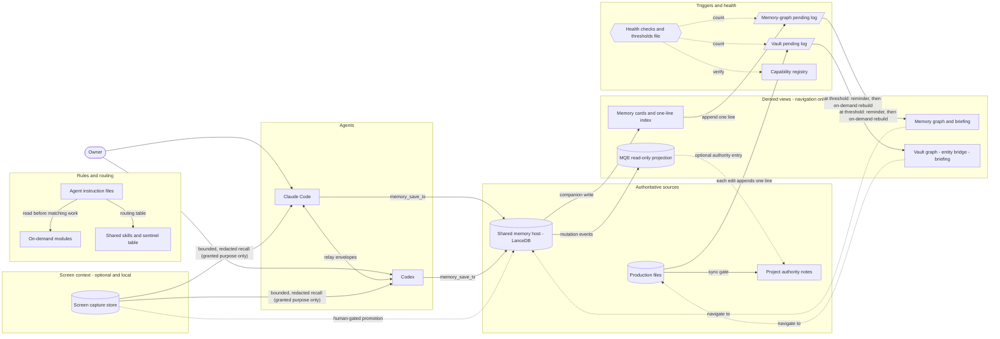

# System overview

This document describes the whole knowledge and memory system that this repository comes from: its layers, how information moves between them, which sources decide facts and which only help an agent find them, what triggers maintenance, and why the system is built this way. It describes structure and method only. No layer publishes data, in v0.1 or in v0.2.

The repository ships code for five of these layers. v0.1 published the memory host, the query engine (MQE) and the BTI card companion, documented in [Architecture](ARCHITECTURE.md). v0.2 adds a memory-graph release and briefing kernel ([graph-memory/](../graph-memory/README.md), method in [Memory graph](MEMORY_GRAPH.md)) and an offline validator for completed screen-context caches ([screen-context/](../screen-context/README.md), method in [Screen context](SCREEN_CONTEXT.md)); both are exercised only with synthetic data. The other layers are published as methods and templates. "The reference installation" below means the owner's live setup from which these methods were extracted; nothing from it is published.

Contents:

- [Purpose](#purpose)
- [Design philosophy](#design-philosophy)
- [The layers](#the-layers)
- [How the layers fit](#how-the-layers-fit)
- [Authoritative and derived sources](#authoritative-and-derived-sources)
- [Layer by layer](#layer-by-layer)
- [Data flows, step by step](#data-flows-step-by-step)
- [Triggers and thresholds](#triggers-and-thresholds)
- [Failure modes and lessons](#failure-modes-and-lessons)
- [How this repository is published](#how-this-repository-is-published)
- [What is not in the public repository](#what-is-not-in-the-public-repository)
- [Adopting the design](#adopting-the-design)
- [Related documents](#related-documents)

## Purpose

One owner works with two coding agents, Claude Code and Codex, on one Windows machine. Each agent starts a session without memory of the previous one, and neither agent sees the other's sessions. Without support, four things go wrong:

- an agent repeats work, forgets corrections and asks the owner again for decisions that were already made;
- the two agents drift apart: one learns a rule and the other never hears of it;
- summaries, indexes and READMEs drift away from the files they describe, and an agent trusts the stale copy;
- private material ends up where it should not: in the other agent's context, in a public repository or in a cloud service.

The system gives both agents one shared long-term memory, one set of authoritative project records, a small set of always-loaded rules, a shared library of procedures, and maintenance that is triggered by real change.

Every storage, index and graph layer keeps its data on the owner's machine. Some text still leaves it. The two agents are clients of hosted model services, so anything an agent reads into its context, including recalled memories, cards and screen excerpts, is sent with the prompt to that service. Graph extraction that uses a model sends the text it extracts in the same way. The optional text-network lens is a remote service that receives only the text explicitly selected for it. This is why recall returns bounded, redacted excerpts rather than whole stores.

## Design philosophy

Each principle below appears in several layers.

1. **Authority over snapshots.** Status, counts, deliverables and decisions come from authoritative records and production files. READMEs, memory cards, graphs, briefings and chat summaries are snapshots. When a snapshot disagrees with its authority, the authority wins and the snapshot is stale.
2. **Memory locates evidence; it is not current state.** A memory says where to look and what was decided at a given time. Before acting on a historical memory, an agent checks the current primary record or the authoritative source. A forget receipt does not prove that every copy is gone.
3. **Honest evidence.** A check proves only what it exercised. A checker that crashes or times out has said nothing about its target: report the run as failed, or narrow its scope and run it again. Expected values in a test come from somewhere other than the code under test. Unknown values stay `unknown`. Current physical or visual state needs fresh evidence recorded with the time it was observed. Before claiming that something does not exist, search every entry point and include a positive control.
4. **Fail-closed privacy.** A missing or malformed exclusion or configuration file stops a write. Search hits that cannot be mapped to a reference are withheld rather than guessed. Unsafe excerpts are replaced by redaction markers. A derived briefing whose binding is stale is refused. Raw screen data never leaves the machine and never enters a graph. Export works from an allowlist: better to omit than to leak.
5. **Human gates for irreversible actions.** Public pushes and releases, repository visibility changes, portal uploads and final submissions, deletions outside an owner-approved retention or cleanup policy, permission changes, creating or promoting a skill, and promoting screen evidence into memory all wait for the owner's approval of that specific action. A request for a quick answer never skips these gates. The safety rules only tighten; none of them grants, widens or bypasses a sandbox, tool or approval permission.
6. **Read-on-demand instructions.** Every always-loaded line costs context in every turn, so the always-loaded instruction layer keeps only stable preferences, hard boundaries and routing. Procedures live in skills or instruction modules, project facts in project notes, incident history in history records. A missing module is an evidence gap, not a withdrawn rule.
7. **Event-driven maintenance.** Changes append lines to pending logs; health checks count those lines and remind the agent when a threshold is crossed. Age alone is informational. No graph rebuild or heavy audit runs on a timer or inside a prompt hook: scheduled reports went unread, and a prompt hook runs on every turn. Scheduled jobs are few and owner-approved: small, deterministic maintenance tasks, plus one native agent reminder every 45 days that only asks for a review. The periodic model refresh of screen summaries is paused. Hooks are short, local and silent when nothing applies.
8. **"Not due" is not "covered".** A count below threshold, or a `FRESH` status, means only that no maintenance trigger fired. An agent that relies on a graph for a specific question still checks the relevant live sources and refreshes if a change matters.
9. **One copy of each shared asset.** Shared vaults, skills and registries are used in place through directory links or shared paths, never copied into each agent's home, because copies drift and the two agents then disagree. The memory graph and the research vault graph live in separate namespaces.
10. **Symmetric peers, explicit ownership.** Both agents execute work. Divisible work is split into slices with exclusive outputs, write locks and one merge owner. Disagreements are settled by evidence or escalated to the owner, never by mutual concession.
11. **Small changes, reuse first.** Change only what the task needs and keep interfaces small and stable. Reuse existing scripts and skills before building a parallel flow. Run a prior-art sweep (adopt, adapt or build) before building anything substantial.
12. **Idempotent retries, no blind replay.** Only idempotent reads and writes that carry a stable idempotency key are retried. The memory host's queues deliver at least once, so consumers tolerate repeats. A non-idempotent action, or one whose outcome is uncertain after a click or a send, is never replayed blindly.
13. **Observe before enforce.** A new retrieval filter first runs in observation mode against a pre-registered protocol, because a filter tuned offline can behave differently on real queries and drop evidence they need. Optional behaviour stays off by default until it is validated.
14. **Measure in five dimensions.** Every candidate change is described on build cost, retrieval cost, generation cost, refresh latency and query scale, with frozen inputs. No saving is bought by weakening a [hard gate](FIVE_DIMENSION_PROGRAMME.md#hard-gates): authority and provenance, answer quality and evidence, privacy and security, recoverability, and isolation between projects and windows.

## The layers

The table lists every layer, whether it is authoritative or derived, and what each release publishes. "Derived" means the layer only helps an agent find things; it never decides a fact.

| # | Layer | What it holds | Authoritative or derived | v0.1 publishes | v0.2 publishes |
|---|---|---|---|---|---|
| 1 | Agent instruction files and on-demand modules | Rules, preferences, routing tables | Authoritative for rules | Nothing | [Method](INSTRUCTION_KERNEL.md) and a [kernel template](templates/instruction-kernel.md); no private rule text |
| 2 | Shared memory host (LanceDB served over the Model Context Protocol, MCP) | Durable preferences, decisions, feedback and facts | Authoritative for durable memory | Code, tests, docs | Unchanged; referenced |
| 3 | Memory cards, one-line index and link registry (BTI) | Readable companions of memories; links between memories, cards and sources | Derived | Code, tests | Card and index method: [memory card](templates/memory-card.md), [index line](templates/memory-index-line.md) |
| 4 | Query engine and read-only projection (MQE) | Bounded evidence over one projection generation | Derived | Code, synthetic fixtures | Unchanged; referenced |
| 5 | Session hooks and the active checkpoint | Short reminders; a navigation checkpoint | Derived | Hook adapters as source only, not installed | What each hook may and may not do |
| 6 | Memory graph (built with Graphify, a third-party graph tool, over memory cards and a primary-store export) | Relationships across memories, topic evolution, long-running concerns | Derived | Nothing, apart from the BTI companion's optional pending-log line | [Method](MEMORY_GRAPH.md), a [release and briefing kernel](../graph-memory/README.md) with a synthetic notebook and a [policy example](templates/memory-graph-policy.example.json); usage rules in [Memory governance](MEMORY_GOVERNANCE.md); no graph data |
| 7 | Screen context (Screenpipe, optional) | What a successful capture showed at a given time | First-hand only for "what was on screen" | Nothing | [Method](SCREEN_CONTEXT.md), an [offline cache validator](../screen-context/README.md) with synthetic checks and a [policy example](templates/screen-context-policy.example.json) with every purpose disabled; no Screenpipe binaries or source, no captures |
| 8 | Research knowledge vault (Obsidian) and its graph | Live view of production work; curated graph; entity-to-path bridge | View is live; graph, bridge and briefing are derived | Nothing | [Methods](RESEARCH_KNOWLEDGE_VAULT.md) only, with synthetic examples |
| 9 | Project authority notes (Obsidian) and production files | Status, plan, deliverables, counts, decisions; the work itself | Authoritative | Nothing | [Method](PROJECT_AUTHORITY_NOTES.md) and note templates |
| 10 | Skills and routing | Shared skill catalog, sentinel table (which procedure a scenario calls for), skill-discovery queue | Authoritative for procedures | Nothing | [Method](ROUTING_AND_GATES.md) and a [sentinel table template](templates/sentinel-table.md) |
| 11 | Dual-agent collaboration | Relay, slice assignment, session rollover | Protocol | Nothing | [Generic protocol](AGENT_COLLABORATION.md) and templates |
| 12 | Capability registry and health checks | Inventory of shared installs, thresholds, health reports | Registry is authoritative for the inventory, not for availability | Generic periodic checks in [Maintenance](MAINTENANCE.md) | [Method](SYSTEM_HEALTH_AND_GOVERNANCE.md): registry schema, threshold file pattern, report-first health |
| 13 | Five-dimension method | How changes are measured and chosen | Method | [Five dimensions](FIVE_DIMENSIONS.md) and [Evaluation](EVALUATION.md) for the host and MQE | [Extended to every layer](FIVE_DIMENSION_PROGRAMME.md), with the method rules |

## How the layers fit

Solid arrows carry writes and data. Dotted arrows only point: a health check reads a log, a graph points back at its source, and a promotion from screen evidence happens only after the owner approves it. Nothing in the derived group writes back into the authoritative group.

## Authoritative and derived sources

| Question | Decided by | Helpers that only navigate |
|---|---|---|
| What is the status, plan, deliverable list, count or methodological decision of a project? | The project's progress note (in newer projects, stable rules and decisions sit in its paired decision note, the playbook), checked against production files | READMEs, memory cards, graphs, briefings, chat summaries |
| What does the work actually contain? | Production files | Vault graph, entity bridge, vault briefing |
| What did the owner prefer, decide or correct? | Primary records in the shared memory host | Memory cards and index, MQE projection, link registry, memory graph, active checkpoint |
| Which rules apply to an agent? | The kernel and the modules it routes to; where a kernel summary and its module differ, the module text; for the sentinel table, the one kernel that holds it in full | Kernel summaries, the peer agent's compact mirror |
| What is installed for both agents? | The capability registry for the inventory; each entry's verify check for current availability | Install notes, chat history |
| Which due thresholds (pending counts, debloat, skill discovery) apply? | One thresholds file | Copies of those numbers in skills, kernels or documents (informational only; the file wins if they differ) |
| How far has an unattended relay segment run? | One rollover state file, changed only through its script | Relay turn numbers |
| Which memory-graph release is active? | The pointer file plus the immutable sealed release, read only through the resolver | Older graph output folders, older briefings |
| What was on the screen at a given time? | A successful screen capture | Overview caches, summaries |

## Layer by layer

### 1. Agent instruction files and on-demand modules

Each agent has one global always-loaded instruction file, the kernel, which project-level instruction files and a per-project memory index may extend. The kernel holds stable preferences, hard rules, the language policy, the conversation-startup procedure and a routing table that names the module to read before each kind of work. Modules are live rules, read at the start of matching work and never imported at startup, which would undo the split; a missing module is an evidence gap, and its safeguards stay in force. Rules for both agents are mirrored, each shared table has one authoritative copy, and text moved out of a kernel stays checkable against its archived original.

The kernel also carries an always-on editing constitution: minimal diffs, honest evidence, authority and traceability, a privacy and publication gate, bounded autonomy (advice, then a confirmed preview, then a narrow, reversible action only with explicit authorization and a written envelope), a rate-limit envelope for shared external services, the rule that procedures serve their purpose (find the path that satisfies both the owner's instruction and the risk a rule guards against), and a split of decision ownership between the agents and the owner (see [Dual-agent collaboration](#11-dual-agent-collaboration)). A request for a short answer reduces checking but never skips a publication, submission or irreversible-action gate, and a reminder every 45 days asks for a review of both kernels without editing anything.

Details: [Instruction kernel](INSTRUCTION_KERNEL.md), [kernel template](templates/instruction-kernel.md), [bounded autonomy](ROUTING_AND_GATES.md#10-bound-autonomy-and-record-current-state).

### 2. Shared memory host

One loopback MCP service is the shared long-term memory of both agents. It stores durable preferences, decisions, feedback and facts in LanceDB. Writes go through `memory_save_tx` with a stable idempotency key; `memory_store` remains only for callers that cannot supply one. `memory_update` and `memory_forget` accept only record references returned by `memory_recall` or `memory_list`, never raw IDs or internal paths. The host keeps an encrypted write-ahead log, durable at-least-once queues, an audit log of tool calls without memory text, and a `/health` endpoint.

The code is in this repository. See [Architecture](ARCHITECTURE.md), [Maintenance](MAINTENANCE.md) and [Design decisions](DECISIONS.md).

### 3. Memory cards, one-line index and link registry

Cards are the readable companions of primary memories: one topic per card, YAML front matter, and a body of one rule sentence, a "Why" line and a "How to apply" line. Cards written by the card companion (the `bti/` package) also bind the primary record by its ID and a hash of its exact text. The `MEMORY.md` index holds exactly one line per card; agents and the companion only append to it, and it is rewritten only in a reviewed debloat pass with zero pointer loss. Aggregate files such as raw dumps, summaries, task-group indexes or keyword collections are not allowed. A small SQLite link registry records nodes, edges and canonical IDs across all memory roots. A direct card read bypasses the projection's lifecycle filter, so check a card against the primary record or an authoritative source before treating it as current; otherwise label it historical or unverified. Here BTI names the `bti/` package as a whole; the memory-graph kernel's BTI evidence is an observation of its link registry ([Memory graph](MEMORY_GRAPH.md#external-registry-evidence)).

Templates: [memory card](templates/memory-card.md), [index line](templates/memory-index-line.md). Code: [bti/README.md](../bti/README.md). Governance rules: [Memory governance](MEMORY_GOVERNANCE.md).

### 4. Query engine and projection

MQE is the retrieval plane. It answers bounded queries with evidence packs and supports separate hydration (expanding the source text behind one evidence reference on request). It reads one projection generation, selected by a pointer file, and applies lifecycle and supersession gates, which keep retired and replaced records out of ordinary answers. Hits are mapped to opaque keyed references; unmapped hits are withheld. An optional authority entry, off by default, gives a label that points toward an authoritative source without granting permission to read it. In the reference installation a native prompt-hook shim, bounded to one second, feeds the engine; in this repository the hook adapters are source only.

Code: [mqe/README.md](../mqe/README.md).

### 5. Session hooks and the active checkpoint

Hooks keep the other layers honest without heavy work. In the reference installation they save a navigation checkpoint before context compaction and reload it at session start, record a session recap and digest, warm up the local retrieval daemon and inject bounded memory excerpts as data, run cheap due-checks and deliver reminders, prompt the agent to save anything durable and, after a memory write, to update the card, the index and the graph pending log, count turns, check the language policy, pre-scan the owner's prompt for gate phrases, inject the last completed short-term screen overview when the recent-context purpose is granted (never querying the recorder), block a few deterministic command mistakes, and prompt the install self-check after a shared install or a configuration edit ([which hook supports which rule](INSTRUCTION_KERNEL.md#which-hook-supports-which-rule)).

Every hook is local and bounded to between one and ten seconds. Hooks make no remote network or MCP call and run no rebuild or audit; the retrieval shim's one bounded call goes only to the local query engine. A hook reminds, blocks or maintains its own small state, and never decides. Hooks fail silently on internal errors; the one deliberate exception is the pre-tool guard, which blocks when it cannot read a renderer script it must check.

The active checkpoint is a navigation aid, not an authority for project status. When it is more than 24 hours old or older than an authority note it links to, a prompt hook backs it up and replaces it with the fresher side's checkpoint, or with a conservative one built from session events and authority headings. Agents never edit it by hand ([Memory governance](MEMORY_GOVERNANCE.md#13-hooks-remind-they-do-not-decide)).

### 6. Memory graph

The memory graph is a derived relationship network over memory cards and an export of the primary memory store, built with Graphify. Use it only for relations across memories or projects, how a topic evolved and long-running concerns; answer a single fact or a live status from the cards and the host, and prefer them whenever the graph is more than a week older than the newest memory. In the reference installation a sync step mirrors cards from every configured memory root, plus the store export, into the graph corpus, using the same roots manifest as the link registry. Extraction uses an agent's model, so card and record text reaches that model's provider. Each rebuild produces a candidate that is sealed as an immutable, hash-bound release and activated through an atomic pointer; consumers reach the active release only through a resolver that never falls back to an older output folder, and the short derived briefing is refused when its binding no longer verifies.

[Memory graph](MEMORY_GRAPH.md) documents the method, the release contract and the runnable scope. This repository ships a standard-library release and briefing kernel with a fixed-seed synthetic notebook in [graph-memory/](../graph-memory/README.md) and a policy example in [templates/memory-graph-policy.example.json](templates/memory-graph-policy.example.json), which takes its numbers from the shared thresholds template. Live source sync, model extraction, Graphify construction and the health check are described as method only, and no graph data is published. When agents consult the graph and how they log new memories for it: [Memory governance](MEMORY_GOVERNANCE.md#11-consult-the-memory-graph-only-for-relational-questions); the refresh steps are summarised under [Refreshing the memory graph](#refreshing-the-memory-graph).

### 7. Screen context

An optional local Screenpipe installation records what successful captures displayed. A capture is first-hand evidence only of what was on screen at a given time, not of acceptance, completion or truth, and "no result" never means "did not happen". Raw recordings, whole frames and full OCR text stay on the machine and never enter a graph; an agent receives only minimal, locally filtered excerpts, which then travel with the prompt to its model provider, a transfer that needs its own authorization. Each purpose is granted separately (the validator qualifies three: on-demand recall, proactive suggestions and recent context), prompt hooks only read an already-completed overview, the periodic model refresh is paused, and nothing is promoted into long-term memory without the owner's approval.

Captures also show other people's names, messages and data. Before enabling capture, check consent and applicable law, exclude apps and windows you are not entitled to record, and read the license terms of the exact recorder version you install. No Screenpipe binaries, source or license text are included.

[Screen context](SCREEN_CONTEXT.md) is the full method: purposes, the bounded recall ladder and its frame limits, evidence grades, budgets, retention and the recorder versions whose license text was checked. This repository ships a first-party offline validator for completed screen-context caches in [screen-context/](../screen-context/README.md), which is not a Screenpipe client, and a policy example with every purpose disabled in [templates/screen-context-policy.example.json](templates/screen-context-policy.example.json).

### 8. Research knowledge vault

One shared Obsidian vault serves both agents, used in place and never copied into either agent's home. It shows the production workspace through an optional directory link and keeps a curated graph, an entity-to-path bridge (a JSON map from a normalised entity name to candidate source paths), node timestamps and derived briefing pages, in a graph namespace separate from the memory graph; the linked view and the append-only pending log are its only live parts. The graph is built from a curated manifest rather than a raw directory walk: a few high-signal subtrees, Markdown files only, plus selected notebooks in generation mode, while code structure goes to a separate code-index tool. Extraction uses an agent's model, so the selected text reaches that model's provider. Graph and bridge are snapshots that change only when an explicit rebuild runs, on request or once the pending log makes a refresh due, never on each file change; the code index is maintained by its own tool. Before reading a briefing page, an agent runs an ensure-fresh check, a content-hash comparison that recompiles a page whose sources changed; if it fails, the agent reads the authority notes and production files instead.

Details: [Research knowledge vault](RESEARCH_KNOWLEDGE_VAULT.md), including its [scope and exclusions](RESEARCH_KNOWLEDGE_VAULT.md#5-choose-sources-with-a-curated-manifest).

### 9. Project authority notes and production files

Each long-running project with tracked deliverables has one authoritative progress note in Obsidian; newer projects pair it with a decision note, the playbook, for stable rules, definitions, the record of methodological decisions and the project's skill and principle loadout. The progress note alone decides status, plan, deliverables, counts and the next action. It opens with a status block (last synced, current step, production status, source order, next action) and keeps an append-only AI sync log, which the templates place last. Production files are the ground truth behind it; graphs and READMEs only point to them. A project README is a signpost, updated only for four structural reasons (a new project directory, a moved authority note, a changed directory structure, a new key entry point), and a shared map lists each project's authority note.

A task that changes deliverables, counts, structure, a methodological decision or step status in production, including a new step such as a submission, rejection or revision, is not finished until the authority note reflects it; cosmetic fixes, debug output, unchanged reruns and reads need no sync. Edits are local, anchored patches, never a regenerated note, and checklist boxes belong to the owner: an agent ticks one only on request. Details: [Project authority notes](PROJECT_AUTHORITY_NOTES.md); templates: [progress note](templates/project-progress-note.md), [decision note](templates/project-decision-note.md), [sync log row](templates/sync-log-row-example.md).

### 10. Skills and routing

Skills are shared procedures: one physical skill directory serves both agents through a directory link (a project-level skill directory needs its own), and each skill's single-line description is its runtime trigger. Shared skill files start with `---` at byte 0, without a byte-order mark, and keep the description on one quoted physical line, because one agent's stricter parser rejects other forms.

A sentinel table in the kernel maps scenario signals to procedures at three priorities (P0 announces its skill at the start of the reply and runs it without asking, P1 adds one suggestion line at the end of the reply, P2 applies silently), with at most one reminder per turn; a prompt-hook pre-scan only hints, and the agent's own reading of the table decides. Three triggers watch the agent's own behaviour: two failed fix variants for the same failure lead to disciplined diagnosis before a third attempt, a new component expected to take more than an hour or a toolchain choice leads to a prior-art sweep first, and an imminent public push, upload, final submission or visibility change leads straight to its P0 gate. Candidate skills come from several detectors (repeated actions and failures in session events, recurring patterns in memory notes and validated screen digests, execution gaps, post-run lessons, and a periodic outward discovery scan that is currently paused in the reference installation) into one queue with provenance; review, creation and promotion are always human-gated.

Details: [Routing and gates](ROUTING_AND_GATES.md), [sentinel table template](templates/sentinel-table.md), [skill discovery](SYSTEM_HEALTH_AND_GOVERNANCE.md#8-turn-repeated-work-into-skills-with-a-human-gate).

### 11. Dual-agent collaboration

The two agents run in separate desktop windows and exchange relay envelopes: a trigger line that loads the receiver's relay skill, a fixed header line (sender, receiver, turn), a separator line and a body. A relay turn is atomic: local work finishes before the send, the envelope is the complete handoff, no project work follows it (except the dispatcher's own slice and a declared background job), and the sender's window shows exactly one acknowledgement line. Claude Code drives the Codex desktop app through its debugging endpoint and binds each send to the target conversation itself; Codex reaches Claude Code, whose terminal has no such endpoint, through guarded mouse and keyboard automation and names its own conversation in the envelope, so the owner is never asked for a thread ID. A debugging endpoint lets any local process control the app and read its conversations: bind it to the loopback address, enable it only while relaying, and check the app's terms before automating it.

Divisible work uses slice assignment records with exclusive outputs, write locks, one merge owner per batch (a role, not a rank) and named owners for memory writes, project-note sync, graph pending entries and registry updates; reviews use fixed status tokens (`PASS`, `PASS_WITH_NOTES`, `NEEDS_FIX`, `BLOCKED`). The agents settle technical and process choices inside existing authorization and report what they chose and why; business policy, budget, external commitments, accountable people and every public or irreversible action belong to the owner, and every question put to the owner comes with a recommended answer. A required approval is given in the executing agent's window, never relayed by the peer, and a permission denial is never routed around with another tool. Turns are counted only inside an explicitly started unattended segment of a project that already has authority notes, until the owner speaks directly; the 15th counted turn may finish after the progress note is synced, both sides move to fresh sessions before the 16th, and work resumes only when the side that reached the limit actually ingests a typed resume acknowledgement with a one-time token, not on a state change, a successful send or a cleared input box.

Details: [Agent collaboration](AGENT_COLLABORATION.md), [relay envelope](templates/relay-envelope.md), [slice assignment](templates/slice-assignment.md).

### 12. Capability registry and health checks

The capability registry is a YAML inventory of shared installs. Each entry records an ID, a type (for example `cli`, `skill`, `mcp`, `skill+cli`, `hook+script`), the install date, paths, verify checks and notes, and it is updated in the same turn as the install. The registry says what should exist; each entry's verify checks show whether it still works.

Health is report-first. A config doctor, a report-only audit that combines the configuration-security, skill-quality and guardrail checks, covers MCP servers, hooks, directory links, skills, audit due dates and a shallow routing check (the pre-scan hook, the sentinel section title and the skills on the doctor's own hand-kept P0 list, which is not compared with the table; see [Routing and gates](ROUTING_AND_GATES.md#6-keep-the-table-fresh)); it never repairs anything. A cheap session-start due check, the "session-start sentinel" in [System health](SYSTEM_HEALTH_AND_GOVERNANCE.md#3-keep-the-session-start-sentinel-cheap) (not the sentinel table), merges due items into one line, and separate scripts check the two graphs. Pending-count, debloat, skill-discovery and review-conversation thresholds live in one machine-readable thresholds file that code and reminders read; other numbers live in the component or rule that uses them (see [Triggers and thresholds](#triggers-and-thresholds)). Any number quoted in a document is informational.

Details: [System health and governance](SYSTEM_HEALTH_AND_GOVERNANCE.md). Templates: [capability entry](templates/capability-entry.md), [thresholds file](templates/thresholds.example.json).

### 13. Five-dimension method

Every candidate change is described on all five dimensions, as a profile rather than an equally weighted score. Before building, run a prior-art sweep and measure a real baseline. The current bottleneck, which moves as the system changes, sets priority; the hard gates decide whether a candidate may enter the pool at all; and the adoption channel decides whether it is worth building. A small, reversible change that reuses the existing stack and adds no resident service, separate store or authority source is adopted as soon as a same-round before-and-after check passes (channel A); a heavy investment needs an isolated pilot and an expected payback within 90 days (channel B), and that window is a forecast horizon, not a waiting period. Tuning changes one attributable variable per round, unmeasured savings stay `unknown`, a benefit is never counted twice (building a graph is build cost, answering queries is generation cost), and a release is done only when its active pointer exists and is verified.

Details: [Five-dimension programme](FIVE_DIMENSION_PROGRAMME.md), including the [candidate states](FIVE_DIMENSION_PROGRAMME.md#candidate-states-and-the-candidate-table); [Five dimensions](FIVE_DIMENSIONS.md), [Evaluation](EVALUATION.md), [candidate table template](templates/five-dimension-candidate-table.md).

### Lenses and guards outside the stack

- **Text-network lens.** An on-demand, hosted text-network analysis service (for example InfraNodus) clusters explicitly selected text and shows bridges and structural gaps. Whatever is selected is sent to that service. Credentials, raw screen captures, OCR text and frames are never sent; other private material is sent only with the current task's authorization, minimized to de-identified statements with stable source IDs. The lens is not a layer and not a fact authority. By default no graph is kept in the service; keeping one needs the owner's explicit authorization and records source pointers. It is never called from a hook.
- **Code graph.** Code structure, call graphs and change impact come from a code-indexing MCP server.
- **Rate-limit envelopes.** Calls that share a provider, endpoint, credential, account, network egress or quota follow that provider's registered limits. An unknown limit means one call at a time; retries honour `Retry-After`, are bounded and apply only to idempotent reads or writes with a stable idempotency key; accounts and keys are never rotated to get around a quota ([Routing and gates](ROUTING_AND_GATES.md#9-respect-remote-limits-rate-limit-envelopes)).
- **Platform guard.** On Windows, the agent chooses the shell and path strategy before diagnosing. Non-ASCII text is passed through environment variables or UTF-8 files, never through inline code or native stdin. Python subprocess calls to npm-installed command-line tools go through a shared resolver instead of a bare name, because a bare name does not resolve the Windows command shim. Broad scans are bounded with exclusions and timeouts. One pinned interpreter is the default.
- **Fragile external tools.** A fragile tool, such as a document renderer, has one mandatory wrapper that owns the binary, profile, timeout, process ownership and output verification. If the wrapper fails, the wrapper is repaired; it is never bypassed.

## Data flows, step by step

### Writing a memory

1. At the end of each turn, the agent decides whether the turn produced a durable preference, decision, fact or method. An explicit "remember this" from the owner leads to an immediate write.
2. `memory_recall` checks for an existing memory, to avoid duplicates.
3. `memory_save_tx` is called with a stable idempotency key.
4. The host records the request in the encrypted write-ahead log, commits it to LanceDB and publishes a mutation event.
5. Optionally, the companion writes the card and one index line before the event moves on to projection invalidation.
6. For preferences and feedback, the agent also writes or updates a single-topic card and appends one index line, unless the companion already did.
7. In the reference installation, the projection producer and consumer build and activate a new projection generation; after that, recall maps the new record to an opaque reference. In this repository both are source only, so a new record stays `pending_projection`.
8. A post-tool hook reminds the agent to check the card and index and to append one line to the memory-graph pending log.

### Refreshing the memory graph

This is a summary of the reference installation; [Memory graph](MEMORY_GRAPH.md) is the full method.

1. Each new memory appends one line with a timestamp and the card name or record descriptor to the memory-graph pending log. Nothing rebuilds.
2. A health check counts the entries after the active release's high-water mark, the log position that release has absorbed. It also compares live card hashes with the release corpus: when more cards differ than unconsumed entries can explain, the graph is due. Both comparisons are counts, so they cannot prove that every change was logged. When the graph is due, the check raises one maintenance reminder.
3. On demand, an agent builds, seals and activates a new release and regenerates the briefing; until then it answers from the cards and the primary store and says that the graph is stale. Entries appended after the candidate froze its prefix stay as an unconsumed suffix. The writer never truncates or rewrites the log, because the resolver checks only the frozen prefix and cannot notice a lost suffix entry.

### Other flows

Each of these is described in full in the linked document.

- **Closing out an update or a forget.** Pass only a reference returned by recall or list; a receipt proves the primary change only, so check the primary result, sync only the cards known to be affected and keep history and supersession links ([Memory governance](MEMORY_GOVERNANCE.md#9-verify-after-every-write)).
- **Recalling at the start of a conversation.** Only when the first message depends on earlier work: the relevant part of the checkpoint and the index, one to five cards and targeted recall, plus the graph briefing for questions across memories, never with an older briefing as a fallback ([Memory governance](MEMORY_GOVERNANCE.md#10-read-memory-at-the-start-of-a-conversation)).
- **Refreshing the research vault graph.** Each edited Markdown file or notebook in the production workspace gets one log line in the same turn; at the threshold only a session that works in that workspace rebuilds, and the log is consumed only up to the prefix a verified build covered, or not written at all in generation mode ([Research knowledge vault](RESEARCH_KNOWLEDGE_VAULT.md#method)).
- **Finding a file through the vault.** Look the entity up in the bridge with a real JSON parser, fall back to the graph's source-file fields, then read the production file directly rather than through the vault's link view ([bridging](RESEARCH_KNOWLEDGE_VAULT.md#bridging-the-vault-graph-and-agent-memory)).
- **Syncing project status.** After a production change of the kinds listed under [project authority notes](#9-project-authority-notes-and-production-files), patch the status block and the affected section with anchored edits and add a row at the end of the sync log; the closing message says whether and where the note was synced, or names the blocker and includes the patch to apply ([Project authority notes](PROJECT_AUTHORITY_NOTES.md#2-the-sync-gate)).
- **Using screen context.** Query only for a separately granted purpose, through a fixed wrapper; promotion records provenance, separates the observation from any claim, de-duplicates, reconciles with the authority and waits for the owner's approval; a promoted memory then reaches the memory graph like any other memory, at the graph's next normal rebuild, and never enters the research knowledge vault ([Screen context](SCREEN_CONTEXT.md)).
- **Installing something both agents use.** Install, run the type-specific self-check in both agents (a CLI on `PATH`, a skill through the shared or per-project link, an MCP server registered in each agent) and add the registry entry in the same turn. Shared CLIs go into a shared tools folder because the peer agent's sandbox could not read the per-user package directory; permissions are judged in the current session, not carried over from an older setup ([Routing and gates](ROUTING_AND_GATES.md#8-register-shared-capabilities-and-self-check-installs)).
- **Persisting work during collaboration.** The active agent, or the owners named in the slice assignment record, persist; a failed write gets one retry, then a handoff to the peer with context, and is never skipped silently ([Memory governance](MEMORY_GOVERNANCE.md#15-when-the-memory-tool-fails)).

## Triggers and thresholds

Every number below is a configurable default unless its row says otherwise, stored in the thresholds file, in a component's own configuration, or in the instruction text that defines the rule. The values are the ones the reference installation uses today. They are operating policy, not measured optima.

| Trigger | Default | What happens |
|---|---|---|
| Memory-graph pending count | 300 non-comment, non-empty entries after the active release's high-water mark; also due when more live cards differ from the release corpus than unconsumed entries can explain | One maintenance reminder; an agent then rebuilds on demand. Neither count proves that every new memory is in the graph. |
| Research-vault pending count | 100 lines that are non-empty and do not start with `#` (counted by pattern, not raw line count); in generation mode, events already absorbed by the active generation are subtracted | One maintenance reminder; an agent then rebuilds on demand, and only in a session that works in the vault's workspace |
| Graph age | 7 days since the active graph was written, informational only | Never triggers a reminder on its own |
| Active checkpoint age | 24 hours, or older than an authority note it links to | A prompt hook backs up the old file, then copies the fresher side's checkpoint or writes a conservative one |
| Hook time budget | 1 to 10 seconds per hook | Hooks give up silently on timeout or error; the pre-tool guard still blocks when a renderer script it must check is unreadable |
| Repeated failure | 2 failed fix variants for the same failure | Disciplined diagnosis before a third attempt |
| New build | Expected to take more than 1 hour, or a toolchain choice | Prior-art sweep first; a sweep of the same area done within 30 days is cited instead |
| Publication, submission or irreversible action | No threshold | Matching P0 gate, every time |
| Skill-discovery backlog | 1 candidate approved for validation (highest priority); 5 runbook failures; 20 candidates with the oldest pending for 14 days; a miner queue older than 21 days while events still arrive; 5 proposed or needs-review items in the skill-discovery queue; a pattern review 7 days after the last one if memory changed, or after 7 new validated screen digests | One merged maintenance line at session start, or at most once every 24 hours in a long task; the same state is not repeated for 24 hours after its visibility was confirmed |
| Kernel size | A size limit per agent, in the unit each client measures (default 45,000 characters for the Claude Code kernel and 55,000 bytes for the Codex kernel); the Codex kernel also has an urgent limit and a growth step | A debloat reminder, held during the maintenance cooldown, then a reviewed debloat (slimming) pass, see [System health](SYSTEM_HEALTH_AND_GOVERNANCE.md#11-slim-the-workbench-with-debloat-reviews); rules are never deleted just to meet the limit |
| Legacy packed memory index | 132 lines, only for the retired format that packs several pointers into one line; a one-pointer-per-line index has no line budget and is checked for structure only | Reviewed index consolidation, never silent deletion |
| Maintenance cooldown | 5 full days after a verified, evidence-backed maintenance receipt | Every debloat reminder at session start waits for it, urgent ones included; the config doctor still lists due items |
| Instruction review | Every 45 days | One reminder, from a native scheduled agent task, to review both kernels |
| Relay rollover | 15 counted turns per agent inside an explicitly started unattended project segment; an invariant of the reference controller, not a tunable default | Sync the progress note, then both sides move to fresh sessions before turn 16 |
| Authority-note deletions | More than 10 lines or about 15 percent of the note | Pause and use a smaller patch |
| Memory-graph briefing size | 2,000 to 4,000 characters | Fixed budget for the derived entry page; a briefing outside it is not built |
| Heavy investment | Expected 90-day payback | Decides whether a heavy change is worth building |
| Screen context | Short local retention (7 days); frames per turn default 0; on explicit request at most 3 selected frames, previewed and minimized locally | Bounded recall only |
| Text-network lens | More than about 100,000 estimated tokens or more than 20 artifacts | Soft signal to map the corpus before reading it closely |

Pending logs are plain text with one entry per line. Counters skip empty lines and lines that start with `#`, so the exact field layout is not load-bearing: the vault log uses tab-separated fields ([pending-update log template](templates/pending-update-log.md)), and the memory-graph log records a timestamp and a card name or record descriptor ([Memory governance](MEMORY_GOVERNANCE.md#12-log-new-memories-for-the-graph)). Neither log is cut blindly; consumption is tracked by a sealed high-water mark or a verified prefix.

Health scripts run when a session touches the vault's workspace, and before the memory graph is consumed or maintained (one agent also runs the memory-graph check at the start of sessions about memory infrastructure or cross-memory questions). They remind only when a threshold is reached or a check fails, and while maintenance is due, the agent never calls the graph layer fresh.

[Maintenance](MAINTENANCE.md) lists the host-level periodic checks; the [thresholds template](templates/thresholds.example.json) shows the file layout, and the [vault health checklist](templates/vault-health-checklist.md) shows the vault side.

## Failure modes and lessons

These lessons shaped more than one layer:

- **Snapshots trusted over authority.** A README gave a wrong deliverable count, and production work went on for days while the authority note went stale. Status now comes only from the authority note, and syncing it is part of done.
- **Whole-file rewrites.** Regenerated notes were damaged, once by a control character injected while escaping a Windows path inside a string. Edits are anchored and checked after each write, logs are append-only, deletions are limited, scripts write paths with forward slashes, and restores use only real snapshots.
- **Receipts and self-reports taken as proof.** A mutation receipt was read as proof that cards changed, a status gate trusted a manifest that the checked component wrote about itself, and a graph reported `FRESH` after cards were edited outside the writer. Verify the primary result, check source, runtime and manifest hashes against the exact file set, and compare live card hashes with the release.
- **Blind retries.** Writing a relay envelope and sending it in parallel delivered stale content, and resending after an uncertain send produced duplicates. Write once, confirm, send once, and never resend after an uncertain click.
- **Negative claims without a full search.** A claim that an option did not exist rested on an incomplete search. Search every entry point with a positive control, and check causes in an isolated copy with the real error.
- **Unreachable services shrugged off.** A disconnected memory server was written off as temporarily unavailable. Check health and registration, and reconnect in the same session.
- **Denials routed around.** After an automated permission denial, the same change was tried with another editing tool. That is a bypass; ask for approval in the executing window instead.
- **Platform transport bugs.** Windows PowerShell 5.1 turned non-ASCII characters in inline code into question marks, Python subprocess calls with bare names of npm-installed CLIs failed, and one agent's stricter parser refused skills with loose front matter. Pass non-ASCII values through UTF-8 files or environment variables and read such question marks as a fault in the transfer step, not a missing file; resolve CLIs through the shared helper; keep front matter at byte 0 with a one-line description.
- **Fragile startup code.** A local service's startup script waited a fixed, too-short time after a real reboot, a classification step relied on a .NET API that the installed shell lacked, and a regression test read the script's text instead of running it. Wait only while the service is not yet listening, never let classification block recovery, and test by launching the real shell in strict mode.
- **Graph scope drift.** A graph tool's directory detection hung on large folders, a path typo silently dropped a whole subtree, and an assumed incremental-update flag did not exist in the version checked. Pass a curated manifest that is rebuilt and scope-checked for every build, and treat "update" as the agent-side pipeline, not a flag of the executable.
- **Retention is not shrinkage.** Retention deleted captured rows, but the capture database file did not shrink. Database and media sizes are reported separately, and compaction needs its own approval.
- **Missed gates.** One agent's sentinel fired far less often than the other's, and the owner caught a missed recommendation. That side got a pre-scan hook, and the owner's exact words went into the signal examples.

Each method document lists its own incidents: [Instruction kernel](INSTRUCTION_KERNEL.md#failure-modes-and-lessons), [Memory governance](MEMORY_GOVERNANCE.md#failure-modes-and-lessons), [Project authority notes](PROJECT_AUTHORITY_NOTES.md#failure-modes-and-lessons), [Research knowledge vault](RESEARCH_KNOWLEDGE_VAULT.md#failure-modes-and-lessons), [Routing and gates](ROUTING_AND_GATES.md#failure-modes-and-lessons), [Agent collaboration](AGENT_COLLABORATION.md#failure-modes-and-lessons), [System health and governance](SYSTEM_HEALTH_AND_GOVERNANCE.md#failure-modes-and-lessons) and [Five-dimension programme](FIVE_DIMENSION_PROGRAMME.md#failure-modes-and-lessons).

## How this repository is published

Publication applies the same principles. Staging is driven by a per-file allowlist manifest (relative path, source hash, transform, output hash, classification, reason) and an exclusions file. The export fails on directory links, paths outside the allowed tree, missing dependencies or unknown new files, and each export goes to a fresh candidate directory; production directories are never turned into repositories. Fixtures are synthetic and come from fixed-seed generators. Deterministic content rules and a secret scanner run on every file and on every commit. A clean scan is not sufficient: every public file is also reviewed individually for private content, copyright and claims that the code does not support. The owner then approves one specific public action, bound to the target repository, the commit, the manifest and the gate report. There is no "private first, then public" step, because uploading even to a private remote is already data leaving the machine. The full procedure is in [Routing and gates](ROUTING_AND_GATES.md#worked-example-the-publication-gate).

## What is not in the public repository

- Data of any kind: memories, cards, index lines, the active checkpoint, pending log entries, recall queries, graphs, releases, briefings, vault notes, project notes, production files, registry contents and the live thresholds file (the [thresholds template](templates/thresholds.example.json) repeats its default values under generic key names).
- Private instruction text. The methods are restated in generic words; the agent instruction files themselves are not published.
- Identifiers and hashes from the private system: record IDs, release IDs, pointer and evidence hashes, thread and session IDs.
- Measurements from private data: corpus sizes, graph sizes, timings, savings and storage sizes.
- Screenpipe binaries, Screenpipe source and license text, and any recordings, frames, OCR text, transcripts or capture databases. The first-party screen-context validator is published; it is not a Screenpipe client and is exercised only with fixed-seed synthetic fixtures.
- Graphify itself, real graph outputs and any third-party tool that is not explicitly vendored; the graph-memory kernel ships only synthetic fixtures.
- Credentials of any kind.
- The owner's identity, projects, research topics, personal workflows and calendars.

As in v0.1, the projection producer, the online projection consumer and the hook adapters are source for review only and are not enabled. In v0.2 the graph-memory kernel is exercised only by its synthetic demonstration, and the screen-context validator checks completed caches held in memory; by default neither reads live data, and neither starts capture or calls a model. The memory-graph producer (live source sync, model extraction, Graphify runs), its runtime health and drift check, and any live screen-recorder client are not included; see the scope sections of [Memory graph](MEMORY_GRAPH.md) and [Screen context](SCREEN_CONTEXT.md).

## Adopting the design

The layers can be adopted one at a time. One reasonable order:

1. Write a small instruction kernel for each agent with a routing table to on-demand modules ([template](templates/instruction-kernel.md)).
2. Run the memory host and the BTI companion, and keep cards and the index under the card rules ([Architecture](ARCHITECTURE.md), [memory card](templates/memory-card.md)).
3. Create authority notes for each active project and make the sync gate part of done ([progress note](templates/project-progress-note.md)).
4. Put the maintenance due thresholds in one file and add a report-first health check ([thresholds](templates/thresholds.example.json), [capability entry](templates/capability-entry.md)).
5. Add a sentinel table once you notice recurring scenarios ([sentinel table](templates/sentinel-table.md)).
6. Add the relay and slice protocol when both agents work on the same project ([relay envelope](templates/relay-envelope.md), [slice assignment](templates/slice-assignment.md)).
7. Add a memory graph only when cross-memory questions actually come up ([Memory graph](MEMORY_GRAPH.md); try the synthetic demo in [graph-memory/](../graph-memory/README.md) first), and a vault graph only when the workspace is too large to navigate by hand ([Research knowledge vault](RESEARCH_KNOWLEDGE_VAULT.md#setting-it-up-for-yourself)).
8. Add screen context last, if at all, after checking its license, your privacy needs and the consent of anyone whose data appears on your screen ([Screen context](SCREEN_CONTEXT.md), [policy example](templates/screen-context-policy.example.json)).

Measure each step against the five dimensions before and after ([candidate table](templates/five-dimension-candidate-table.md)).

## Related documents

- [Architecture](ARCHITECTURE.md): the memory host, MQE and BTI code.
- [Memory graph](MEMORY_GRAPH.md) with [graph-memory/README.md](../graph-memory/README.md); [Screen context](SCREEN_CONTEXT.md) with [screen-context/README.md](../screen-context/README.md).
- [Design decisions](DECISIONS.md), [Maintenance](MAINTENANCE.md), [Evaluation](EVALUATION.md), [Five dimensions](FIVE_DIMENSIONS.md), [Five-dimension programme](FIVE_DIMENSION_PROGRAMME.md).
- [Instruction kernel](INSTRUCTION_KERNEL.md), [Routing and gates](ROUTING_AND_GATES.md), [Memory governance](MEMORY_GOVERNANCE.md), [Agent collaboration](AGENT_COLLABORATION.md), [System health and governance](SYSTEM_HEALTH_AND_GOVERNANCE.md).
- [Project authority notes](PROJECT_AUTHORITY_NOTES.md), [Research knowledge vault](RESEARCH_KNOWLEDGE_VAULT.md).
- Templates: [instruction kernel](templates/instruction-kernel.md), [memory card](templates/memory-card.md), [index line](templates/memory-index-line.md), [progress note](templates/project-progress-note.md), [decision note](templates/project-decision-note.md), [sync log row](templates/sync-log-row-example.md), [sentinel table](templates/sentinel-table.md), [relay envelope](templates/relay-envelope.md), [slice assignment](templates/slice-assignment.md), [capability entry](templates/capability-entry.md), [thresholds](templates/thresholds.example.json), [five-dimension candidate table](templates/five-dimension-candidate-table.md), [pending-update log](templates/pending-update-log.md), [vault health checklist](templates/vault-health-checklist.md), [memory-graph policy](templates/memory-graph-policy.example.json), [screen-context policy](templates/screen-context-policy.example.json).
